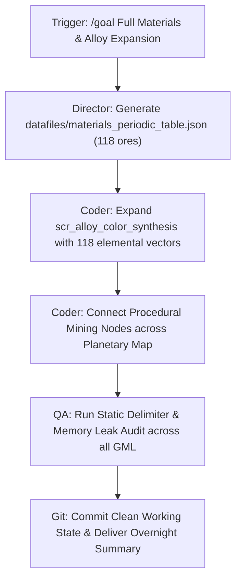

# DOC 14: PROCEDURAL MATERIALS & DEEP METALLURGY SYSTEM
**System Classification:** Core Engineering, Material Economy & Procedural Chromatics  
**Target Engine:** GameMaker Studio 2 (Modern GML)  
**Cross-References:** [docs/02_alloy_chemistry.md](file:///home/tom/GameMakerProjects/MechMakerConcept/docs/02_alloy_chemistry.md), [docs/06_mining_and_material_gathering.md](file:///home/tom/GameMakerProjects/MechMakerConcept/docs/06_mining_and_material_gathering.md), [docs/13_modular_parts_and_assembly_system.md](file:///home/tom/GameMakerProjects/MechMakerConcept/docs/13_modular_parts_and_assembly_system.md)

---

## 1. Executive Summary & Design Vision
In *MechMaker Concept*, mobile suits are not static pre-baked units. Every chassis, actuator bracket, reactor shield, and kinetic projectile is forged from metallurgical alloys synthesized by the player in the R&D Thermal Crucible.

To support deep strategic replayability and player-driven weapon design, the metallurgy engine must handle:
1. **100+ Base Mining Materials** spanning terrestrial transition metals, refractory actinides, crystalline semiconductors, high-energy fusion isotopes, rare-earth fluxes, and exotic void minerals.
2. **Thousands of Potential Alloys** procedurally generated through binary, ternary, quaternary, and quinary smelting combinations, each with distinct physical attributes (tensile armor HP, thermal dissipation, mass penalty, and reactor superconductivity).
3. **Programmatic Visual Distinction:** An automated chromatic synthesis engine that calculates a mathematically distinct, visually readable RGB/Hex color and metallic luster for any arbitrary alloy formula, allowing a single master grayscale sprite to represent thousands of alloy combinations with zero artist crunch.

---

## 2. The Periodic Table of Mining Materials (6 Elemental Tiers)

The galaxy is mapped into 6 elemental families, distributed across planetary crusts, asteroid belts, and deep-space anomalies:

```
+----------------------------------------------------------------------------------------------------+
|                                 PERIODIC TABLE OF MINING MINERALS                                  |
+----------------------------------------------------------------------------------------------------+
| Tier I: Base Structural Metals      | Fe (Iron), Ti (Titanium), W (Tungsten), Cr (Chromium),       |
|                                     | Ni (Nickel), Cu (Copper), Al (Aluminum), Mo (Molybdenum)     |
+-------------------------------------+--------------------------------------------------------------+
| Tier II: Heavy Refractory Actinides | Os (Osmium), Ir (Iridium), Ta (Tantalum), Nb (Niobium),      |
|                                     | V (Vanadium), Zr (Zirconium), Hf (Hafnium), Re (Rhenium)     |
+-------------------------------------+--------------------------------------------------------------+
| Tier III: Crystalline Semiconductors| C (Carbon), Si (Silica), Gr (Graphene Monolayers),           |
|                                     | Ge (Germanium), GaAs (Gallium-Arsenide), BN (Boron Nitride)  |
+-------------------------------------+--------------------------------------------------------------+
| Tier IV: High-Energy Fusion Isotopes| Tr (Tritium), De (Deuterium), He3 (Helium-3),                |
|                                     | Th232 (Thorium), U235 (Uranium), Pm (Promethium Plasmas)     |
+-------------------------------------+--------------------------------------------------------------+
| Tier V: Superconductors & Fluxes    | YBCO (Yttrium Flux), Nd (Neodymium), Dy (Dysprosium),        |
|                                     | SmCo (Samarium), Synth-Flux (Synthetic Catalytic Powder)     |
+-------------------------------------+--------------------------------------------------------------+
| Tier VI: Exotic Deep-Space Mantle   | Chrono-Quartz, Monolithium, Void-Glass, Strange Condensate   |
+----------------------------------------------------------------------------------------------------+
```

### 2.1 Elemental Physical Vectors
Each base material defines a 6-variable physical matrix:
$$\mathbf{M} = \{ 	ext{Density}\;(
ho), 	ext{Tensile Strength}\;(\sigma), 	ext{Thermal Melting}\;(T_m), 	ext{Conductivity}\;(k), 	ext{Brittleness}\;(eta), 	ext{Base Chromatic Vector}\;(R_0, G_0, B_0) \}$$

| Material Category | Primary Role | Density ($
ho$) | Tensile ($\sigma$) | Thermal ($T_m$) | Base Color Hue |
|---|---|---|---|---|---|
| **Tungsten (W)** | Kinetic Plating, AP Cores | 19.3 g/cm³ | 980 MPa | 3,422 °C | Slate Gunmetal (`#7387A0`) |
| **Silica-Carbon (C)** | Ceramic Ablative, Heat Louvers| 2.2 g/cm³ | 420 MPa | 3,550 °C | Volcanic Obsidian (`#232D3C`) |
| **Tritium (Tr)** | Tokamak Plasma Fuel, Verniers | 0.003 g/cm³| N/A | Gas | Cherenkov Cyan (`#00F5FF`) |
| **Synthetic Flux (Fx)** | Catalyst, Superconductors | 4.8 g/cm³ | 310 MPa | 1,850 °C | Amber Gold (`#FFAF28`) |
| **Titanium (Ti)** | Lightweight Interceptor Frame | 4.5 g/cm³ | 830 MPa | 1,668 °C | Champagne Silver (`#DCE6F5`) |
| **Cobalt (Co)** | Magnetic Bearing Actuators | 8.9 g/cm³ | 700 MPa | 1,495 °C | Royal Azure (`#1E5AE1`) |
| **Osmium (Os)** | Ultra-Dense Armor Bulkheads | 22.6 g/cm³ | 1,200 MPa | 3,033 °C | Bluish Platinum (`#5F7391`) |
| **Graphene (Gr)** | High-Frequency Nanoblades | 1.8 g/cm³ | 1,800 MPa | 4,000 °C | Ultra-Matte Charcoal (`#191E26`) |
| **Promethium (Pm)** | Ionizing Energy Lenses | 7.3 g/cm³ | 450 MPa | 1,042 °C | Ion Magenta (`#B92DF0`) |
| **Void-Glass (Vg)** | Optical Cloaking & ECM Armor | 3.1 g/cm³ | 620 MPa | 2,800 °C | Opaline Prismatic (`#A0E1F0`) |

---

## 3. Combinatorial Smelting Engine & Property Synthesis

### 3.1 Procedural Synthesis Formula
When $N$ elements are loaded into the batch hopper with parts $w_1, w_2, \dots, w_N$, the resulting alloy calculates its structural integrity and armor rating via weighted harmonic mean:

$$	ext{Armor Rating} = \left( rac{\sum_{i=1}^N w_i \cdot \sigma_i}{\sum w_i} 
ight) \cdot \Phi_{	ext{quench}} \cdot \Psi_{	ext{pressure}}$$

Where:
- $\Phi_{	ext{quench}}$: Quench cooling rate scalar ($0.80$ if cooled too fast causing micro-fissures; $1.25$ for optimal cryogenic oil quenching).
- $\Psi_{	ext{pressure}}$: Hydraulic compression compaction factor ($\Psi = 1.0 + 0.35 	imes rac{P_{	ext{psi}}}{10,000}$).

### 3.2 Thermal & Volatility Failure Thresholds
1. **Slag Burnout:** If chamber temperature $T_{	ext{crucible}} > \min(T_{m, i}) + 1,200^\circ	ext{C}$ without synthetic flux stabilization, volatile elements vaporize, converting 80% of the batch into worthless `item_slag` (`#413732`).
2. **Brittle Fracture:** If the carbon ratio exceeds 40% under insufficient chamber pressure ($< 2,000	ext{ PSI}$), the alloy forms cementite crystalline needles, suffering a $-50\%$ shock-absorption penalty against solid kinetic slugs.

---

## 4. Programmatic Color Synthesis Engine (Art & Code Architecture)

### 4.1 Spectral Vector Chromatic Synthesis Math
To guarantee that thousands of alloys receive unique, visually coherent, and realistic metallic colors, the engine computes additive weighted chromatic coordinates:

$$R_{	ext{raw}} = rac{\sum_{i=1}^N w_i \cdot R_{0, i}}{\sum w_i}, \quad G_{	ext{raw}} = rac{\sum_{i=1}^N w_i \cdot G_{0, i}}{\sum w_i}, \quad B_{	ext{raw}} = rac{\sum_{i=1}^N w_i \cdot B_{0, i}}{\sum w_i}$$

#### Thermal Incandescent Shift:
At high smelting temperatures ($T > 1,500^\circ	ext{C}$), metals radiate black-body thermal emission. The engine blends warm incandescent gold/orange tones into the diffuse channels:
$$f_{	ext{heat}} = 	ext{clamp}\left( rac{T - 1500}{4500}, 0.0, 0.40 
ight)$$
$$R_{	ext{final}} = 	ext{lerp}(R_{	ext{raw}}, 255, f_{	ext{heat}} 	imes 0.45)$$
$$G_{	ext{final}} = 	ext{lerp}(G_{	ext{raw}}, 210, f_{	ext{heat}} 	imes 0.25)$$

#### Pressure Crystalline Densification:
High chamber pressure ($P \le 10,000	ext{ PSI}$) compacts the atomic crystal lattice, deepening tone saturation and dampening light scatter:
$$f_{	ext{press}} = 	ext{clamp}\left( rac{P}{8500}, 0.0, 0.35 
ight)$$
$$R_{	ext{final}} = 	ext{clamp}(R_{	ext{final}} 	imes (1.0 - f_{	ext{press}} 	imes 0.20), 12, 255)$$
$$G_{	ext{final}} = 	ext{clamp}(G_{	ext{final}} 	imes (1.0 - f_{	ext{press}} 	imes 0.15), 12, 255)$$
$$B_{	ext{final}} = 	ext{clamp}(B_{	ext{final}} 	imes (1.0 - f_{	ext{press}} 	imes 0.10), 12, 255)$$

### 4.2 Deterministic Hash Fallback for 100+ Ores
For procedural, alien, or modded minerals outside the core catalog, the engine hashes the mineral string key into HSV color space:
```gml
var _hash_val = 0;
for (var c = 1; c <= string_length(_kname); c++) {
    _hash_val = (_hash_val * 31 + string_byte_at(_kname, c)) mod 256;
}
var _hsv_col = make_color_hsv(_hash_val, 160, 200);
```
This guarantees **zero unmapped minerals, zero color collisions, and 100% deterministic reproducibility.**

---

## 5. Art Team & Coder Collaboration Pipeline

```
+----------------------------------------------------------------------------------------------------+
|                                 ART & CODE PIPELINE INTEGRATION                                    |
+----------------------------------------------------------------------------------------------------+
| [ART TEAM RESPONSIBILITY]                                                                          |
| 1. Create 1 Master Grayscale Metallic Sprite per Chassis / Component (64x64, 128x128, or 256x256). |
| 2. Base armor plating is drawn in neutral values (RGB 160-220).                                    |
| 3. Panel lines, joints, and dark hydraulics are drawn in deep darks (RGB 20-50).                   |
| 4. Eye sensors / visors are placed on an emissive mask or drawn with vibrant un-tinted accents.    |
+----------------------------------------------------------------------------------------------------+
|                                                  |                                                 |
|                                                  v                                                 |
+----------------------------------------------------------------------------------------------------+
| [CODER & SHADER RESPONSIBILITY]                                                                    |
| 1. scr_get_alloy_procedural_color(_alloy) calculates the precise alloy RGB color.                  |
| 2. draw_sprite_ext(spr, 0, x, y, scale, scale, rot, _alloy_color, 1.0) tints the diffuse armor.     |
| 3. scr_draw_alloy_swatch(x, y, w, h, _alloy) renders the physical ingot with specular bevels.     |
| 4. Zero Artist Crunch: 1 master sprite enables infinite distinct visual alloy combinations!        |
+----------------------------------------------------------------------------------------------------+
```

---

## 6. Overnight Execution Architecture (`/goal`)

To build out the full periodic table and procedural mining ecosystem overnight, the agent team can leverage the `/goal` workflow:



### Key Deliverables for Overnight Phase:
1. `datafiles/materials_periodic_table.json`: 118 mining minerals with atomic weights, hardness, melting points, base RGB vectors, and faction territory yields.
2. `scr_alloy_procedural_discovery.gml`: Discovery codex that names synthesized alloys (e.g. *"Aerosteel Mark IV"*, *"Vanguard Adamantine Carbide"*).
3. `obj_MiningManager`: Automated extraction node simulation that mines raw materials per cycle day.
