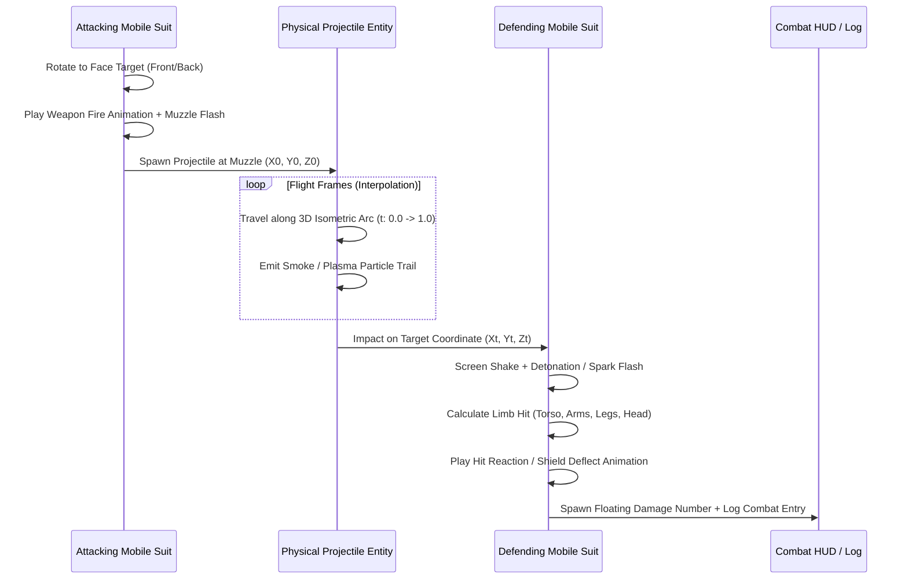

# 17. Grand-Scale Isometric Combat System
**Document Version:** 1.0.0  
**Role:** Lead Game Designer & Systems Architect  
**Inspiration:** *Front Mission* (PS1/PS2), *Tactics Ogre*, *Armored Core*  
**Target Engine:** GameMaker Studio 2 (Modern GML)

---

## 1. Executive Vision & Camera Architecture

The upgraded combat system transitions *MechMaker* from a 1v1 tactical duel to a **grand-scale platoon-level isometric battlefield**. Up to **24 to 32 mobile suits** engage simultaneously across a massive $20 \times 20$ axonometric grid with multi-level terrain elevation, destructible cover, and continuous physical projectile simulation.

```
       [NW: Back-Left]        [NE: Back-Right]
             \                      /
              \   ISOMETRIC GRID   /
               \     (2:1 Ratio)  /
                \                /
                 \              /
                  \            /
                   \          /
             [SW: Front-Left]  [SE: Front-Right]
```

### 1.1 Isometric 2:1 Projection Formulas
Given grid coordinates $(C, R)$ and vertical elevation level $Z \in \{0, 1, 2\}$:
$$X_{\text{screen}} = (C - R) \times \frac{W_{\text{iso}}}{2} \times \text{Zoom} + \text{Cam}_X$$
$$Y_{\text{screen}} = \left((C + R) \times \frac{H_{\text{iso}}}{2} - (Z \times H_{\text{elev}})\right) \times \text{Zoom} + \text{Cam}_Y$$

Where:
- $W_{\text{iso}} = 64\text{ px}$ (Tile Width)
- $H_{\text{iso}} = 32\text{ px}$ (Tile Height, creating classic 2:1 Front Mission ratio)
- $H_{\text{elev}} = 16\text{ px}$ (Vertical height per elevation tier)
- $\text{Zoom} \in [0.65, 1.40]$ (Smooth mouse-wheel zoom)

### 1.2 Mouse-to-Grid Inverse Projection (Screen Unproject)
To detect the active tile under mouse cursor $(M_X, M_Y)$ adjusted for camera offset and zoom:
$$X' = \frac{M_X - \text{Cam}_X}{\text{Zoom}}$$
$$Y' = \frac{M_Y - \text{Cam}_Y}{\text{Zoom}}$$
$$C = \text{floor}\left(\frac{\frac{X'}{W_{\text{iso}}/2} + \frac{Y'}{H_{\text{iso}}/2}}{2}\right)$$
$$R = \text{floor}\left(\frac{\frac{Y'}{H_{\text{iso}}/2} - \frac{X'}{W_{\text{iso}}/2}}{2}\right)$$

---

## 2. 4-Way Isometric Facing & Dual Perspective System

Each mobile suit variation features distinct **Front Perspective** and **Back Perspective** sprite suites:

| Isometric Direction | Vector ($\Delta C, \Delta R$) | Perspective | Horizontal Flip (`xscale`) | Visual Focal Point |
| :--- | :--- | :--- | :---: | :--- |
| **Southeast (`DIR_SE`)** | $+C, \pm 0$ | **Front** | $+1$ | Cockpit, chest armor, forward cannon |
| **Southwest (`DIR_SW`)** | $\pm 0, +R$ | **Front** | $-1$ | Cockpit, chest armor, mirrored |
| **Northeast (`DIR_NE`)** | $\pm 0, -R$ | **Back** | $+1$ | Dual thruster nozzles, spinal heat fins |
| **Northwest (`DIR_NW`)** | $-C, \pm 0$ | **Back** | $-1$ | Dual thruster nozzles, mirrored |

When units maneuver or aim towards targets behind them, the animation controller dynamically evaluates:
$$\text{is\_back} = (\text{target}_R < \text{unit}_R) \lor (\text{target}_C < \text{unit}_C)$$
And transitions to the respective `back_idle`, `back_fire`, or `back_boost` sprite set!

---

## 3. Real-Time Physical Projectile Flight Engine

Attacks do not instantaneously subtract HP. Instead, firing a weapon initiates a continuous physical projectile sequence:



### 3.1 Projectile Trajectory Formulas
A projectile interpolates over flight duration $T_{\text{max}} \in [18, 36]\text{ frames}$:
$$t = \frac{\text{frame}}{T_{\text{max}}}$$
$$X(t) = \text{lerp}(X_{\text{start}}, X_{\text{target}}, t)$$
$$Y(t) = \text{lerp}(Y_{\text{start}}, Y_{\text{target}}, t)$$
$$Z_{\text{arc}}(t) = Z_{\text{peak}} \times \sin(\pi \times t)$$
$$Y_{\text{render}}(t) = Y(t) - Z_{\text{arc}}(t)$$

### 3.2 Weapon Projectile Taxonomy
1. **120mm Solid Kinetic AP Shell:** High velocity, parabolic ballistic arc ($Z_{\text{peak}} = 24$), leaves smoke trail, heavy kinetic impact shock.
2. **Rotary Vulcan Stream:** Volley of 6 to 8 rapid tracer streaks with minimal arc ($Z_{\text{peak}} = 4$), low heat, rapid armor attrition.
3. **Coherent Particle Beam Pulse:** Relativistic laser bolt ($T_{\text{max}} = 12\text{ frames}$), straight zero-arc trajectory, piercing neon bloom.
4. **Ares Swarm-16 Micro-Missiles:** High-G spiraling trajectory ($Z_{\text{peak}} = 45$), billowing exhaust plumes, saturation explosion clusters.
5. **Relativistic Siege Rail Slug:** Violet-white kinetic rod, near-instant flight with shockwave distortion rings.
6. **Melee Battering Strike / Saber Rush:** Physical unit sprint across tiles, impact sparks, return dash.

---

## 4. Platoon Scale Deployment & Initiative Phase Architecture

To support **dozens of units simultaneously**, units are organized into battlegroups:

```
[TACTICAL COMBAT BATTLEGROUP ROSTER]
  ├── ALLIED / PLAYER PMC FORCES (Blue/Gold)
  │    ├── Alpha-01: Commander Unit (GHA-07 Ironclad / Player Modular Chassis)
  │    ├── Alpha-02: Heavy Fire Support (Siegebreaker Artillery / Titan Railgun)
  │    ├── Alpha-03: Vernier Interceptor (AET-01 Aether / Stratos Vernier)
  │    ├── Alpha-04: Vanguard Raider (AM-01 Autocannon Dual Arms)
  │    ├── Bravo-01: Terran Coalition Armored Garrison Reinforcement
  │    └── Bravo-02: Terran Coalition Armored Vanguard
  │
  └── HOSTILE ENEMY FORCES (Crimson/Amber)
       ├── Viper-01: Syndicate Outlaw Boss Chassis
       ├── Viper-02: Raider Skirmisher (SCR-12 Hyena Flak)
       ├── Viper-03: Heavy Outlaw Grunt (GHA-07 Captured Chassis)
       ├── Viper-04: Outlaw Interceptor (Stolen Aether Chassis)
       ├── Squad-C1..C4: Marauder Scout Infantry Platoons
       └── Squad-D1..D4: Heavy Mortar Battery Batteries
```

### 4.1 Turn Resolution: Alternating Squad Activation
Instead of moving 1 unit per entire turn, each phase grants Action Points (AP) to all active platoon members. Players can freely cycle between ready units (`[TAB]` or clicking), position forward squads behind cover, coordinate crossfires, and trigger combined attacks before passing the turn to the AI battlegroup.

---

## 5. Front Mission Component Damage Subsystem

Mobile suits are partitioned into 6 distinct mechanical modules:

$$\begin{aligned}
\text{Torso} &\quad\text{(Central Reactor \& Cockpit - Core Survival)} \\
\text{Head} &\quad\text{(Sensors \& Target-Lock Optics - Accuracy)} \\
\text{Left Arm} &\quad\text{(Primary Weapon Mount 1)} \\
\text{Right Arm} &\quad\text{(Primary Weapon Mount 2)} \\
\text{Legs} &\quad\text{(Hydraulic Bipedal / Hover - Speed, AP \& Evasion)} \\
\text{Backpack} &\quad\text{(Vernier Boosters / Missile Ordnance)}
\end{aligned}$$

### 5.1 Hit Location Probability Distribution
When a physical projectile strikes a mobile suit, hit location is computed based on relative impact angle and targeting mode:
- **Normal Attack (Center of Mass):** Torso $40\%$, Arms $15\%$ each, Legs $20\%$, Head $10\%$.
- **Aimed Limb Shot (+2 AP Cost):** Increases designated limb probability to $65\%$.
- **Crippling Consequences:**
  - Arm destroyed $\to$ Weapon mount lost immediately; unit disarmed.
  - Legs destroyed $\to$ Mobility and AP reduced to minimum (1 AP); Evasion dropped to $0\%$.
  - Head destroyed $\to$ Target-lock sensors blinded; $-40\%$ Accuracy penalty.
  - Torso destroyed $\to$ Catastrophic reactor breach; mobile suit eliminated!
