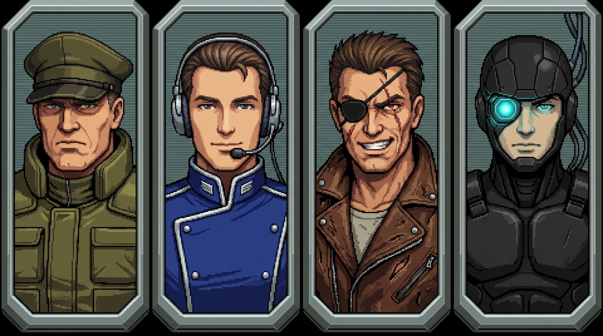

# Document 19: Pilot Nemesis System, Relational Character Web & Dynamic Allegiance Engine
**Document Version:** 1.2.0  
**Target Systems:** GameMaker Studio 2 (Modern GML), Datafiles JSON Pipeline (`datafiles/characters_roster.json`)  
**Inspirational Benchmarks:** *Middle-earth: Shadow of Mordor / War* (Monolith Nemesis System), *Front Mission 1/3/5* (Square / SNES 1995), *BattleTech*, *Crusader Kings III*, *Fire Emblem: Genealogy of the Holy War*  
**Authors & Contributors:** Lead Systems Architect (Lead Dev), Lead Game Designer (Director GDD), Lead Narrative Designer, Lead QA Engineer, Technical Art Director

---

## 1. Executive Summary & Core Philosophical Pillars

In *MechMakerConcept*, mobile suits are mechanical manifestations of geopolitical mass destruction, but human agency pulls the triggers. The **Pilot Nemesis & Relational Character Web System** elevates tactical isometric battles and base management into a high-stakes, consequences-driven human drama.

Characters—ranging from supreme planetary directors and fleet commodores to mercenary aces, trench grunts, and recruited PMC rookies—are not disposable stat-blocks. They belong to a **living directed relationship multi-graph** anchored by bloodlines, mentorship bonds, ideological loyalties, close comradeship circles, romantic devotion, and bitter grudges.

```
                                [THE PLAYER PMC]
                               /        |       \
                     (Actions)          |         (Decisions)
                       /                |                \
                      v                 v                 v
            [Assassination / Kill]  [Imprisonment]  [Faction Contracts]
                      |                 |                 |
                      v                 v                 v
             +--------------------------------------------------+
             |             RELATIONAL GRAPH DISPATCHER          |
             +--------------------------------------------------+
              /            |                  |               \
             v             v                  v                v
     [Blood Vendettas] [Romance Trauma] [Friend Cascades] [Faction Shifts]
      (Kin / Wingmen)   (Heartbreak)     (Referral/Morale) (Seed Variance)
             |             |                  |                |
             v             v                  v                v
     [Drop-Pod Ambush] [Suicidal Charge] [Mutiny Threat]  [Dynamic Roster]
```

### 1.1 Core Design Directives
1. **Consequences Have Faces**: If the player obliterates an enemy ace in combat or orders the execution of an imprisoned general, their kin, lovers, wingmen, and pupils actively retaliate.
2. **The Romantic Web & Heartbreak Calculus**: Pilots form deep emotional bonds (spouses, courting, star-crossed cross-faction lovers, unrequited devotion, and bitter ex-flames). Harming a pilot's love interest unleashes catastrophic emotional trauma ($K_{\text{romance}} = 3.0\times$ grudge multiplier, triggering `berserker_rage` or `suicidal_charge`).
3. **Friendship Networks & Comradeship Synergies**: Pilots maintain circles of 2–4 close friends (academy classmates, trench survivors, cantina comrades). Hiring one friend unlocks recruitment discounts and morale boosts; losing a friend triggers grieving and mutiny risk.
4. **Procedural Playthrough Allegiance Variation**: To deliver infinite campaign replayability, pilots are not permanently bound to a single hiring hall. Each playthrough seeds dynamic faction allegiances—disillusioned veterans can defect, corporate contractors switch sponsors, and roaming ronin drift across solar borders.
5. **Front Mission (SNES, 1995) Visual Authenticity**: All character portraits adhere strictly to the 16-bit Super Nintendo *Front Mission 1 (1995)* aesthetic backdrop: 64x64 pixel busts, high-contrast dithered shading, aviator comm headsets with boom mics, high-collar flak jackets, and dynamic palette swapping upon faction defection.

---

## 2. Mathematical Relationship Graph & Grudge Calculus

The game universe models all 204 figures as nodes within a directed multi-graph:
$$\mathcal{G} = (\mathcal{V}, \mathcal{E})$$

Where each node $v_i \in \mathcal{V}$ represents a character, and each directed edge $e_{ij} = (v_i, v_j, \tau, \omega) \in \mathcal{E}$ represents a relationship of type $\tau$ with weight $\omega$.

### 2.1 Character State Vector
Each character struct in GameMaker maintains dynamic emotional variables:
$$\mathbf{S}_i = \begin{bmatrix} A_{i,\text{player}} \\ V_{i,\text{player}} \\ L_{i,\text{faction}} \\ F_{i,\text{player}} \\ M_i \end{bmatrix} = \begin{bmatrix} \text{Affinity toward Player} \in [-100, 100] \\ \text{Vendetta / Grudge Level} \in [0, 100] \\ \text{Faction Loyalty} \in [0, 100] \\ \text{Fear of Player} \in [0, 100] \\ \text{Morale} \in [0, 100] \end{bmatrix}$$

### 2.2 Grudge & Heartbreak Propagation Calculus
When Character $K$ is killed, executed, or captured by the player, ripple events dispatch across all incident edges $e_{jK} \in \mathcal{E}$:

$$\Delta V_j = \min\left(100, \; \Delta V_j + (B_{\text{severity}} \times K_{\text{bond}} \times I_{\text{intensity}})\right)$$

$$\Delta A_j = \max\left(-100, \; \Delta A_j - (B_{\text{severity}} \times K_{\text{bond}} \times 1.25)\right)$$

Where:
- $B_{\text{severity}}$: Base event severity (Combat Kill: $+30$, Core Meltdown: $+45$, Formal Execution in Prison: $+75$).
- $K_{\text{bond}}$: Relationship multiplier:
  - **Love Interest / Spouse / Star-Crossed Partner**: $\mathbf{\times 3.00}$ (Absolute highest emotional priority)
  - Parent / Child / Sibling: $\times 2.50$
  - Sworn Wingman / Mentor / Protégé: $\times 1.80$
  - Close Friend / Trench Survivor: $\times 1.50$
  - Extended Family (Cousin, In-Law): $\times 1.30$
  - Faction Comrade: $\times 1.00$
- $I_{\text{intensity}}$: Emotional connection coefficient ($0.65$ to $0.95$).

### 2.3 Combat Romance Trauma States
When a character's romantic partner is disabled or incinerated in combat, the surviving lover immediately enters one of five psychological trauma states:

| Trauma State | Psychological Response | Tactical Combat Overrides |
| :--- | :--- | :--- |
| **`berserker_rage`** | Blind, destructive fury. | Gains $+25\%$ kinetic/melee damage, $+20\%$ weapon heat tolerance; ignores evasive maneuvers and charges the killer. |
| **`suicidal_charge`** | Complete loss of survival instinct. | Ejection module is disabled; locks core overclock to maximum; rushes point-blank range to trigger a manual core detonation. |
| **`protective_intercept`** | Desperate self-sacrifice. | Automatically redirects their mobile suit to take line-of-fire hits aimed at their lover's chassis if within 3 grid tiles. |
| **`grief_paralysis`** | Catatonic despair. | Suffers $-50\%$ evasion and accuracy; unit skips alternate action phases due to sensory overload. |
| **`hostage_bargain`** | Conditional compliance. | If the lover is captured alive in the player brig, this pilot refuses to engage player units and can be coerced into defection. |

---

## 3. The Front Mission (SNES, 1995) Character Design Bible

```
+-----------------------------------------------------------------------------------+
|               FRONT MISSION (SUPER NINTENDO, 1995) VISUAL BENCHMARK               |
|                                                                                   |
|  [64x64 Native Pixel Canvas] -> [Beveled Metallic Border] -> [16-Color Palette]   |
|  [High Ballistic Collar]     -> [Aviator Boom Microphone] -> [Tachyon Cybernetics]|
+-----------------------------------------------------------------------------------+
```



### 3.1 Art Direction & Historical Backdrop
Character portraits in *MechMakerConcept* draw direct aesthetic heritage from **Front Mission (Square, 1995, Super Famicom)**, illustrated by Yoshitaka Amano with mechanical design by Kow Yokoyama and Yoshiyuki Sadamoto. 

The visual style rejects clean, glossy space-opera tropes in favor of **gritty, worn military realism**:
- **Tired, Cold Gaze**: Pilots exhibit hollow eyes, furrowed brows, and angular facial planes shaped by high-G maneuvers, neural feedback stress, and cockpit insomnia.
- **Flight Suit Functionalism**: Collars are thick ballistic neck protectors with visible seams and heavy brass zippers.
- **Retro Tactical Avionics**: Pilots wear bulky single-cup or dual-cup communications headsets with metal spring headbands, curved boom microphones positioning capsules directly at the mouth corner, and coiled black wiring running into chest avionics ports.
- **Visible Battlefield Trauma**: Shrapnel scars, chemical burns, glass lacerations, and rough field stitches demonstrate cockpit survival.
- **Cybernetic Augmentations**: Zaibatsu and rim pilots feature crude or sub-nanometer cybernetics—matte black ocular camera sockets with glowing cyan reticles, cranial brackets, and sub-dermal data jack ports behind the ear.

### 3.2 Technical Frame & Palette Specifications
All character portraits are authored to strict SNES hardware constraints:

| Parameter | Engine Specification | GameMaker Studio 2 Asset Pipeline |
| :--- | :--- | :--- |
| **Native Resolution** | $64 \times 64\text{ pixels}$ | Stored in `spr_portrait_*` (Uniform $64 \times 64$) |
| **Upscaled UI Render** | $128 \times 128\text{ px}$ (2x) / $256 \times 256\text{ px}$ (4x) | Scaled via Point / Nearest Neighbor sampling |
| **Color Depth** | 16 Colors per sub-palette (4-bit indexed) | Strict indexed color ramps to preserve retro contrast |
| **Frame Border** | 2-pixel outer beveled metallic rim | Top/Left: Highlight `#6C757D`, Bottom/Right: `#2A2D34` |
| **Dithering Technique** | Ordered $2 \times 2$ checkerboard dithering | Applied to cheekbone transitions, neck shadow, and background |

### 3.3 Faction 16-Color Indexed Palettes & Defection Reskinning
Each faction maintains an authentic 16-color retro palette:

```
[TERRAN COALITION]       : Olive Drab (#43523B), Khaki (#7C8068), Brass Eagle (#C69B3D), Cold Steel (#505860)
[OUTER COLONIES LEAGUE]  : Cobalt Navy (#1D3354), Pearl Silver (#9EADB8), Aristocratic Azure (#467599), Chrome (#E0E5E9)
[SYNDICATE RIM]          : Distressed Rust (#5C241C), Scrapper Leather (#684A36), Hazard Amber (#D4812B), Copper (#3B5B57)
[ZAIBATSU AEROSPACE]     : Matte Obsidian (#18191E), Carbon Weave (#2B2D35), Neon Cyan (#00F0FF), Magenta Monocle (#D6006E)
```


*Figure 3.1: Four-Faction Master Reference Strip at 2x Integer Scale (Terran Commander Vance, Colony Fleet Ace Cassian, Syndicate Reaver Jackal, Zaibatsu Cyber-Pilot Null-07).*

When a pilot rolls an alternate faction at campaign start, the procedural compositor swaps the portrait's Layer 1 uniform palette to match the newly adopted faction's signature colors!

---

## 4. Procedural Playthrough Allegiance Variation System

To maximize campaign replayability, pilot faction alignments are **probabilistically seeded** rather than hardcoded. Across different campaigns, pilots might appear under different banners based on political purges, corporate poaching, or mercenary contracts.

```
+------------------------------------------------------------------------------------+
|                   PROCEDURAL CAMPAIGN ALLEGIANCE SEED ENGINE                       |
|                                                                                    |
|  [Campaign Seed] -> [Pilot Archetype] -> [Evaluate Weights] -> [Assign Faction]   |
|         |                     |                   |                    |           |
|         v                     v                   v                    v           |
|    random_set_seed     Diehard Purist      Terran (85%)         Dynamic Portrait   |
|     (Deterministic)   Free Contractor     Syndicate (10%)       Palette Recolor    |
|                       Roaming Ronin       Indep (5%)            Defection Hook     |
+------------------------------------------------------------------------------------+
```

### 4.1 Ideological Loyalty Archetypes
Every character belongs to one of five ideological flexibility categories:

1. **`diehard_purist` (Flexibility: 0.0)**:
   - *Target Figures*: 72 High Command VIPs, Faction Patriarchs/Matriarchs (e.g. Gen. Deborah Vance, Director Renzo Takahashi, Fleet Cmdr Cassian Vane, Madame Rosalind Cruz).
   - *Behavior*: 100% locked to their home faction. They represent the ideological core of the war and never defect.
2. **`career_officer` (Flexibility: 0.15)**:
   - *Target Figures*: Elite Tier 3 Aces, Dedicated Staff Officers.
   - *Distribution*: 85% Canonical Faction, 7% Independent Freelance, 8% Rival Factions.
   - *Defection Narrative*: Only severe military tribunals or hostage negotiations cause them to fly under foreign flags.
3. **`disillusioned_veteran` (Flexibility: 0.35)**:
   - *Target Figures*: Tier 2 Veterans, Trench Grunts.
   - *Distribution*: 65% Canonical Faction, 15% Independent, 20% Rival Factions.
   - *Defection Narrative*: High weariness of planetary war; frequently recruited by private security or rival corporate interests.
4. **`free_contractor` (Flexibility: 0.50)**:
   - *Target Figures*: Tier 1 Rookies, Scrappers, Tech-Pilots.
   - *Distribution*: 50% Canonical Faction, 20% Independent, 30% Other Factions.
   - *Defection Narrative*: Motivated by debt payoff, signing bonuses, or personal survival.
5. **`roaming_ronin` (Flexibility: 0.80)**:
   - *Target Figures*: 12 Legendary Independent Mercenaries.
   - *Distribution*: Dispersed across all 4 major factions (20% Terran, 20% Colony, 20% Syndicate, 20% Zaibatsu, 20% Independent).
   - *Defection Narrative*: Free agents who sign exclusive campaign retainers with whoever bids highest.

### 4.2 Playthrough Seed Roll Algorithm (GML)
At campaign generation, the engine initializes deterministically:

```gml
function scr_campaign_seed_allegiance_roll(_campaign_seed) {
    random_set_seed(_campaign_seed);
    var _char_keys = variable_struct_get_names(obj_NemesisManager.characters_map);
    
    for (var i = 0; i < array_length(_char_keys); i++) {
        var _c = variable_struct_get(obj_NemesisManager.characters_map, _char_keys[i]);
        var _var_data = _c.allegiance_variance;
        
        // Skip purists
        if (_var_data.ideological_loyalty == "diehard_purist") {
            _c.current_faction_id = _var_data.canonical_faction;
            continue;
        }
        
        // Roll random float [0.0, 1.0)
        var _roll = random(1.0);
        var _weights = _var_data.playthrough_weights;
        var _cumulative = 0.0;
        var _assigned_faction = _var_data.canonical_faction;
        
        var _fac_keys = variable_struct_get_names(_weights);
        for (var f = 0; f < array_length(_fac_keys); f++) {
            var _fk = _fac_keys[f];
            _cumulative += variable_struct_get(_weights, _fk);
            if (_roll <= _cumulative) {
                _assigned_faction = _fk;
                break;
            }
        }
        
        _c.current_faction_id = _assigned_faction;
        
        // Update defection bio if changed
        if (_assigned_faction != _var_data.canonical_faction) {
            _c.active_defection_hook = variable_struct_get(_var_data.defection_hooks, _assigned_faction);
            show_debug_message("CAMPAIGN VARIANCE: " + _c.name + " defected from " + _var_data.canonical_faction + " to " + _assigned_faction);
        }
    }
}
```

---

## 5. Universe Census & Dynastic Lineage Graphs

The game universe contains **exactly 204 named figures** defined in `datafiles/characters_roster.json`.

```
+-----------------------------------------------------------------------------------------+
|                              UNIVERSE CENSUS SUMMARY MATRIX                             |
+-------------------------+--------------------+---------------------+--------------------+
| Faction                 | Total Figures      | Recruitable Pilots  | High-Value VIPs    |
+-------------------------+--------------------+---------------------+--------------------+
| Terran Coalition        | 48 Figures         | 30 Recruitable      | 18 Non-Recruitable |
| Outer Colonies League   | 48 Figures         | 30 Recruitable      | 18 Non-Recruitable |
| Syndicate Rim           | 48 Figures         | 30 Recruitable      | 18 Non-Recruitable |
| Zaibatsu Aerospace      | 48 Figures         | 30 Recruitable      | 18 Non-Recruitable |
| Independent Drifters    | 12 Figures         | 12 Recruitable      | 0 Non-Recruitable  |
+-------------------------+--------------------+---------------------+--------------------+
| TOTAL UNIVERSE ROSTER   | 204 Named Figures  | 132 Pilots          | 72 Commanders/VIPs |
+-------------------------+--------------------+---------------------+--------------------+
```

### 5.1 The Seven Major Interstellar Dynasties

#### 1. House Vance (Terran Hegemony vs. Syndicate Exile) — 11 Figures
- **Patriarch / Matriarch**: General Deborah Vance (`char_terran_vance`), Supreme Director of Planetary Ordnance.
- **Dynasty Theme**: Iron-fisted Terran military aristocracy shattered by ideological desertion.
- **Lineage Tree**:
```
                        General Deborah Vance
                         (Terran Supreme Cmd)
                                  |
         +------------------------+------------------------+
         |                                                 |
  Julian Vance (Brother)                            Claire Vance (Daughter)
  (Terran Senate Hawk)                              (Trench Battery Commander)
         |                                                 |
  +------+------+                                   Tyler Vance (Son)
  |             |                                   (Artillery Test Ace)
Jax Vance     Victor Vance (Cousin)
"Jackal"      (Logistics Liaison)
(ESTRANGED NEPHEW)
[SYNDICATE REAVER ACE]
```

#### 2. House Vane (Colony Aristocratic Armada) — 8 Figures
- **Patriarch**: Fleet Commander Cassian Vane (`char_colony_cassian`).
- **Dynasty Theme**: Jovian orbital shipbuilders and aristocratic naval nobility.
- **Key Members**: Lady Genevieve Vane (Chief Orbital Engineer), Lucian Vane (Star-Legion Ace), Lyra Vane (Sensor Specialist), Roland Vane (Shipyard Director).

#### 3. House Cruz (Syndicate Rim Underworld Cartel) — 7 Figures
- **Matriarch**: Madame Rosalind Cruz (`char_syndicate_cruz`), High Fence of Callisto.
- **Dynasty Theme**: Black-market smuggling, scrap processing cartels, and pirate armadas.
- **Key Members**: Hector Cruz (Enforcer Wingman), Mateo Cruz (Smuggler Pilot), Sofia Cruz (Shadow Broker), Diego Cruz (Marauder Pilot).

#### 4. House Takahashi (Zaibatsu Executive Board) — 7 Figures
- **Patriarch**: Director Renzo Takahashi (`char_zaibatsu_takahashi`), VP of Advanced Mobile Armor.
- **Dynasty Theme**: Transhumanist cybernetics, corporate espionage, and ruthless corporate climbing.
- **Key Members**: Dr. Kenji Takahashi (Lead Cyber-Neurologist), Kaori Takahashi (Test Ace), Shinji Takahashi (Internal Affairs Director).

#### 5. House Rostov (Terran Veteran Artillery Lineage) — 5 Figures
- **Patriarch**: Colonel Viktor Rostov (`char_terran_viktor_rostov`).
- **Dynasty Theme**: Multigenerational trench artillerymen and frontline heavy walkers.
- **Key Members**: Elena Rostova (`pilot_terran_rostov`, Ace Pilot), Boris Rostov, Mikhail Rostov, Daria Rostova.

#### 6. House Thorne (Syndicate Marauder Kin) — 5 Figures
- **Warlord**: 'Gargoyle' Silas Thorne (`pilot_syndicate_thorne`).
- **Dynasty Theme**: Brutal raider clans operating modified close-combat mobile suits.
- **Key Members**: Boris Thorne, Val Thorne, Maya Thorne, Corva Thorne.

#### 7. Cross-Faction Dynasties: Chen, Lin, Mori, Ortiz, Torval, Morgan
- Families torn across faction borders through migration, mercenary employment, and corporate contracts.

---

## 6. Recruitable Pilot Registries (The 30 Recruitable Pilots per Faction)

Below are the complete dossiers for the **132 Recruitable Pilots** available for contract across the four warring powers and independent space, featuring their **Love Interests**, **Friendship Circles**, and **Playthrough Allegiance Weights**.

### 6.1 Terran Coalition Pilot Corps (30 Recruitable Pilots)
| ID & Callsign | Full Name & Tier | Preferred MS & Traits | Potential Love Interest | Friendship Circle & Synergy | Playthrough Faction Variance | Cost & Salary |
| :--- | :--- | :--- | :--- | :--- | :--- | :---: |
| `pilot_terran_cole`<br>**"Breaker"** | **Lt. Marcus Cole**<br>Tier **T3** | `GHA-07`<br>`vanguard_shield`, `guardian_protector`, `iron_grit` | **Kira Dahl**<br>*Star crossed* (Intensity 92%)<br>`berserker_rage` | **Academy classmates**:<br>Ensign Elena Rostova, Dr. Heinrich Arnold<br>*+15% formation accuracy when deployed in adjacent grid tiles.* | **Career officer** (Flex 0.15)<br>Canonical: 87%<br>Indep: 7% | **120,000 Cr**<br>(7,500/cyc) |
| `pilot_terran_rostova`<br>**"Sparrow"** | **Ensign Elena Rostova**<br>Tier **T1** | `TCM-03`<br>`high_agility`, `eagle_optic`, `family_debt` | **Cadet Tyler Vance**<br>*Dating* (Intensity 90%)<br>`protective_intercept` | **Trench survivors**:<br>Lt. Marcus Cole, Foundry Master Otto<br>*+20 Morale threshold against battlefield panic when friend is alive on grid.* | **Free contractor** (Flex 0.5)<br>Canonical: 50%<br>Indep: 20% | **35,000 Cr**<br>(2,200/cyc) |
| `pilot_terran_tyler_vance`<br>**"Bastion"** | **Cadet Tyler Vance**<br>Tier **T1** | `TCM-03`<br>`hothead`, `reckless_bravery`, `noble_blood` | **Ensign Elena Rostova**<br>*Dating* (Intensity 90%)<br>`berserker_rage` | **Cantina cadre**:<br>Commodore Sean O'Connor, Lt. Sergei Volkov<br>*-25% hiring cost discount if this pilot's friend is already contracted by player PMC.* | **Free contractor** (Flex 0.5)<br>Canonical: 50%<br>Indep: 20% | **40,000 Cr**<br>(2,400/cyc) |
| `pilot_terran_lucas_sterling`<br>**"Goldfinger"** | **Sub-Lt. Lucas Sterling**<br>Tier **T2** | `GHA-07B`<br>`ammo_saver`, `aristocratic_vanity`, `railgun_aim` | **Cpl. Igor Dubov**<br>*Dating* (Intensity 76%)<br>`protective_intercept` | **Sworn blood pact**:<br>Lt. Marcus Cole, Foundry Master Otto<br>*If friend drops below 25% integrity, gains +2 Movement AP and +15% damage to rush to defense.* | **Disillusioned veteran** (Flex 0.35)<br>Canonical: 68%<br>Indep: 16% | **75,000 Cr**<br>(4,800/cyc) |
| `pilot_terran_tara_briggs`<br>**"Bunker-Buster"** | **Lt. Tara Briggs**<br>Tier **T2** | `GHA-07`<br>`fortress_ram`, `explosive_expert` | **General Gregory Briggs**<br>*Dating* (Intensity 82%)<br>`suicidal_charge` | **Cantina cadre**:<br>Ensign Elena Rostova, Sub-Lt. Roland Vance<br>*-25% hiring cost discount if this pilot's friend is already contracted by player PMC.* | **Disillusioned veteran** (Flex 0.35)<br>Canonical: 68%<br>Indep: 16% | **65,000 Cr**<br>(4,200/cyc) |
| `pilot_terran_liam_oconnor`<br>**"Deadeye"** | **Warrant Officer Liam O'Connor**<br>Tier **T2** | `GHA-07B`<br>`sniper_stance`, `cool_headed` | **Capt. Wade Greer**<br>*Dating* (Intensity 86%)<br>`protective_intercept` | **Academy classmates**:<br>Lt. Marcus Cole, Lt. Sergei Volkov<br>*+15% formation accuracy when deployed in adjacent grid tiles.* | **Disillusioned veteran** (Flex 0.35)<br>Canonical: 68%<br>Indep: 16% | **70,000 Cr**<br>(4,500/cyc) |
| `pilot_terran_karl_vogel`<br>**"War-Pig"** | **Sgt. Karl Vogel**<br>Tier **T2** | `GHA-07`<br>`trigger_happy`, `ballistic_saturation` | **General Gregory Briggs**<br>*Dating* (Intensity 94%)<br>`hostage_bargain` | **Cantina cadre**:<br>Pvt. Jake Murdock, Sgt. Dmitri Rostov<br>*-25% hiring cost discount if this pilot's friend is already contracted by player PMC.* | **Disillusioned veteran** (Flex 0.35)<br>Canonical: 68%<br>Indep: 16% | **55,000 Cr**<br>(3,800/cyc) |
| `pilot_terran_anna_kovac`<br>**"Trench-Rat"** | **Cpl. Anna Kovac**<br>Tier **T1** | `TCM-03`<br>`trench_cover_bonus`, `stubborn` | *Single / Unattached* | **Trench survivors**:<br>Ensign Elena Rostova, Sub-Lt. Roland Vance<br>*+20 Morale threshold against battlefield panic when friend is alive on grid.* | **Free contractor** (Flex 0.5)<br>Canonical: 50%<br>Indep: 20% | **32,000 Cr**<br>(2,000/cyc) |
| `pilot_terran_dmitri_rostov`<br>**"Anvil"** | **Sgt. Dmitri Rostov**<br>Tier **T2** | `TCM-03`<br>`shield_master`, `brotherly_protection` | **Chief Warrant Kane**<br>*Former flame* (Intensity 93%)<br>`hostage_bargain` | **Trench survivors**:<br>Ensign Elena Rostova, Cpl. Igor Dubov<br>*+20 Morale threshold against battlefield panic when friend is alive on grid.* | **Disillusioned veteran** (Flex 0.35)<br>Canonical: 68%<br>Indep: 16% | **58,000 Cr**<br>(3,900/cyc) |
| `pilot_terran_sergei_volkov`<br>**"Iron Wolf"** | **Lt. Sergei Volkov**<br>Tier **T3** | `GHA-07`<br>`pack_hunter`, `kinetic_penetrator` | **Cpl. Anna Kovac**<br>*Spouse* (Intensity 69%)<br>`suicidal_charge` | **Cantina cadre**:<br>Lt. Marcus Cole, Cadet Tomas Zima<br>*-25% hiring cost discount if this pilot's friend is already contracted by player PMC.* | **Career officer** (Flex 0.15)<br>Canonical: 87%<br>Indep: 7% | **95,000 Cr**<br>(6,200/cyc) |
| `pilot_terran_mira_chen`<br>**"Comet-Lock"** | **Flight Officer Mira Chen**<br>Tier **T2** | `GHA-07`<br>`swarm_missile_specialist`, `calm_sensor` | **Pvt. Casper Lind**<br>*Unrequited* (Intensity 82%)<br>`berserker_rage` | **Veteran wingmen**:<br>Lt. Marcus Cole, Sgt. Caleb Brant<br>*+10% evasion and synchronized counter-battery fire against attacking enemies.* | **Disillusioned veteran** (Flex 0.35)<br>Canonical: 68%<br>Indep: 16% | **62,000 Cr**<br>(4,100/cyc) |
| `pilot_terran_boris_kane`<br>**"Grave-Digger"** | **Chief Warrant Kane**<br>Tier **T2** | `GHA-07B`<br>`indirect_fire_master`, `heavy_recoil_soak` | **Flight Lt. Sonia Reyes**<br>*Spouse* (Intensity 74%)<br>`grief_paralysis` | **Sworn blood pact**:<br>Sub-Lt. Roland Vance, General Deborah Vance<br>*If friend drops below 25% integrity, gains +2 Movement AP and +15% damage to rush to defense.* | **Disillusioned veteran** (Flex 0.35)<br>Canonical: 68%<br>Indep: 16% | **68,000 Cr**<br>(4,400/cyc) |
| `pilot_terran_claudia_lang`<br>**"Valkyrie-Zero"** | **Cpl. Claudia Lang**<br>Tier **T1** | `TCM-03`<br>`high_mobility_aspiration`, `evasion_drill` | *Single / Unattached* | **Academy classmates**:<br>Ensign Elena Rostova, Lt. Nadine Ross<br>*+15% formation accuracy when deployed in adjacent grid tiles.* | **Free contractor** (Flex 0.5)<br>Canonical: 50%<br>Indep: 20% | **38,000 Cr**<br>(2,500/cyc) |
| `pilot_terran_hans_richter`<br>**"Old Bastion"** | **Master Sgt. Richter**<br>Tier **T3** | `TCM-03`<br>`impenetrable_guard`, `veteran_instinct` | *Single / Unattached* | **Veteran wingmen**:<br>Lt. Marcus Cole, Cadet Elise Vance<br>*+10% evasion and synchronized counter-battery fire against attacking enemies.* | **Career officer** (Flex 0.15)<br>Canonical: 87%<br>Indep: 7% | **88,000 Cr**<br>(5,800/cyc) |
| `pilot_terran_veronica_frost`<br>**"Cold Iron"** | **Lt. Veronica Frost**<br>Tier **T2** | `GHA-07`<br>`cryo_radiator_specialist`, `calm_under_fire` | **Lt. Tara Briggs**<br>*Spouse* (Intensity 84%)<br>`protective_intercept` | **Sworn blood pact**:<br>High Commissioner Arthur Sterling, Ensign Elena Rostova<br>*If friend drops below 25% integrity, gains +2 Movement AP and +15% damage to rush to defense.* | **Disillusioned veteran** (Flex 0.35)<br>Canonical: 68%<br>Indep: 16% | **72,000 Cr**<br>(4,600/cyc) |
| `pilot_terran_jake_murdock`<br>**"Grease-Monkey"** | **Pvt. Jake Murdock**<br>Tier **T1** | `TCM-03`<br>`emergency_patch`, `jury_rig` | **Ayumi Takahashi**<br>*Star crossed* (Intensity 67%)<br>`grief_paralysis` | **Trench survivors**:<br>Cpl. Anna Kovac, Captain Maxim Volk<br>*+20 Morale threshold against battlefield panic when friend is alive on grid.* | **Free contractor** (Flex 0.5)<br>Canonical: 50%<br>Indep: 20% | **30,000 Cr**<br>(1,900/cyc) |
| `pilot_terran_sonia_reyes`<br>**"Scatter-Queen"** | **Flight Lt. Sonia Reyes**<br>Tier **T2** | `GHA-07`<br>`point_blank_burst`, `aggressive_charge` | **Anna Rostova**<br>*Dating* (Intensity 73%)<br>`hostage_bargain` | **Trench survivors**:<br>Sgt. Karl Vogel, Cadet Tomas Zima<br>*+20 Morale threshold against battlefield panic when friend is alive on grid.* | **Disillusioned veteran** (Flex 0.35)<br>Canonical: 68%<br>Indep: 16% | **64,000 Cr**<br>(4,200/cyc) |
| `pilot_terran_arthur_pendleton`<br>**"Squire"** | **Ensign Pendleton**<br>Tier **T1** | `TCM-03`<br>`protocol_follower`, `steady_hands` | **Foundry Master Otto**<br>*Unrequited* (Intensity 79%)<br>`hostage_bargain` | **Trench survivors**:<br>Sub-Lt. Lucas Sterling, Ensign Elena Rostova<br>*+20 Morale threshold against battlefield panic when friend is alive on grid.* | **Free contractor** (Flex 0.5)<br>Canonical: 50%<br>Indep: 20% | **34,000 Cr**<br>(2,100/cyc) |
| `pilot_terran_igor_dubov`<br>**"Hammer-Head"** | **Cpl. Igor Dubov**<br>Tier **T2** | `GHA-07`<br>`battering_ram`, `stun_specialist` | **Whisper**<br>*Star crossed* (Intensity 83%)<br>`suicidal_charge` | **Academy classmates**:<br>Sgt. Karl Vogel, General Gregory Briggs<br>*+15% formation accuracy when deployed in adjacent grid tiles.* | **Disillusioned veteran** (Flex 0.35)<br>Canonical: 68%<br>Indep: 16% | **56,000 Cr**<br>(3,700/cyc) |
| `pilot_terran_helena_braun`<br>**"Iron-Siege"** | **Capt. Helena Braun**<br>Tier **T3** | `GHA-07B`<br>`battery_synchronizer`, `morale_beacon` | **Pvt. Jake Murdock**<br>*Spouse* (Intensity 81%)<br>`suicidal_charge` | **Veteran wingmen**:<br>Foundry Master Otto, Cpl. Felix Grimm<br>*+10% evasion and synchronized counter-battery fire against attacking enemies.* | **Career officer** (Flex 0.15)<br>Canonical: 87%<br>Indep: 7% | **92,000 Cr**<br>(6,000/cyc) |
| `pilot_terran_nathan_cross`<br>**"Bloodhound"** | **Warrant Officer Cross**<br>Tier **T2** | `TCM-03`<br>`radar_lock_bonus`, `counter_ecm` | **Dr. Heinrich Arnold**<br>*Former flame* (Intensity 72%)<br>`grief_paralysis` | **Academy classmates**:<br>Ensign Elena Rostova, Sgt. Karl Vogel<br>*+15% formation accuracy when deployed in adjacent grid tiles.* | **Disillusioned veteran** (Flex 0.35)<br>Canonical: 68%<br>Indep: 16% | **59,000 Cr**<br>(3,900/cyc) |
| `pilot_terran_greta_hahn`<br>**"Iron-Sow"** | **Sgt. Greta Hahn**<br>Tier **T2** | `GHA-07`<br>`reactive_armor_expert`, `damage_sponge` | **Warrant Officer Cross**<br>*Former flame* (Intensity 92%)<br>`berserker_rage` | **Cantina cadre**:<br>Cpl. Anna Kovac, Major Donald Trent<br>*-25% hiring cost discount if this pilot's friend is already contracted by player PMC.* | **Disillusioned veteran** (Flex 0.35)<br>Canonical: 68%<br>Indep: 16% | **66,000 Cr**<br>(4,300/cyc) |
| `pilot_terran_tomas_zima`<br>**"Spike"** | **Cadet Tomas Zima**<br>Tier **T1** | `TCM-03`<br>`fearless_rookie`, `fast_reloader` | **Lt. Marcus Cole**<br>*Dating* (Intensity 71%)<br>`suicidal_charge` | **Sworn blood pact**:<br>Cadet Tyler Vance, Lt. Beatrice Fallon<br>*If friend drops below 25% integrity, gains +2 Movement AP and +15% damage to rush to defense.* | **Free contractor** (Flex 0.5)<br>Canonical: 50%<br>Indep: 20% | **31,000 Cr**<br>(2,000/cyc) |
| `pilot_terran_beatrice_fallon`<br>**"Sky-Hammer"** | **Lt. Beatrice Fallon**<br>Tier **T2** | `GHA-07`<br>`drop_pod_assault`, `kinetic_shock` | **General Gregory Briggs**<br>*Former flame* (Intensity 90%)<br>`hostage_bargain` | **Veteran wingmen**:<br>Lt. Marcus Cole, Major Claire Vance<br>*+10% evasion and synchronized counter-battery fire against attacking enemies.* | **Disillusioned veteran** (Flex 0.35)<br>Canonical: 68%<br>Indep: 16% | **71,000 Cr**<br>(4,700/cyc) |
| `pilot_terran_roland_vance`<br>**"Cast-Iron"** | **Sub-Lt. Roland Vance**<br>Tier **T2** | `TCM-03`<br>`flak_screen_wall`, `family_pride` | **Lt. Sergei Volkov**<br>*Dating* (Intensity 78%)<br>`grief_paralysis` | **Academy classmates**:<br>Cadet Tyler Vance, Cpl. Anna Kovac<br>*+15% formation accuracy when deployed in adjacent grid tiles.* | **Disillusioned veteran** (Flex 0.35)<br>Canonical: 68%<br>Indep: 16% | **63,000 Cr**<br>(4,100/cyc) |
| `pilot_terran_yulia_morozova`<br>**"Hail-Storm"** | **Flight Officer Morozova**<br>Tier **T2** | `GHA-07`<br>`salvo_density`, `suppressive_rain` | **Boss Varek**<br>*Former flame* (Intensity 94%)<br>`grief_paralysis` | **Veteran wingmen**:<br>Flight Officer Mira Chen, Sgt. Greta Hahn<br>*+10% evasion and synchronized counter-battery fire against attacking enemies.* | **Disillusioned veteran** (Flex 0.35)<br>Canonical: 68%<br>Indep: 16% | **67,000 Cr**<br>(4,400/cyc) |
| `pilot_terran_felix_grimm`<br>**"Bulldozer"** | **Cpl. Felix Grimm**<br>Tier **T1** | `TCM-03`<br>`wall_crusher`, `close_range_blast` | **Sgt. Karl Vogel**<br>*Unrequited* (Intensity 71%)<br>`berserker_rage` | **Academy classmates**:<br>Sgt. Karl Vogel, Captain Maxim Volk<br>*+15% formation accuracy when deployed in adjacent grid tiles.* | **Free contractor** (Flex 0.5)<br>Canonical: 50%<br>Indep: 20% | **36,000 Cr**<br>(2,300/cyc) |
| `pilot_terran_nadine_ross`<br>**"Iron-Sentry"** | **Lt. Nadine Ross**<br>Tier **T2** | `TCM-03`<br>`overwatch_reflexes`, `first_strike` | **Pvt. Casper Lind**<br>*Dating* (Intensity 66%)<br>`hostage_bargain` | **Academy classmates**:<br>Ensign Elena Rostova, Warrant Officer Liam O'Connor<br>*+15% formation accuracy when deployed in adjacent grid tiles.* | **Disillusioned veteran** (Flex 0.35)<br>Canonical: 68%<br>Indep: 16% | **61,000 Cr**<br>(4,000/cyc) |
| `pilot_terran_casper_lind`<br>**"Ghost-Echo"** | **Pvt. Casper Lind**<br>Tier **T1** | `TCM-03`<br>`jamming_chaff`, `sensor_ghost` | **Lt. Sergei Volkov**<br>*Former flame* (Intensity 68%)<br>`hostage_bargain` | **Veteran wingmen**:<br>Warrant Officer Cross, Quartermaster Graves<br>*+10% evasion and synchronized counter-battery fire against attacking enemies.* | **Free contractor** (Flex 0.5)<br>Canonical: 50%<br>Indep: 20% | **33,000 Cr**<br>(2,100/cyc) |
| `pilot_terran_maxim_volk`<br>**"Dread-Walker"** | **Captain Maxim Volk**<br>Tier **T3** | `TCX-11`<br>`dreadnought_presence`, `capital_rail_aim` | **Madoka Kitano**<br>*Unrequited* (Intensity 83%)<br>`hostage_bargain` | **Sworn blood pact**:<br>Lt. Marcus Cole, Flight Officer Mira Chen<br>*If friend drops below 25% integrity, gains +2 Movement AP and +15% damage to rush to defense.* | **Career officer** (Flex 0.15)<br>Canonical: 87%<br>Indep: 7% | **110,000 Cr**<br>(7,200/cyc) |

---

### 6.2 Outer Colonies League Star-Legion (30 Recruitable Pilots)
| ID & Callsign | Full Name & Tier | Preferred MS & Traits | Potential Love Interest | Friendship Circle & Synergy | Playthrough Faction Variance | Cost & Salary |
| :--- | :--- | :--- | :--- | :--- | :--- | :---: |
| `pilot_colony_sorren`<br>**"Ghost of Sol"** | **Sorren 'Ghost' Lin**<br>Tier **T3** | `OCM-09`<br>`invisible_flight`, `sniper_focus`, `chivalric_oath` | **Major Claire Vance**<br>*Star crossed* (Intensity 86%)<br>`protective_intercept` | **Cantina cadre**:<br>Kira Dahl, Rin Lin<br>*-25% hiring cost discount if this pilot's friend is already contracted by player PMC.* | **Career officer** (Flex 0.15)<br>Canonical: 87%<br>Indep: 7% | **125,000 Cr**<br>(7,800/cyc) |
| `pilot_colony_kira`<br>**"Sun-Dancer"** | **Kira Dahl**<br>Tier **T2** | `OCM-04`<br>`vector_drift`, `rapid_saber_flurry` | **Lt. Marcus Cole**<br>*Star crossed* (Intensity 92%)<br>`berserker_rage` | **Sworn blood pact**:<br>Sorren 'Ghost' Lin, Selene Voss<br>*If friend drops below 25% integrity, gains +2 Movement AP and +15% damage to rush to defense.* | **Disillusioned veteran** (Flex 0.35)<br>Canonical: 68%<br>Indep: 16% | **65,000 Cr**<br>(4,200/cyc) |
| `pilot_colony_erik_thorne`<br>**"Solar-Flare"** | **Erik Thorne**<br>Tier **T2** | `OCA-07`<br>`beam_accelerator_boost`, `family_obligation` | **Leo Drachen**<br>*Unrequited* (Intensity 71%)<br>`grief_paralysis` | **Cantina cadre**:<br>Sorren 'Ghost' Lin, Dockmaster Thea<br>*-25% hiring cost discount if this pilot's friend is already contracted by player PMC.* | **Disillusioned veteran** (Flex 0.35)<br>Canonical: 68%<br>Indep: 16% | **72,000 Cr**<br>(4,600/cyc) |
| `pilot_colony_rin_lin`<br>**"Stardust"** | **Rin Lin**<br>Tier **T1** | `OCM-04`<br>`sensor_boost`, `agile_evasion` | **Nadia Vane**<br>*Former flame* (Intensity 90%)<br>`suicidal_charge` | **Veteran wingmen**:<br>Sorren 'Ghost' Lin, Flight Marshal Alistair Finch<br>*+10% evasion and synchronized counter-battery fire against attacking enemies.* | **Free contractor** (Flex 0.5)<br>Canonical: 50%<br>Indep: 20% | **36,000 Cr**<br>(2,300/cyc) |
| `pilot_colony_julian_vane`<br>**"Falconet"** | **Julian Vane**<br>Tier **T2** | `OCM-09`<br>`noble_fencing`, `high_accuracy_beam` | **Orion Sol**<br>*Unrequited* (Intensity 72%)<br>`suicidal_charge` | **Academy classmates**:<br>Sorren 'Ghost' Lin, Minister Lyra Thorne<br>*+15% formation accuracy when deployed in adjacent grid tiles.* | **Disillusioned veteran** (Flex 0.35)<br>Canonical: 68%<br>Indep: 16% | **78,000 Cr**<br>(4,900/cyc) |
| `pilot_colony_kai_aether`<br>**"Solar-Pulse"** | **Kai Aether**<br>Tier **T2** | `OCM-09`<br>`beam_pulse_cadence`, `evasive_jink` | **Admiral Helmut Zhao**<br>*Former flame* (Intensity 78%)<br>`hostage_bargain` | **Cantina cadre**:<br>Kira Dahl, Archivist Valeria<br>*-25% hiring cost discount if this pilot's friend is already contracted by player PMC.* | **Disillusioned veteran** (Flex 0.35)<br>Canonical: 68%<br>Indep: 16% | **68,000 Cr**<br>(4,400/cyc) |
| `pilot_colony_selene_voss`<br>**"Moon-Shadow"** | **Selene Voss**<br>Tier **T2** | `OCM-04`<br>`chaff_specialist`, `stealth_skirmish` | **Sayaka Mori**<br>*Unrequited* (Intensity 65%)<br>`berserker_rage` | **Veteran wingmen**:<br>Rin Lin, Milo Trent<br>*+10% evasion and synchronized counter-battery fire against attacking enemies.* | **Disillusioned veteran** (Flex 0.35)<br>Canonical: 68%<br>Indep: 16% | **62,000 Cr**<br>(4,000/cyc) |
| `pilot_colony_tariq_mansoor`<br>**"Dervish"** | **Tariq Mansoor**<br>Tier **T2** | `OCM-09`<br>`dual_wield_master`, `acrobatic_strike` | **Kira Dahl**<br>*Former flame* (Intensity 69%)<br>`grief_paralysis` | **Sworn blood pact**:<br>Kira Dahl, Soren Kane<br>*If friend drops below 25% integrity, gains +2 Movement AP and +15% damage to rush to defense.* | **Disillusioned veteran** (Flex 0.35)<br>Canonical: 68%<br>Indep: 16% | **74,000 Cr**<br>(4,700/cyc) |
| `pilot_colony_chloe_duval`<br>**"Starlight Arbalest"** | **Chloe Duval**<br>Tier **T3** | `OCA-07`<br>`tachyon_lock`, `overcharge_beam` | *Single / Unattached* | **Veteran wingmen**:<br>Sorren 'Ghost' Lin, Sister Mara Vane<br>*+10% evasion and synchronized counter-battery fire against attacking enemies.* | **Career officer** (Flex 0.15)<br>Canonical: 87%<br>Indep: 7% | **98,000 Cr**<br>(6,400/cyc) |
| `pilot_colony_milo_trent`<br>**"Zephyr"** | **Milo Trent**<br>Tier **T1** | `OCM-04`<br>`hot_rod_thrusters`, `reckless_speed` | **Lyra Thorne-Vane**<br>*Dating* (Intensity 88%)<br>`grief_paralysis` | **Sworn blood pact**:<br>Freja Lind, Orion Sol<br>*If friend drops below 25% integrity, gains +2 Movement AP and +15% damage to rush to defense.* | **Free contractor** (Flex 0.5)<br>Canonical: 50%<br>Indep: 20% | **34,000 Cr**<br>(2,200/cyc) |
| `pilot_colony_orion_sol`<br>**"Corona"** | **Orion Sol**<br>Tier **T3** | `OCX-15`<br>`transam_compatibility`, `singularity_harmonizer` | **Farmer Sam Thorne**<br>*Dating* (Intensity 73%)<br>`grief_paralysis` | **Sworn blood pact**:<br>Sorren 'Ghost' Lin, Archivist Valeria<br>*If friend drops below 25% integrity, gains +2 Movement AP and +15% damage to rush to defense.* | **Career officer** (Flex 0.15)<br>Canonical: 87%<br>Indep: 7% | **115,000 Cr**<br>(7,500/cyc) |
| `pilot_colony_freja_lind`<br>**"Aegis-Angel"** | **Freja Lind**<br>Tier **T2** | `OCM-09`<br>`thermal_siphon_shield`, `convoy_guardian` | **Ace-01 Elysium**<br>*Spouse* (Intensity 69%)<br>`suicidal_charge` | **Trench survivors**:<br>Erik Thorne, Cyrus Vane<br>*+20 Morale threshold against battlefield panic when friend is alive on grid.* | **Disillusioned veteran** (Flex 0.35)<br>Canonical: 68%<br>Indep: 16% | **69,000 Cr**<br>(4,500/cyc) |
| `pilot_colony_dante_mercer`<br>**"Star-Reaper"** | **Dante Mercer**<br>Tier **T2** | `OCM-04`<br>`plasma_needle_master`, `weakpoint_strike` | **Tony 'Cinder' Varek**<br>*Former flame* (Intensity 82%)<br>`grief_paralysis` | **Cantina cadre**:<br>Kai Aether, Chief Engineer Paul Thorne<br>*-25% hiring cost discount if this pilot's friend is already contracted by player PMC.* | **Disillusioned veteran** (Flex 0.35)<br>Canonical: 68%<br>Indep: 16% | **64,000 Cr**<br>(4,100/cyc) |
| `pilot_colony_astraea_vane`<br>**"Silver-Wing"** | **Lady Astraea Vane**<br>Tier **T2** | `OCM-09`<br>`aristocratic_fencing`, `high_speed_turn` | **Commander Titus**<br>*Spouse* (Intensity 92%)<br>`hostage_bargain` | **Sworn blood pact**:<br>Julian Vane, Faye Valerie<br>*If friend drops below 25% integrity, gains +2 Movement AP and +15% damage to rush to defense.* | **Disillusioned veteran** (Flex 0.35)<br>Canonical: 68%<br>Indep: 16% | **76,000 Cr**<br>(4,800/cyc) |
| `pilot_colony_leo_drachen`<br>**"Comet-Tail"** | **Leo Drachen**<br>Tier **T2** | `OCM-04`<br>`missile_barrage_agility`, `lock_break_drift` | **Aurora Blake**<br>*Dating* (Intensity 80%)<br>`suicidal_charge` | **Cantina cadre**:<br>Gideon Cross, Damien Sinclair<br>*-25% hiring cost discount if this pilot's friend is already contracted by player PMC.* | **Disillusioned veteran** (Flex 0.35)<br>Canonical: 68%<br>Indep: 16% | **61,000 Cr**<br>(3,900/cyc) |
| `pilot_colony_nyx_callisto`<br>**"Eclipse"** | **Nyx Callisto**<br>Tier **T3** | `OCM-09`<br>`active_camouflage`, `cold_thrusters` | **Talon Skye**<br>*Dating* (Intensity 91%)<br>`grief_paralysis` | **Veteran wingmen**:<br>Selene Voss, Sister Mara Vane<br>*+10% evasion and synchronized counter-battery fire against attacking enemies.* | **Career officer** (Flex 0.15)<br>Canonical: 87%<br>Indep: 7% | **94,000 Cr**<br>(6,100/cyc) |
| `pilot_colony_valentin_roux`<br>**"Solar-Fencer"** | **Valentin Roux**<br>Tier **T2** | `OCM-09`<br>`saber_counter_parry`, `graceful_footwork` | **Ambassador Varis Koren**<br>*Spouse* (Intensity 67%)<br>`grief_paralysis` | **Trench survivors**:<br>Tariq Mansoor, Hugo Belmont<br>*+20 Morale threshold against battlefield panic when friend is alive on grid.* | **Disillusioned veteran** (Flex 0.35)<br>Canonical: 68%<br>Indep: 16% | **71,000 Cr**<br>(4,600/cyc) |
| `pilot_colony_jun_takahashi`<br>**"Ronin-Aether"** | **Jun Takahashi**<br>Tier **T2** | `OCM-09`<br>`hybrid_doctrine`, `kinetic_deflector` | **Tariq Mansoor**<br>*Former flame* (Intensity 75%)<br>`protective_intercept` | **Sworn blood pact**:<br>Sorren 'Ghost' Lin, Freja Lind<br>*If friend drops below 25% integrity, gains +2 Movement AP and +15% damage to rush to defense.* | **Disillusioned veteran** (Flex 0.35)<br>Canonical: 68%<br>Indep: 16% | **67,000 Cr**<br>(4,300/cyc) |
| `pilot_colony_esper_hale`<br>**"Sol-Warden"** | **Esper Hale**<br>Tier **T1** | `OCM-04`<br>`habitat_loyalty`, `steady_defense` | **Ace-01 Elysium**<br>*Spouse* (Intensity 76%)<br>`suicidal_charge` | **Academy classmates**:<br>Erik Thorne, Admiral Helmut Zhao<br>*+15% formation accuracy when deployed in adjacent grid tiles.* | **Free contractor** (Flex 0.5)<br>Canonical: 50%<br>Indep: 20% | **35,000 Cr**<br>(2,200/cyc) |
| `pilot_colony_cyrus_vane`<br>**"Peregrine"** | **Cyrus Vane**<br>Tier **T2** | `OCA-07`<br>`sniper_endurance`, `heat_management` | *Single / Unattached* | **Veteran wingmen**:<br>Chloe Duval, Minister Lyra Thorne<br>*+10% evasion and synchronized counter-battery fire against attacking enemies.* | **Disillusioned veteran** (Flex 0.35)<br>Canonical: 68%<br>Indep: 16% | **75,000 Cr**<br>(4,800/cyc) |
| `pilot_colony_talon_skye`<br>**"Wind-Walker"** | **Talon Skye**<br>Tier **T2** | `OCM-04`<br>`high_boost_speed`, `tight_vector_turn` | **Zenjiro Ohta**<br>*Star crossed* (Intensity 83%)<br>`suicidal_charge` | **Sworn blood pact**:<br>Kira Dahl, Commander Titus<br>*If friend drops below 25% integrity, gains +2 Movement AP and +15% damage to rush to defense.* | **Disillusioned veteran** (Flex 0.35)<br>Canonical: 68%<br>Indep: 16% | **63,000 Cr**<br>(4,000/cyc) |
| `pilot_colony_aurora_blake`<br>**"Solar-Flare-Two"** | **Aurora Blake**<br>Tier **T1** | `OCM-04`<br>`rapid_fire_cadence`, `evasive_instinct` | **Archivist Valeria**<br>*Spouse* (Intensity 89%)<br>`suicidal_charge` | **Academy classmates**:<br>Rin Lin, Sorren 'Ghost' Lin<br>*+15% formation accuracy when deployed in adjacent grid tiles.* | **Free contractor** (Flex 0.5)<br>Canonical: 50%<br>Indep: 20% | **37,000 Cr**<br>(2,400/cyc) |
| `pilot_colony_gideon_cross`<br>**"Crucible"** | **Gideon Cross**<br>Tier **T3** | `OCA-07`<br>`siege_penetration`, `radiator_wing_overdrive` | *Single / Unattached* | **Trench survivors**:<br>Chloe Duval, Selim Mansoor<br>*+20 Morale threshold against battlefield panic when friend is alive on grid.* | **Career officer** (Flex 0.15)<br>Canonical: 87%<br>Indep: 7% | **96,000 Cr**<br>(6,200/cyc) |
| `pilot_colony_lyra_junior`<br>**"Morning-Star"** | **Lyra Thorne-Vane**<br>Tier **T1** | `OCM-04`<br>`sensor_network`, `diplomatic_immunity_hope` | **Farmer Sam Thorne**<br>*Dating* (Intensity 68%)<br>`protective_intercept` | **Academy classmates**:<br>Erik Thorne, Dockmaster Thea<br>*+15% formation accuracy when deployed in adjacent grid tiles.* | **Free contractor** (Flex 0.5)<br>Canonical: 50%<br>Indep: 20% | **39,000 Cr**<br>(2,500/cyc) |
| `pilot_colony_hugo_belmont`<br>**"Saber-Knight"** | **Hugo Belmont**<br>Tier **T2** | `OCM-09`<br>`interceptor_bodyguard`, `honor_duel` | **Jun Takahashi**<br>*Spouse* (Intensity 81%)<br>`protective_intercept` | **Cantina cadre**:<br>Julian Vane, Talon Skye<br>*-25% hiring cost discount if this pilot's friend is already contracted by player PMC.* | **Disillusioned veteran** (Flex 0.35)<br>Canonical: 68%<br>Indep: 16% | **73,000 Cr**<br>(4,700/cyc) |
| `pilot_colony_faye_valerie`<br>**"Super-Nova"** | **Faye Valerie**<br>Tier **T2** | `OCM-09`<br>`burst_beam_specialist`, `overheat_risk_taker` | **Farmer Sam Thorne**<br>*Former flame* (Intensity 87%)<br>`suicidal_charge` | **Sworn blood pact**:<br>Kai Aether, Kenzo Lin<br>*If friend drops below 25% integrity, gains +2 Movement AP and +15% damage to rush to defense.* | **Disillusioned veteran** (Flex 0.35)<br>Canonical: 68%<br>Indep: 16% | **69,000 Cr**<br>(4,400/cyc) |
| `pilot_colony_damien_sinclair`<br>**"Void-Hound"** | **Damien Sinclair**<br>Tier **T2** | `OCM-04`<br>`relentless_pursuit`, `zero_g_grapple` | **Hugo Belmont**<br>*Former flame* (Intensity 78%)<br>`hostage_bargain` | **Academy classmates**:<br>Dante Mercer, Leo Drachen<br>*+15% formation accuracy when deployed in adjacent grid tiles.* | **Disillusioned veteran** (Flex 0.35)<br>Canonical: 68%<br>Indep: 16% | **66,000 Cr**<br>(4,200/cyc) |
| `pilot_colony_nadia_vane`<br>**"Silver-Arrow"** | **Nadia Vane**<br>Tier **T1** | `OCM-04`<br>`high_altitude_optics`, `evasion_reflex` | **Lyra Thorne-Vane**<br>*Former flame* (Intensity 75%)<br>`berserker_rage` | **Cantina cadre**:<br>Lady Astraea Vane, Leo Drachen<br>*-25% hiring cost discount if this pilot's friend is already contracted by player PMC.* | **Free contractor** (Flex 0.5)<br>Canonical: 50%<br>Indep: 20% | **38,000 Cr**<br>(2,400/cyc) |
| `pilot_colony_soren_kane`<br>**"Particle-Fist"** | **Soren Kane**<br>Tier **T2** | `OCM-09`<br>`beam_saber_parry`, `close_range_blast` | **Nyx Callisto**<br>*Unrequited* (Intensity 93%)<br>`hostage_bargain` | **Veteran wingmen**:<br>Tariq Mansoor, Freja Lind<br>*+10% evasion and synchronized counter-battery fire against attacking enemies.* | **Disillusioned veteran** (Flex 0.35)<br>Canonical: 68%<br>Indep: 16% | **70,000 Cr**<br>(4,500/cyc) |
| `pilot_colony_elysium_zero`<br>**"Trans-Am Phantom"** | **Ace-01 Elysium**<br>Tier **T4** | `OCX-15`<br>`transam_apex`, `funnel_mastery`, `singularity_strike` | *Single / Unattached* | **Cantina cadre**:<br>Sorren 'Ghost' Lin, Milo Trent<br>*-25% hiring cost discount if this pilot's friend is already contracted by player PMC.* | **Career officer** (Flex 0.15)<br>Canonical: 87%<br>Indep: 7% | **140,000 Cr**<br>(9,200/cyc) |

---

### 6.3 Syndicate Rim Marauders & Rust Aces (30 Recruitable Pilots)
| ID & Callsign | Full Name & Tier | Preferred MS & Traits | Potential Love Interest | Friendship Circle & Synergy | Playthrough Faction Variance | Cost & Salary |
| :--- | :--- | :--- | :--- | :--- | :--- | :---: |
| `pilot_syndicate_nadia`<br>**"Spark"** | **Nadia 'Spark' Ortiz**<br>Tier **T2** | `SCA-14`<br>`incendiary_slag_master`, `jury_rig_expert`, `explosive_temper` | **Skag 'The Hook' Morgan**<br>*Former flame* (Intensity 76%)<br>`grief_paralysis` | **Academy classmates**:<br>Madame Rosalind Cruz, Dan 'Oiler' Kowalski<br>*+15% formation accuracy when deployed in adjacent grid tiles.* | **Disillusioned veteran** (Flex 0.35)<br>Canonical: 68%<br>Indep: 16% | **75,000 Cr**<br>(4,800/cyc) |
| `pilot_syndicate_jackal`<br>**"Jackal"** | **Jax 'Jackal' Vance**<br>Tier **T3** | `SCR-12`<br>`hydraulic_claw_crush`, `blood_traitor_hate`, `reckless_fury` | **char_colony_genevieve_vane**<br>*Former flame* (Intensity 88%)<br>`suicidal_charge` | **Cantina cadre**:<br>Commodore 'Iron-Eye' Torval, Clara 'Sparky' Cruz<br>*-25% hiring cost discount if this pilot's friend is already contracted by player PMC.* | **Career officer** (Flex 0.15)<br>Canonical: 87%<br>Indep: 7% | **110,000 Cr**<br>(7,200/cyc) |
| `pilot_syndicate_rico_cruz`<br>**"Slick"** | **Rico Cruz**<br>Tier **T2** | `SCR-05`<br>`hit_and_run_plunder`, `evasive_cockpit` | **Tony 'Cinder' Varek**<br>*Spouse* (Intensity 79%)<br>`berserker_rage` | **Academy classmates**:<br>Madame Rosalind Cruz, Otto 'Sledge' Krupp<br>*+15% formation accuracy when deployed in adjacent grid tiles.* | **Disillusioned veteran** (Flex 0.35)<br>Canonical: 68%<br>Indep: 16% | **58,000 Cr**<br>(3,800/cyc) |
| `pilot_syndicate_skag_tony`<br>**"Cinder"** | **Tony 'Cinder' Varek**<br>Tier **T2** | `SCA-14`<br>`area_denial_fire`, `crucible_heat_soak` | *Single / Unattached* | **Veteran wingmen**:<br>Nadia 'Spark' Ortiz, Ned 'Hound' Kelly<br>*+10% evasion and synchronized counter-battery fire against attacking enemies.* | **Disillusioned veteran** (Flex 0.35)<br>Canonical: 68%<br>Indep: 16% | **68,000 Cr**<br>(4,400/cyc) |
| `pilot_syndicate_marauder_rex`<br>**"Guzzler"** | **Rex 'Guzzler' Thorne**<br>Tier **T2** | `SCR-12`<br>`scattergun_shredder`, `fuel_thief` | **Greta Cruz**<br>*Unrequited* (Intensity 84%)<br>`grief_paralysis` | **Sworn blood pact**:<br>Jax 'Jackal' Vance, Sam 'Gutter' Higgins<br>*If friend drops below 25% integrity, gains +2 Movement AP and +15% damage to rush to defense.* | **Disillusioned veteran** (Flex 0.35)<br>Canonical: 68%<br>Indep: 16% | **64,000 Cr**<br>(4,200/cyc) |
| `pilot_syndicate_gristle_pete`<br>**"Gristle"** | **Pete 'Gristle' Murphy**<br>Tier **T1** | `SCR-05`<br>`cheap_repair`, `desperate_charge` | **Sam 'Gutter' Higgins**<br>*Former flame* (Intensity 68%)<br>`berserker_rage` | **Sworn blood pact**:<br>Toby Ortiz, Lou 'Scrappy' Finch<br>*If friend drops below 25% integrity, gains +2 Movement AP and +15% damage to rush to defense.* | **Free contractor** (Flex 0.5)<br>Canonical: 50%<br>Indep: 20% | **28,000 Cr**<br>(1,800/cyc) |
| `pilot_syndicate_val_fang`<br>**"Fang"** | **Valeria 'Fang' Drachen**<br>Tier **T2** | `SCR-12`<br>`pincer_decapitator`, `armor_shredder` | **Skag 'The Hook' Morgan**<br>*Dating* (Intensity 91%)<br>`berserker_rage` | **Cantina cadre**:<br>Jax 'Jackal' Vance, Babs 'Hammer' Varek<br>*-25% hiring cost discount if this pilot's friend is already contracted by player PMC.* | **Disillusioned veteran** (Flex 0.35)<br>Canonical: 68%<br>Indep: 16% | **72,000 Cr**<br>(4,700/cyc) |
| `pilot_syndicate_rust_maggot`<br>**"Maggot"** | **Mick 'Maggot' Doyle**<br>Tier **T1** | `SCR-05`<br>`debris_stealth`, `dirty_shot` | *Single / Unattached* | **Sworn blood pact**:<br>Rico Cruz, Ned 'Hound' Kelly<br>*If friend drops below 25% integrity, gains +2 Movement AP and +15% damage to rush to defense.* | **Free contractor** (Flex 0.5)<br>Canonical: 50%<br>Indep: 20% | **31,000 Cr**<br>(2,000/cyc) |
| `pilot_syndicate_slik_talia`<br>**"Viper"** | **Talia 'Viper' Vasquez**<br>Tier **T2** | `SCR-05`<br>`close_shrapnel_cone`, `toxic_exhaust` | **Mira 'Vulture' Sterling**<br>*Dating* (Intensity 79%)<br>`hostage_bargain` | **Trench survivors**:<br>Nadia 'Spark' Ortiz, Armin 'Junk-King' Vogel<br>*+20 Morale threshold against battlefield panic when friend is alive on grid.* | **Disillusioned veteran** (Flex 0.35)<br>Canonical: 68%<br>Indep: 16% | **62,000 Cr**<br>(4,000/cyc) |
| `pilot_syndicate_baron_slag`<br>**"Gag-Order"** | **Baron 'Gag' Gorman**<br>Tier **T3** | `SCX-19`<br>`stolen_rail_mastery`, `four_arm_grapple` | *Single / Unattached* | **Cantina cadre**:<br>Jax 'Jackal' Vance, Rico Cruz<br>*-25% hiring cost discount if this pilot's friend is already contracted by player PMC.* | **Career officer** (Flex 0.15)<br>Canonical: 87%<br>Indep: 7% | **105,000 Cr**<br>(6,800/cyc) |
| `pilot_syndicate_scrappy_lou`<br>**"Scrappy"** | **Lou 'Scrappy' Finch**<br>Tier **T1** | `SCR-05`<br>`salvage_bonus`, `quick_escape` | **Katja 'Razor' Vane**<br>*Spouse* (Intensity 74%)<br>`protective_intercept` | **Trench survivors**:<br>Rico Cruz, Greta Cruz<br>*+20 Morale threshold against battlefield panic when friend is alive on grid.* | **Free contractor** (Flex 0.5)<br>Canonical: 50%<br>Indep: 20% | **33,000 Cr**<br>(2,100/cyc) |
| `pilot_syndicate_hammer_fist_otto`<br>**"Sledge"** | **Otto 'Sledge' Krupp**<br>Tier **T2** | `SCR-12`<br>`harpoon_tether`, `kinetic_pulverizer` | **Clara 'Sparky' Cruz**<br>*Former flame* (Intensity 79%)<br>`protective_intercept` | **Trench survivors**:<br>Nadia 'Spark' Ortiz, Roxy 'Static'<br>*+20 Morale threshold against battlefield panic when friend is alive on grid.* | **Disillusioned veteran** (Flex 0.35)<br>Canonical: 68%<br>Indep: 16% | **66,000 Cr**<br>(4,300/cyc) |
| `pilot_syndicate_katja_slit`<br>**"Razor"** | **Katja 'Razor' Vane**<br>Tier **T2** | `SCR-05`<br>`serrated_cleaver_bleed`, `ruthless_parry` | **Wraith-99**<br>*Former flame* (Intensity 66%)<br>`protective_intercept` | **Cantina cadre**:<br>Jax 'Jackal' Vance, Mira 'Vulture' Sterling<br>*-25% hiring cost discount if this pilot's friend is already contracted by player PMC.* | **Disillusioned veteran** (Flex 0.35)<br>Canonical: 68%<br>Indep: 16% | **69,000 Cr**<br>(4,500/cyc) |
| `pilot_syndicate_bones_mccoy`<br>**"Bone-Saw"** | **Bones 'Doc' McCoy**<br>Tier **T2** | `SCR-12`<br>`cockpit_extraction`, `stim_injector` | *Single / Unattached* | **Trench survivors**:<br>Nadia 'Spark' Ortiz, Tony 'Cinder' Varek<br>*+20 Morale threshold against battlefield panic when friend is alive on grid.* | **Disillusioned veteran** (Flex 0.35)<br>Canonical: 68%<br>Indep: 16% | **59,000 Cr**<br>(3,900/cyc) |
| `pilot_syndicate_blaze_keller`<br>**"Torch"** | **Keller 'Torch' Brandt**<br>Tier **T2** | `SCA-14`<br>`thermite_spread`, `smoke_screen_evade` | **Nadia 'Spark' Ortiz**<br>*Former flame* (Intensity 68%)<br>`hostage_bargain` | **Trench survivors**:<br>Tony 'Cinder' Varek, Madame Rosalind Cruz<br>*+20 Morale threshold against battlefield panic when friend is alive on grid.* | **Disillusioned veteran** (Flex 0.35)<br>Canonical: 68%<br>Indep: 16% | **65,000 Cr**<br>(4,200/cyc) |
| `pilot_syndicate_grease_pit_dan`<br>**"Oiler"** | **Dan 'Oiler' Kowalski**<br>Tier **T1** | `SCR-05`<br>`fission_overclock`, `reckless_boost` | **Tony 'Cinder' Varek**<br>*Spouse* (Intensity 80%)<br>`protective_intercept` | **Cantina cadre**:<br>Rico Cruz, Glitch 'Zero'<br>*-25% hiring cost discount if this pilot's friend is already contracted by player PMC.* | **Free contractor** (Flex 0.5)<br>Canonical: 50%<br>Indep: 20% | **35,000 Cr**<br>(2,200/cyc) |
| `pilot_syndicate_cinder_clara`<br>**"Sparky"** | **Clara 'Sparky' Cruz**<br>Tier **T1** | `SCR-05`<br>`shrapnel_barrage_spotting`, `kin_loyalty` | **Foreman Grog**<br>*Former flame* (Intensity 75%)<br>`grief_paralysis` | **Trench survivors**:<br>Nadia 'Spark' Ortiz, Tito Cruz<br>*+20 Morale threshold against battlefield panic when friend is alive on grid.* | **Free contractor** (Flex 0.5)<br>Canonical: 50%<br>Indep: 20% | **37,000 Cr**<br>(2,400/cyc) |
| `pilot_syndicate_diesel_dave`<br>**"Diesel"** | **Dave 'Diesel' O'Malley**<br>Tier **T2** | `SCR-12`<br>`ramming_prowess`, `hydraulic_torque` | **Talia 'Viper' Vasquez**<br>*Spouse* (Intensity 78%)<br>`berserker_rage` | **Sworn blood pact**:<br>Hulk Morgan, Nadia 'Spark' Ortiz<br>*If friend drops below 25% integrity, gains +2 Movement AP and +15% damage to rush to defense.* | **Disillusioned veteran** (Flex 0.35)<br>Canonical: 68%<br>Indep: 16% | **58,000 Cr**<br>(3,800/cyc) |
| `pilot_syndicate_siren_zara`<br>**"Siren"** | **Zara 'Siren' Vance**<br>Tier **T2** | `SCR-05`<br>`frequency_screamer`, `jamming_static` | *Single / Unattached* | **Academy classmates**:<br>Jax 'Jackal' Vance, Keller 'Torch' Brandt<br>*+15% formation accuracy when deployed in adjacent grid tiles.* | **Disillusioned veteran** (Flex 0.35)<br>Canonical: 68%<br>Indep: 16% | **71,000 Cr**<br>(4,600/cyc) |
| `pilot_syndicate_junk_king_armin`<br>**"Junk-King"** | **Armin 'Junk-King' Vogel**<br>Tier **T3** | `SCR-12`<br>`tungsten_slag_armor`, `brutal_intimidation` | **Tony 'Cinder' Varek**<br>*Dating* (Intensity 81%)<br>`grief_paralysis` | **Trench survivors**:<br>Nadia 'Spark' Ortiz, Foreman Grog<br>*+20 Morale threshold against battlefield panic when friend is alive on grid.* | **Career officer** (Flex 0.15)<br>Canonical: 87%<br>Indep: 7% | **89,000 Cr**<br>(5,800/cyc) |
| `pilot_syndicate_molten_mike`<br>**"Ladle"** | **Mike 'Ladle' Thorne**<br>Tier **T2** | `SCA-14`<br>`fast_crucible_feed`, `burn_resistance` | **Glitch 'Zero'**<br>*Dating* (Intensity 80%)<br>`hostage_bargain` | **Cantina cadre**:<br>Nadia 'Spark' Ortiz, Talia 'Viper' Vasquez<br>*-25% hiring cost discount if this pilot's friend is already contracted by player PMC.* | **Disillusioned veteran** (Flex 0.35)<br>Canonical: 68%<br>Indep: 16% | **63,000 Cr**<br>(4,100/cyc) |
| `pilot_syndicate_grudge_boris`<br>**"Grudge"** | **Boris 'Grudge' Volkov**<br>Tier **T2** | `SCR-12`<br>`blood_feud_rage`, `heavy_recoil_endure` | **Vic 'Vapor' Vance**<br>*Spouse* (Intensity 93%)<br>`grief_paralysis` | **Trench survivors**:<br>Jax 'Jackal' Vance, Foreman Grog<br>*+20 Morale threshold against battlefield panic when friend is alive on grid.* | **Disillusioned veteran** (Flex 0.35)<br>Canonical: 68%<br>Indep: 16% | **67,000 Cr**<br>(4,400/cyc) |
| `pilot_syndicate_tinkerer_pip`<br>**"Sprocket"** | **Pip 'Sprocket' Chen**<br>Tier **T1** | `SCR-05`<br>`hotwire_avionics`, `sensor_glitch` | **Greta Cruz**<br>*Unrequited* (Intensity 85%)<br>`grief_paralysis` | **Trench survivors**:<br>Nadia 'Spark' Ortiz, Lou 'Scrappy' Finch<br>*+20 Morale threshold against battlefield panic when friend is alive on grid.* | **Free contractor** (Flex 0.5)<br>Canonical: 50%<br>Indep: 20% | **38,000 Cr**<br>(2,500/cyc) |
| `pilot_syndicate_gutter_rat_sam`<br>**"Gutter"** | **Sam 'Gutter' Higgins**<br>Tier **T1** | `SCR-05`<br>`crawlspace_ambush`, `shrapnel_burst` | *Single / Unattached* | **Veteran wingmen**:<br>Nadia 'Spark' Ortiz, Baron 'Gag' Gorman<br>*+10% evasion and synchronized counter-battery fire against attacking enemies.* | **Free contractor** (Flex 0.5)<br>Canonical: 50%<br>Indep: 20% | **29,000 Cr**<br>(1,900/cyc) |
| `pilot_syndicate_reaver_elena`<br>**"Banshee"** | **Elena 'Banshee' Cruz**<br>Tier **T2** | `SCR-05`<br>`hull_breacher`, `fearless_pirate` | **Engineer Minerva Vance-Chen**<br>*Former flame* (Intensity 65%)<br>`grief_paralysis` | **Academy classmates**:<br>Rico Cruz, Madame Rosalind Cruz<br>*+15% formation accuracy when deployed in adjacent grid tiles.* | **Disillusioned veteran** (Flex 0.35)<br>Canonical: 68%<br>Indep: 16% | **68,000 Cr**<br>(4,400/cyc) |
| `pilot_syndicate_salvage_queen_mira`<br>**"Vulture"** | **Mira 'Vulture' Sterling**<br>Tier **T2** | `SCR-12`<br>`part_harvest_bonus`, `chassis_strip_expert` | *Single / Unattached* | **Veteran wingmen**:<br>Madame Rosalind Cruz, Kurt 'Tusk' Bauer<br>*+10% evasion and synchronized counter-battery fire against attacking enemies.* | **Disillusioned veteran** (Flex 0.35)<br>Canonical: 68%<br>Indep: 16% | **70,000 Cr**<br>(4,600/cyc) |
| `pilot_syndicate_iron_tusk_kurt`<br>**"Tusk"** | **Kurt 'Tusk' Bauer**<br>Tier **T2** | `SCR-12`<br>`ram_shockwave`, `heavy_frontal_plate` | **Minister Lyra Thorne**<br>*Unrequited* (Intensity 73%)<br>`suicidal_charge` | **Academy classmates**:<br>Jax 'Jackal' Vance, Nadia 'Spark' Ortiz<br>*+15% formation accuracy when deployed in adjacent grid tiles.* | **Disillusioned veteran** (Flex 0.35)<br>Canonical: 68%<br>Indep: 16% | **66,000 Cr**<br>(4,300/cyc) |
| `pilot_syndicate_rust_hound_ned`<br>**"Hound"** | **Ned 'Hound' Kelly**<br>Tier **T1** | `SCR-05`<br>`heat_signature_tracker`, `relentless_scent` | **Greta Cruz**<br>*Unrequited* (Intensity 88%)<br>`suicidal_charge` | **Sworn blood pact**:<br>Nadia 'Spark' Ortiz, Katja 'Razor' Vane<br>*If friend drops below 25% integrity, gains +2 Movement AP and +15% damage to rush to defense.* | **Free contractor** (Flex 0.5)<br>Canonical: 50%<br>Indep: 20% | **34,000 Cr**<br>(2,200/cyc) |
| `pilot_syndicate_mad_dog_rocco`<br>**"Mad-Dog"** | **Rocco 'Mad-Dog' Rossi**<br>Tier **T2** | `SCR-12`<br>`point_blank_flak`, `berserk_rage` | **Pvt. Casper Lind**<br>*Unrequited* (Intensity 93%)<br>`protective_intercept` | **Sworn blood pact**:<br>Jax 'Jackal' Vance, Kurt 'Tusk' Bauer<br>*If friend drops below 25% integrity, gains +2 Movement AP and +15% damage to rush to defense.* | **Disillusioned veteran** (Flex 0.35)<br>Canonical: 68%<br>Indep: 16% | **65,000 Cr**<br>(4,200/cyc) |
| `pilot_syndicate_apex_chimera_dread`<br>**"Apex Corsair"** | **Captain 'Wreckage' Torval**<br>Tier **T4** | `SCX-19`<br>`four_arm_annihilation`, `stolen_rail_battery`, `pirate_terror` | *Single / Unattached* | **Academy classmates**:<br>Jax 'Jackal' Vance, Katja 'Razor' Vane<br>*+15% formation accuracy when deployed in adjacent grid tiles.* | **Career officer** (Flex 0.15)<br>Canonical: 87%<br>Indep: 7% | **135,000 Cr**<br>(8,900/cyc) |

---

### 6.4 Zaibatsu Aerospace Cyber-Pilots & Test Aces (30 Recruitable Pilots)
| ID & Callsign | Full Name & Tier | Preferred MS & Traits | Potential Love Interest | Friendship Circle & Synergy | Playthrough Faction Variance | Cost & Salary |
| :--- | :--- | :--- | :--- | :--- | :--- | :---: |
| `pilot_zaibatsu_null07`<br>**"Neural-Zero"** | **Null-07 (Ren)**<br>Tier **T3** | `ZX-22`<br>`zero_latency_synapse`, `quantum_blade_mastery`, `fractured_memory` | **pilot_zaibatsu_kaori**<br>*Dating* (Intensity 95%)<br>`berserker_rage` | **Academy classmates**:<br>Maya 'Kestrel' Zhao, Madoka Kitano<br>*+15% formation accuracy when deployed in adjacent grid tiles.* | **Career officer** (Flex 0.15)<br>Canonical: 87%<br>Indep: 7% | **130,000 Cr**<br>(8,200/cyc) |
| `pilot_zaibatsu_maya`<br>**"Kestrel"** | **Maya 'Kestrel' Zhao**<br>Tier **T3** | `ZM-11`<br>`plasma_katana_crit`, `stealth_baffle_ambush`, `code_of_bushido` | **Chiyo Noda**<br>*Unrequited* (Intensity 69%)<br>`grief_paralysis` | **Academy classmates**:<br>Null-07 (Ren), Senior Board Member Kuroda<br>*+15% formation accuracy when deployed in adjacent grid tiles.* | **Career officer** (Flex 0.15)<br>Canonical: 87%<br>Indep: 7% | **100,000 Cr**<br>(6,500/cyc) |
| `pilot_zaibatsu_kenji_sato`<br>**"Razor-Edge"** | **Kenji Sato**<br>Tier **T2** | `ZM-11`<br>`critical_hit_boost`, `optical_cloak_expert` | **Captain Silas Vance**<br>*Former flame* (Intensity 90%)<br>`suicidal_charge` | **Veteran wingmen**:<br>Maya 'Kestrel' Zhao, Jin Chen<br>*+10% evasion and synchronized counter-battery fire against attacking enemies.* | **Disillusioned veteran** (Flex 0.35)<br>Canonical: 68%<br>Indep: 16% | **72,000 Cr**<br>(4,600/cyc) |
| `pilot_zaibatsu_hana_mori`<br>**"Vibro-Fang"** | **Hana Mori**<br>Tier **T2** | `ZM-06`<br>`rapid_pdw_burst`, `parry_riposte` | **Jovan Sol**<br>*Unrequited* (Intensity 89%)<br>`grief_paralysis` | **Sworn blood pact**:<br>Maya 'Kestrel' Zhao, Jin Chen<br>*If friend drops below 25% integrity, gains +2 Movement AP and +15% damage to rush to defense.* | **Disillusioned veteran** (Flex 0.35)<br>Canonical: 68%<br>Indep: 16% | **65,000 Cr**<br>(4,200/cyc) |
| `pilot_zaibatsu_unit_14_echo`<br>**"Echo-Pulse"** | **Unit-14 (Echo)**<br>Tier **T2** | `ZM-06`<br>`reflex_overclock`, `synthetic_pain_block` | **Subject-09 (Kai)**<br>*Dating* (Intensity 86%)<br>`grief_paralysis` | **Veteran wingmen**:<br>Null-07 (Ren), Naomi Inada<br>*+10% evasion and synchronized counter-battery fire against attacking enemies.* | **Disillusioned veteran** (Flex 0.35)<br>Canonical: 68%<br>Indep: 16% | **62,000 Cr**<br>(4,000/cyc) |
| `pilot_zaibatsu_raiden_kenta`<br>**"Volt-Sniper"** | **Kenta Raiden**<br>Tier **T3** | `ZMA-15`<br>`helium_cooled_sniper`, `bipod_lock_perfection` | **Dr. Yosuke Fujita**<br>*Dating* (Intensity 90%)<br>`grief_paralysis` | **Veteran wingmen**:<br>Maya 'Kestrel' Zhao, Quartermaster Shin<br>*+10% evasion and synchronized counter-battery fire against attacking enemies.* | **Career officer** (Flex 0.15)<br>Canonical: 87%<br>Indep: 7% | **105,000 Cr**<br>(6,800/cyc) |
| `pilot_zaibatsu_ayako_shimizu`<br>**"Ghost-Wire"** | **Ayako Shimizu**<br>Tier **T2** | `ZM-11`<br>`radar_absorb_matrix`, `ecm_scramble` | **Broker Vogel-Takahashi**<br>*Unrequited* (Intensity 65%)<br>`suicidal_charge` | **Sworn blood pact**:<br>Kenji Sato, Broker Vogel-Takahashi<br>*If friend drops below 25% integrity, gains +2 Movement AP and +15% damage to rush to defense.* | **Disillusioned veteran** (Flex 0.35)<br>Canonical: 68%<br>Indep: 16% | **69,000 Cr**<br>(4,400/cyc) |
| `pilot_zaibatsu_ryo_kurata`<br>**"Plasma-Burn"** | **Ryo Kurata**<br>Tier **T2** | `ZM-11`<br>`plasma_salvo_burst`, `high_temp_dissipation` | **Dr. Heinrich Arnold**<br>*Unrequited* (Intensity 86%)<br>`grief_paralysis` | **Academy classmates**:<br>Hana Mori, Emi Takahashi<br>*+15% formation accuracy when deployed in adjacent grid tiles.* | **Disillusioned veteran** (Flex 0.35)<br>Canonical: 68%<br>Indep: 16% | **68,000 Cr**<br>(4,300/cyc) |
| `pilot_zaibatsu_subject_09_kai`<br>**"Mind-Shatter"** | **Subject-09 (Kai)**<br>Tier **T2** | `ZM-06`<br>`berserk_synapse`, `suicidal_charge` | **Sayaka Mori**<br>*Former flame* (Intensity 79%)<br>`protective_intercept` | **Sworn blood pact**:<br>Null-07 (Ren), Genta Okada<br>*If friend drops below 25% integrity, gains +2 Movement AP and +15% damage to rush to defense.* | **Disillusioned veteran** (Flex 0.35)<br>Canonical: 68%<br>Indep: 16% | **64,000 Cr**<br>(4,100/cyc) |
| `pilot_zaibatsu_shizuka_takahashi`<br>**"Black-Lotus"** | **Shizuka Takahashi**<br>Tier **T2** | `ZM-11`<br>`viper_strike`, `executive_bodyguard` | **Dr. Yosuke Fujita**<br>*Spouse* (Intensity 93%)<br>`berserker_rage` | **Veteran wingmen**:<br>Ayumi Takahashi, Unit-14 (Echo)<br>*+10% evasion and synchronized counter-battery fire against attacking enemies.* | **Disillusioned veteran** (Flex 0.35)<br>Canonical: 68%<br>Indep: 16% | **76,000 Cr**<br>(4,900/cyc) |
| `pilot_zaibatsu_daiki_endo`<br>**"Tachyon-Edge"** | **Daiki Endo**<br>Tier **T3** | `ZX-22`<br>`tachyon_blade_dance`, `vernier_phase_shift` | **Katja 'Razor' Vane**<br>*Unrequited* (Intensity 78%)<br>`grief_paralysis` | **Trench survivors**:<br>Null-07 (Ren), Mariko Asano<br>*+20 Morale threshold against battlefield panic when friend is alive on grid.* | **Career officer** (Flex 0.15)<br>Canonical: 87%<br>Indep: 7% | **112,000 Cr**<br>(7,400/cyc) |
| `pilot_zaibatsu_chiyo_noda`<br>**"Viper-PDW"** | **Chiyo Noda**<br>Tier **T1** | `ZM-06`<br>`caseless_ammo_cadence`, `urban_sweep` | **Baron 'Gag' Gorman**<br>*Star crossed* (Intensity 74%)<br>`hostage_bargain` | **Sworn blood pact**:<br>Hana Mori, Satoshi Endo<br>*If friend drops below 25% integrity, gains +2 Movement AP and +15% damage to rush to defense.* | **Free contractor** (Flex 0.5)<br>Canonical: 50%<br>Indep: 20% | **36,000 Cr**<br>(2,300/cyc) |
| `pilot_zaibatsu_kazuo_miura`<br>**"Iron-Baffle"** | **Kazuo Miura**<br>Tier **T2** | `ZM-11`<br>`composite_carbon_plate`, `stun_baton_melee` | **Director Hisa Mori**<br>*Spouse* (Intensity 65%)<br>`suicidal_charge` | **Sworn blood pact**:<br>Kenji Sato, Ryo Kurata<br>*If friend drops below 25% integrity, gains +2 Movement AP and +15% damage to rush to defense.* | **Disillusioned veteran** (Flex 0.35)<br>Canonical: 68%<br>Indep: 16% | **67,000 Cr**<br>(4,300/cyc) |
| `pilot_zaibatsu_reiko_honda`<br>**"Shadow-Sniper"** | **Reiko Honda**<br>Tier **T2** | `ZMA-15`<br>`thermal_decoy_specialist`, `camo_baffle` | **Helena 'Valkyrie' Thorne**<br>*Former flame* (Intensity 70%)<br>`suicidal_charge` | **Trench survivors**:<br>Kenta Raiden, Cyber-Dominator Susanoo-X<br>*+20 Morale threshold against battlefield panic when friend is alive on grid.* | **Disillusioned veteran** (Flex 0.35)<br>Canonical: 68%<br>Indep: 16% | **73,000 Cr**<br>(4,700/cyc) |
| `pilot_zaibatsu_shin_kuroda`<br>**"Gilded-Edge"** | **Shin Kuroda**<br>Tier **T2** | `ZM-06`<br>`corporate_arrogance`, `finely_tuned_servos` | **Naomi Inada**<br>*Spouse* (Intensity 77%)<br>`berserker_rage` | **Sworn blood pact**:<br>Dr. Vivienne Chen, Zenjiro Ohta<br>*If friend drops below 25% integrity, gains +2 Movement AP and +15% damage to rush to defense.* | **Disillusioned veteran** (Flex 0.35)<br>Canonical: 68%<br>Indep: 16% | **74,000 Cr**<br>(4,800/cyc) |
| `pilot_zaibatsu_yuki_nagata`<br>**"Cryo-Baffle"** | **Yuki Nagata**<br>Tier **T2** | `ZMA-15`<br>`sub_zero_radiator`, `continuous_fire` | **Aya Chen**<br>*Former flame* (Intensity 74%)<br>`berserker_rage` | **Trench survivors**:<br>Kenta Raiden, Dr. Vivienne Chen<br>*+20 Morale threshold against battlefield panic when friend is alive on grid.* | **Disillusioned veteran** (Flex 0.35)<br>Canonical: 68%<br>Indep: 16% | **66,000 Cr**<br>(4,200/cyc) |
| `pilot_zaibatsu_tetsuo_araki`<br>**"Nanite-Fist"** | **Tetsuo Araki**<br>Tier **T2** | `ZM-06`<br>`monomolecular_grip`, `hydraulic_snap` | **Broker Vogel-Takahashi**<br>*Unrequited* (Intensity 67%)<br>`grief_paralysis` | **Cantina cadre**:<br>Unit-14 (Echo), Shizuka Takahashi<br>*-25% hiring cost discount if this pilot's friend is already contracted by player PMC.* | **Disillusioned veteran** (Flex 0.35)<br>Canonical: 68%<br>Indep: 16% | **63,000 Cr**<br>(4,000/cyc) |
| `pilot_zaibatsu_naomi_inada`<br>**"Strobe-Flash"** | **Naomi Inada**<br>Tier **T1** | `ZM-06`<br>`flashbang_mortar_bonus`, `sensor_blind` | **Toru Matsuda**<br>*Unrequited* (Intensity 88%)<br>`protective_intercept` | **Trench survivors**:<br>Chiyo Noda, Yuki Nagata<br>*+20 Morale threshold against battlefield panic when friend is alive on grid.* | **Free contractor** (Flex 0.5)<br>Canonical: 50%<br>Indep: 20% | **35,000 Cr**<br>(2,200/cyc) |
| `pilot_zaibatsu_genta_okada`<br>**"Black-Tide"** | **Genta Okada**<br>Tier **T2** | `ZM-11`<br>`pdw_saturation`, `close_in_defense` | **Satoshi Endo**<br>*Dating* (Intensity 93%)<br>`protective_intercept` | **Trench survivors**:<br>Commander Jinbo, Dr. Yoshida<br>*+20 Morale threshold against battlefield panic when friend is alive on grid.* | **Disillusioned veteran** (Flex 0.35)<br>Canonical: 68%<br>Indep: 16% | **64,000 Cr**<br>(4,100/cyc) |
| `pilot_zaibatsu_sayaka_mori`<br>**"Razor-Silk"** | **Sayaka Mori**<br>Tier **T2** | `ZM-11`<br>`monowire_trap`, `tactical_snare` | **Dr. Clara Rostova**<br>*Unrequited* (Intensity 69%)<br>`berserker_rage` | **Cantina cadre**:<br>Maya 'Kestrel' Zhao, Emi Takahashi<br>*-25% hiring cost discount if this pilot's friend is already contracted by player PMC.* | **Disillusioned veteran** (Flex 0.35)<br>Canonical: 68%<br>Indep: 16% | **71,000 Cr**<br>(4,500/cyc) |
| `pilot_zaibatsu_toru_matsuda`<br>**"Data-Siphon"** | **Toru Matsuda**<br>Tier **T2** | `ZM-06`<br>`target_telemetry_share`, `neural_uplink` | **Engineer Minerva Vance-Chen**<br>*Former flame* (Intensity 86%)<br>`hostage_bargain` | **Sworn blood pact**:<br>Ayako Shimizu, Emi Takahashi<br>*If friend drops below 25% integrity, gains +2 Movement AP and +15% damage to rush to defense.* | **Disillusioned veteran** (Flex 0.35)<br>Canonical: 68%<br>Indep: 16% | **61,000 Cr**<br>(3,900/cyc) |
| `pilot_zaibatsu_madoka_kitano`<br>**"Tachyon-Ghost"** | **Madoka Kitano**<br>Tier **T3** | `ZX-22`<br>`zero_point_shift`, `neural_drone_swarm` | **Katja 'Razor' Vane**<br>*Unrequited* (Intensity 74%)<br>`protective_intercept` | **Academy classmates**:<br>Null-07 (Ren), Jin Chen<br>*+15% formation accuracy when deployed in adjacent grid tiles.* | **Career officer** (Flex 0.15)<br>Canonical: 87%<br>Indep: 7% | **115,000 Cr**<br>(7,600/cyc) |
| `pilot_zaibatsu_isamu_toba`<br>**"Bio-Shock"** | **Isamu Toba**<br>Tier **T2** | `ZM-06`<br>`emp_disruptor_specialist`, `reactor_scramble` | **Jin Chen**<br>*Unrequited* (Intensity 91%)<br>`protective_intercept` | **Academy classmates**:<br>Kenji Sato, Dr. Yoshida<br>*+15% formation accuracy when deployed in adjacent grid tiles.* | **Disillusioned veteran** (Flex 0.35)<br>Canonical: 68%<br>Indep: 16% | **65,000 Cr**<br>(4,200/cyc) |
| `pilot_zaibatsu_mariko_asano`<br>**"Executive-Blade"** | **Mariko Asano**<br>Tier **T2** | `ZM-11`<br>`dueling_etiquette`, `monomolecular_crit` | **Zenjiro Ohta**<br>*Spouse* (Intensity 79%)<br>`hostage_bargain` | **Cantina cadre**:<br>Maya 'Kestrel' Zhao, Ayako Shimizu<br>*-25% hiring cost discount if this pilot's friend is already contracted by player PMC.* | **Disillusioned veteran** (Flex 0.35)<br>Canonical: 68%<br>Indep: 16% | **70,000 Cr**<br>(4,500/cyc) |
| `pilot_zaibatsu_zenjiro_ohta`<br>**"Cyber-Vanguard"** | **Zenjiro Ohta**<br>Tier **T2** | `ZM-11`<br>`aggressive_blade_rush`, `armor_piercing_plasma` | **Isamu Toba**<br>*Spouse* (Intensity 90%)<br>`protective_intercept` | **Trench survivors**:<br>Kazuo Miura, Senior Board Member Kuroda<br>*+20 Morale threshold against battlefield panic when friend is alive on grid.* | **Disillusioned veteran** (Flex 0.35)<br>Canonical: 68%<br>Indep: 16% | **67,000 Cr**<br>(4,300/cyc) |
| `pilot_zaibatsu_fubuki_takahashi`<br>**"Cold-Lotus"** | **Fubuki Takahashi**<br>Tier **T1** | `ZM-06`<br>`family_pride`, `disciplined_aim` | **Isamu Toba**<br>*Dating* (Intensity 76%)<br>`protective_intercept` | **Sworn blood pact**:<br>Shizuka Takahashi, Genta Okada<br>*If friend drops below 25% integrity, gains +2 Movement AP and +15% damage to rush to defense.* | **Free contractor** (Flex 0.5)<br>Canonical: 50%<br>Indep: 20% | **38,000 Cr**<br>(2,400/cyc) |
| `pilot_zaibatsu_gen_kudo`<br>**"Chrome-Fang"** | **Gen Kudo**<br>Tier **T2** | `ZM-06`<br>`hydraulic_kick`, `vibro_blade_rend` | **Reiko Honda**<br>*Unrequited* (Intensity 67%)<br>`protective_intercept` | **Cantina cadre**:<br>Tetsuo Araki, VP Ken Tanaka<br>*-25% hiring cost discount if this pilot's friend is already contracted by player PMC.* | **Disillusioned veteran** (Flex 0.35)<br>Canonical: 68%<br>Indep: 16% | **62,000 Cr**<br>(4,000/cyc) |
| `pilot_zaibatsu_erika_nomura`<br>**"Plasma-Whip"** | **Erika Nomura**<br>Tier **T2** | `ZM-11`<br>`continuous_beam_whip`, `thermal_stress` | **Overseer-00**<br>*Dating* (Intensity 75%)<br>`berserker_rage` | **Sworn blood pact**:<br>Ryo Kurata, Overseer-00<br>*If friend drops below 25% integrity, gains +2 Movement AP and +15% damage to rush to defense.* | **Disillusioned veteran** (Flex 0.35)<br>Canonical: 68%<br>Indep: 16% | **69,000 Cr**<br>(4,400/cyc) |
| `pilot_zaibatsu_satoshi_endo`<br>**"Linear-God"** | **Satoshi Endo**<br>Tier **T3** | `ZMA-15`<br>`kinetic_rod_penetration`, `recoil_nullifier` | *Single / Unattached* | **Veteran wingmen**:<br>Kenta Raiden, Overseer-00<br>*+10% evasion and synchronized counter-battery fire against attacking enemies.* | **Career officer** (Flex 0.15)<br>Canonical: 87%<br>Indep: 7% | **108,000 Cr**<br>(7,100/cyc) |
| `pilot_zaibatsu_omega_susanoo_prime`<br>**"Omega Prime"** | **Cyber-Dominator Susanoo-X**<br>Tier **T4** | `ZX-22`<br>`singularity_core_overdrive`, `tachyon_godhood`, `mind_eater_strike` | **Dr. Vivienne Chen**<br>*Former flame* (Intensity 85%)<br>`protective_intercept` | **Veteran wingmen**:<br>Null-07 (Ren), Overseer-00<br>*+10% evasion and synchronized counter-battery fire against attacking enemies.* | **Career officer** (Flex 0.15)<br>Canonical: 87%<br>Indep: 7% | **150,000 Cr**<br>(9,800/cyc) |

---

### 6.5 Independent Ronin & Legendary Mercenaries (12 Recruitable Pilots)
| ID & Callsign | Full Name & Tier | Preferred MS & Traits | Potential Love Interest | Friendship Circle & Synergy | Playthrough Faction Variance | Cost & Salary |
| :--- | :--- | :--- | :--- | :--- | :--- | :---: |
| `pilot_indep_vance_outlaw`<br>**"Gray-Ghost"** | **Captain Silas Vance**<br>Tier **T3** | `bp_player_vanguard_heavy`<br>`freelance_loyalty`, `veteran_instinct`, `heavy_recoil_soak` | **Reiko Honda**<br>*Unrequited* (Intensity 79%)<br>`berserker_rage` | **Veteran wingmen**:<br>Wraith-99, Major Lucas Fallon<br>*+10% evasion and synchronized counter-battery fire against attacking enemies.* | **Roaming ronin** (Flex 0.8)<br>Canonical: 30%<br>Indep: 30% | **115,000 Cr**<br>(7,500/cyc) |
| `pilot_indep_starlight_ronin`<br>**"Ceres-Ronin"** | **Miyamoto 'Zero' Vance**<br>Tier **T3** | `bp_player_ghost_sniper`<br>`wandering_blade`, `critical_parry`, `unbound_mercenary` | **Carmen Cruz**<br>*Dating* (Intensity 74%)<br>`grief_paralysis` | **Trench survivors**:<br>Major Lucas Fallon, Old Toby<br>*+20 Morale threshold against battlefield panic when friend is alive on grid.* | **Roaming ronin** (Flex 0.8)<br>Canonical: 30%<br>Indep: 30% | **120,000 Cr**<br>(7,800/cyc) |
| `pilot_indep_helena_valk`<br>**"Free-Flight"** | **Helena 'Valkyrie' Thorne**<br>Tier **T3** | `bp_player_stratos_interceptor`<br>`unshackled_vector`, `particle_fury` | **Madoka Kitano**<br>*Star crossed* (Intensity 81%)<br>`protective_intercept` | **Cantina cadre**:<br>Carlos Ortiz, Captain Silas Vance<br>*-25% hiring cost discount if this pilot's friend is already contracted by player PMC.* | **Roaming ronin** (Flex 0.8)<br>Canonical: 30%<br>Indep: 30% | **118,000 Cr**<br>(7,600/cyc) |
| `pilot_indep_iron_jaw_boris`<br>**"Old War-Hound"** | **Boris 'Iron-Jaw' Rostov**<br>Tier **T3** | `bp_player_scrapper_brawler`<br>`shrapnel_veteran`, `cockpit_crusher` | *Single / Unattached* | **Sworn blood pact**:<br>Jin Takahashi-Chen, Jill 'Corsair' Morgan<br>*If friend drops below 25% integrity, gains +2 Movement AP and +15% damage to rush to defense.* | **Roaming ronin** (Flex 0.8)<br>Canonical: 30%<br>Indep: 30% | **108,000 Cr**<br>(7,000/cyc) |
| `pilot_indep_smuggler_queen_cruz`<br>**"Shadow-Runner"** | **Carmen Cruz**<br>Tier **T2** | `SCR-05`<br>`blockade_runner`, `stealth_drift` | **Major Lucas Fallon**<br>*Spouse* (Intensity 76%)<br>`suicidal_charge` | **Trench survivors**:<br>Jin Takahashi-Chen, Miyamoto 'Zero' Vance<br>*+20 Morale threshold against battlefield panic when friend is alive on grid.* | **Roaming ronin** (Flex 0.8)<br>Canonical: 30%<br>Indep: 30% | **78,000 Cr**<br>(5,000/cyc) |
| `pilot_indep_cyborg_kage`<br>**"Cyber-Ronin"** | **Kage-00**<br>Tier **T3** | `bp_player_ghost_sniper`<br>`hacked_neural_leash`, `monoblade_decapitator` | **Jin Takahashi-Chen**<br>*Dating* (Intensity 91%)<br>`grief_paralysis` | **Cantina cadre**:<br>Wraith-99, Jin Takahashi-Chen<br>*-25% hiring cost discount if this pilot's friend is already contracted by player PMC.* | **Roaming ronin** (Flex 0.8)<br>Canonical: 30%<br>Indep: 30% | **125,000 Cr**<br>(8,000/cyc) |
| `pilot_indep_old_miner_toby`<br>**"Drill-Master"** | **Old Toby**<br>Tier **T2** | `bp_player_scrapper_brawler`<br>`mining_drill_melee`, `debris_crusher` | **Jin Takahashi-Chen**<br>*Dating* (Intensity 93%)<br>`berserker_rage` | **Veteran wingmen**:<br>Carmen Cruz, Carlos Ortiz<br>*+10% evasion and synchronized counter-battery fire against attacking enemies.* | **Roaming ronin** (Flex 0.8)<br>Canonical: 30%<br>Indep: 30% | **62,000 Cr**<br>(4,000/cyc) |
| `pilot_indep_sol_corsair_jill`<br>**"Void-Cat"** | **Jill 'Corsair' Morgan**<br>Tier **T2** | `SCR-12`<br>`harpoon_breach`, `zero_g_acrobatics` | **Yuki Nagata**<br>*Star crossed* (Intensity 74%)<br>`protective_intercept` | **Sworn blood pact**:<br>Jin Takahashi-Chen, Kage-00<br>*If friend drops below 25% integrity, gains +2 Movement AP and +15% damage to rush to defense.* | **Roaming ronin** (Flex 0.8)<br>Canonical: 30%<br>Indep: 30% | **74,000 Cr**<br>(4,800/cyc) |
| `pilot_indep_tachyon_wraith`<br>**"Tachyon-Wraith"** | **Wraith-99**<br>Tier **T3** | `bp_player_stratos_interceptor`<br>`tachyon_sniping`, `ghost_radar` | **Old Toby**<br>*Former flame* (Intensity 93%)<br>`grief_paralysis` | **Veteran wingmen**:<br>Helena 'Valkyrie' Thorne, Jill 'Corsair' Morgan<br>*+10% evasion and synchronized counter-battery fire against attacking enemies.* | **Roaming ronin** (Flex 0.8)<br>Canonical: 30%<br>Indep: 30% | **122,000 Cr**<br>(7,900/cyc) |
| `pilot_indep_foundry_exile_ortiz`<br>**"Crucible-Exile"** | **Carlos Ortiz**<br>Tier **T2** | `bp_player_scrapper_brawler`<br>`incendiary_ram`, `boiler_overclock` | **Valeria 'Fang' Drachen**<br>*Star crossed* (Intensity 78%)<br>`hostage_bargain` | **Sworn blood pact**:<br>Wraith-99, Carmen Cruz<br>*If friend drops below 25% integrity, gains +2 Movement AP and +15% damage to rush to defense.* | **Roaming ronin** (Flex 0.8)<br>Canonical: 30%<br>Indep: 30% | **71,000 Cr**<br>(4,600/cyc) |
| `pilot_indep_senate_deserter_fallon`<br>**"Renegade Hawk"** | **Major Lucas Fallon**<br>Tier **T3** | `bp_player_vanguard_heavy`<br>`military_tactician`, `kinetic_penetration` | **Carmen Cruz**<br>*Unrequited* (Intensity 79%)<br>`hostage_bargain` | **Cantina cadre**:<br>Old Toby, Helena 'Valkyrie' Thorne<br>*-25% hiring cost discount if this pilot's friend is already contracted by player PMC.* | **Roaming ronin** (Flex 0.8)<br>Canonical: 30%<br>Indep: 30% | **112,000 Cr**<br>(7,300/cyc) |
| `pilot_indep_transhuman_nomad_jin`<br>**"The Hybrid"** | **Jin Takahashi-Chen**<br>Tier **T4** | `bp_player_ghost_sniper`<br>`hybrid_neural_chassis`, `monoblade_singularity`, `free_agent_legend` | **Kage-00**<br>*Former flame* (Intensity 73%)<br>`berserker_rage` | **Sworn blood pact**:<br>Major Lucas Fallon, Old Toby<br>*If friend drops below 25% integrity, gains +2 Movement AP and +15% damage to rush to defense.* | **Roaming ronin** (Flex 0.8)<br>Canonical: 30%<br>Indep: 30% | **145,000 Cr**<br>(9,500/cyc) |

---

## 7. High-Value Targets & Command Structures (The 72 VIPs)

The game features **72 Non-Recruitable VIPs and Military Leaders** (18 per major faction) who command fleets, govern orbital sectors, and fund military R&D. Eliminating or capturing them triggers massive geopolitical and relational shocks.

### 7.1 Terran Coalition High Command & Aristocracy (18 VIPs)
| ID & Name | Title & Planetary Role | Dynasty & Kinship | Love Interest & Secret Ties | Ideological Stance & Consequence |
| :--- | :--- | :---: | :--- | :--- |
| `char_terran_vance`<br>**General Deborah Vance** | Supreme Director of Planetary Ordnance | **Vance**<br>Wingman: `terran_cole`<br>Rival: `colony_cassian`<br>Brother: `terran_julian_vance`; Daughter: `terran_claire_vance`; Son: `terran_tyler_vance`; Estranged nephew: `syndicate_jackal` | **Fleet Commander Cassian Vane**<br>*Former flame* (Intensity 78%)<br>`hostage_bargain` | **Diehard purist**<br>Supreme commander of Earth defense forces. Sacrificed family ties for imperial survival. |
| `char_terran_sterling`<br>**High Commissioner Arthur Sterling** | Senate Defense Liaison & Procurement Hawk | **Sterling**<br>Rival: `terran_vance`<br>Son: `terran_lucas_sterling` | **Dr. Clara Rostova**<br>*Spouse* (Intensity 83%)<br>`grief_paralysis` | **Diehard purist**<br>Controls the military budget with an iron spreadsheet. Secretly trades with Zaibatsu brokers. |
| `char_terran_julian_vance`<br>**Col. Julian Vance (Ret.)** | Foundry Logistics Overseer | **Vance**<br>Sister: `terran_vance`; Son: `syndicate_jackal` | **Anna Rostova**<br>*Dating* (Intensity 87%)<br>`hostage_bargain` | **Diehard purist**<br>Deborah's older brother whose son Jax stole a prototype and joined the pirate fringe. |
| `char_terran_claire_vance`<br>**Major Claire Vance** | Planetary Defense Battalion Commander | **Vance**<br>Wingman: `terran_cole`<br>Mentor: `terran_vance`<br>Rival: `colony_sorren`<br>Mother: `terran_vance`; Brother: `terran_tyler_vance`; Cousin: `syndicate_jackal` | **Sorren 'Ghost' Lin**<br>*Star crossed* (Intensity 84%)<br>`protective_intercept` | **Diehard purist**<br>Deborah's disciplined daughter, determined to prove herself on merit rather than bloodline. |
| `char_terran_briggs`<br>**General Gregory Briggs** | High Command Fortification Marshal | **Briggs**<br>Rival: `colony_cassian`<br>Daughter: `terran_tara_briggs` | **Kage-00**<br>*Former flame* (Intensity 68%)<br>`berserker_rage` | **Diehard purist**<br>Architect of the Callisto bunker networks. |
| `char_terran_oconnor`<br>**Commodore Sean O'Connor** | Orbital Defense Station Overseer | **OConnor**<br>Rival: `colony_lyra`<br>Son: `terran_liam_oconnor` | **Captain Maxim Volk**<br>*Spouse* (Intensity 94%)<br>`grief_paralysis` | **Diehard purist**<br>Commands orbital weapon platforms overlooking lunar staging yards. |
| `char_terran_anna_rostova`<br>**Anna Rostova** | civilian_liaison | **Rostov**<br>Mother: `terran_rostova`; Mother: `terran_dmitri_rostov` | **Foundry Master Otto**<br>*Unrequited* (Intensity 79%)<br>`protective_intercept` | **Diehard purist**<br>Widow of late Admiral Viktor Rostov fighting debt collection. |
| `char_terran_dr_arnold`<br>**Dr. Heinrich Arnold** | chief_metallurgist | **None**<br>Independent | *Single / Unattached* | **Diehard purist**<br>Lead foundry scientist developing Tungsten-Carbide alloys. |
| `char_terran_quartermaster_graves`<br>**Quartermaster Graves** | logistics_director | **None**<br>Independent | **Toby Finch**<br>*Star crossed* (Intensity 93%)<br>`suicidal_charge` | **Diehard purist**<br>Rigid inventory clerk who accounts for every depleted uranium sabot. |
| `char_terran_senator_holloway`<br>**Senator Evelyn Holloway** | senate_diplomat | **Holloway**<br>Independent | **Major Donald Trent**<br>*Spouse* (Intensity 86%)<br>`hostage_bargain` | **Diehard purist**<br>Earth Senate advocate for total planetary mobilization. |
| `char_terran_engineer_burt`<br>**Chief Mechanic Burt** | hangar_chief | **None**<br>Independent | **Hulk Morgan**<br>*Star crossed* (Intensity 73%)<br>`protective_intercept` | **Diehard purist**<br>Veteran grease monkey who has patched over two hundred Ironclads. |
| `char_terran_cadet_elise`<br>**Cadet Elise Vance** | cadet_in_training | **Vance**<br>Granddaughter: `terran_vance` | **Cpl. Anna Kovac**<br>*Spouse* (Intensity 85%)<br>`grief_paralysis` | **Diehard purist**<br>Deborah's granddaughter studying ballistics at the Geneva Academy. |
| `char_terran_liaison_trent`<br>**Major Donald Trent** | military_police | **None**<br>Independent | **Aya Chen**<br>*Former flame* (Intensity 82%)<br>`grief_paralysis` | **Diehard purist**<br>Coalition internal affairs investigator watching for defectors. |
| `char_terran_refit_master_otto`<br>**Foundry Master Otto** | foundry_overseer | **None**<br>Independent | **Dr. Heinrich Arnold**<br>*Dating* (Intensity 78%)<br>`suicidal_charge` | **Diehard purist**<br>Supervises the casting of 400mm Behemoth rail barrels. |
| `char_terran_nurse_clara`<br>**Dr. Clara Rostova** | field_surgeon | **Rostov**<br>Aunt: `terran_rostova` | *Single / Unattached* | **Diehard purist**<br>Battlefield surgeon treating trauma and amputations in bunker redoubts. |
| `char_terran_test_pilot_greer`<br>**Capt. Wade Greer** | test_pilot | **None**<br>Independent | **Warrant Officer Cross**<br>*Dating* (Intensity 94%)<br>`suicidal_charge` | **Diehard purist**<br>Test-flies experimental Vanguard prototypes; survived four core breeches. |
| `char_terran_attache_morris`<br>**Diplomatic Attache Morris** | intelligence_liaison | **None**<br>Independent | **Warrant Officer Cross**<br>*Dating* (Intensity 73%)<br>`suicidal_charge` | **Diehard purist**<br>Monitors clandestine transmissions between Earth and Mars. |
| `char_terran_supply_sergeant_brant`<br>**Sgt. Caleb Brant** | convoy_commander | **None**<br>Independent | **Flight Lt. Sonia Reyes**<br>*Unrequited* (Intensity 91%)<br>`suicidal_charge` | **Diehard purist**<br>Commands the heavy tungsten supply haulers across crater routes. |

---

### 7.2 Outer Colonies League High Council & Admiralty (18 VIPs)
| ID & Name | Title & Planetary Role | Dynasty & Kinship | Love Interest & Secret Ties | Ideological Stance & Consequence |
| :--- | :--- | :---: | :--- | :--- |
| `char_colony_cassian`<br>**Fleet Commander Cassian Vane** | Supreme Marshall of the Liberation Flotilla | **Vane**<br>Wingman: `colony_sorren`<br>Rival: `terran_vance`<br>Sister: `colony_beatrice_vane`; Son: `colony_julian_vane` | **General Deborah Vance**<br>*Former flame* (Intensity 78%)<br>`hostage_bargain` | **Diehard purist**<br>Supreme Marshall of the Outer Colony Flotilla. Former Academy rival of General Deborah Vance. |
| `char_colony_lyra`<br>**Minister Lyra Thorne** | Chief Diplomat & Solar Habitat Resource Chair | **Thorne**<br>Rival: `terran_sterling`<br>Husband: `colony_paul_thorne`; Nephew: `colony_erik_thorne` | *Single / Unattached* | **Diehard purist**<br>Protector of the civilian orbital cylinders who negotiates desperately for raw water and tritium. |
| `char_colony_beatrice_vane`<br>**Senator Beatrice Vane** | Colony High Council Representative | **Vane**<br>Brother: `colony_cassian` | **Valentin Roux**<br>*Spouse* (Intensity 68%)<br>`protective_intercept` | **Diehard purist**<br>Cassian's sister who champions political autonomy from Terran resource quotas. |
| `char_colony_paul_thorne`<br>**Chief Engineer Paul Thorne** | Orbital Environmental Mesh Overseer | **Thorne**<br>Wife: `colony_lyra`; Son: `colony_erik_thorne` | **Kenzo Lin**<br>*Unrequited* (Intensity 78%)<br>`hostage_bargain` | **Diehard purist**<br>Designs the radiator wings and magnetic containment fields for Aether reactors. |
| `char_colony_helmut_zhao`<br>**Admiral Helmut Zhao** | Deep Space Patrol Fleet Commander | **Zhao**<br>Rival: `terran_oconnor`<br>Estranged daughter: `zaibatsu_maya` | **Soren Kane**<br>*Dating* (Intensity 76%)<br>`grief_paralysis` | **Diehard purist**<br>Hardline orbital fleet officer whose daughter defected to Zaibatsu corporate security. |
| `char_colony_finch`<br>**Flight Marshal Alistair Finch** | Interceptor Wing Flight Instructor | **Finch**<br>Wingman: `colony_sorren` | **Kenzo Lin**<br>*Unrequited* (Intensity 81%)<br>`protective_intercept` | **Diehard purist**<br>Trains young interceptor recruits in three-dimensional vector thruster combat. |
| `char_colony_dr_arundel`<br>**Dr. Althea Arundel** | chief_materials_scientist | **None**<br>Independent | **Commander Titus**<br>*Former flame* (Intensity 85%)<br>`grief_paralysis` | **Diehard purist**<br>Pioneered lightweight Aerosteel nanoweave for Colony frames. |
| `char_colony_ambassador_koren`<br>**Ambassador Varis Koren** | un_council_liaison | **None**<br>Independent | **Toru Matsuda**<br>*Unrequited* (Intensity 76%)<br>`grief_paralysis` | **Diehard purist**<br>Represents the Outer Colonies at the Geneva Peace Accords. |
| `char_colony_habitat_gov_orlov`<br>**Governor Orlov** | habitat_governor | **None**<br>Independent | **Lady Astraea Vane**<br>*Unrequited* (Intensity 72%)<br>`berserker_rage` | **Diehard purist**<br>Administers agricultural colony Cylinder 4 overlooking Ceres. |
| `char_colony_dockmaster_thea`<br>**Dockmaster Thea** | shipyard_superintendent | **None**<br>Independent | **Freja Lind**<br>*Unrequited* (Intensity 68%)<br>`suicidal_charge` | **Diehard purist**<br>Manages zero-G mobile suit gantry cranes and launch catapults. |
| `char_colony_hospitaller_mara`<br>**Sister Mara Vane** | medical_director | **Vane**<br>Sister: `colony_cassian` | **Freja Lind**<br>*Spouse* (Intensity 66%)<br>`hostage_bargain` | **Diehard purist**<br>Directs civilian hospitals for habitat decompression trauma victims. |
| `char_colony_hydroponics_sam`<br>**Farmer Sam Thorne** | food_syndicate_chief | **Thorne**<br>Cousin: `colony_lyra` | **Esper Hale**<br>*Former flame* (Intensity 80%)<br>`grief_paralysis` | **Diehard purist**<br>Controls algae protein synthesizers and water filtration grids. |
| `char_colony_telemetry_toby`<br>**Toby Finch** | radar_station_chief | **Finch**<br>Son: `colony_finch` | **Elena 'Banshee' Cruz**<br>*Star crossed* (Intensity 83%)<br>`berserker_rage` | **Diehard purist**<br>Detects approaching Coalition rail gunboats across lunar shadow corridors. |
| `char_colony_tritium_refiner_jov`<br>**Jovan Sol** | refinery_boss | **None**<br>Independent | **Whisper**<br>*Former flame* (Intensity 84%)<br>`hostage_bargain` | **Diehard purist**<br>Refines high-purity fusion fuel from Jupiter gas scoops. |
| `char_colony_quartermaster_selim`<br>**Selim Mansoor** | fleet_quartermaster | **None**<br>Independent | **Aurora Blake**<br>*Unrequited* (Intensity 83%)<br>`hostage_bargain` | **Diehard purist**<br>Balances emergency munitions allocations across fifty fighter wings. |
| `char_colony_cadet_instructor_titus`<br>**Commander Titus** | academy_proctor | **None**<br>Independent | **Lt. Veronica Frost**<br>*Star crossed* (Intensity 72%)<br>`suicidal_charge` | **Diehard purist**<br>Evaluates flight simulation scores for high-G vector pilots. |
| `char_colony_historian_valeria`<br>**Archivist Valeria** | cultural_archivist | **None**<br>Independent | **Senator Beatrice Vane**<br>*Dating* (Intensity 74%)<br>`protective_intercept` | **Diehard purist**<br>Preserves the historical treaty documents of the Secession War. |
| `char_colony_salvage_broker_kenzo`<br>**Kenzo Lin** | habitat_recycler | **Lin**<br>Uncle: `colony_sorren` | **Toby Finch**<br>*Dating* (Intensity 78%)<br>`berserker_rage` | **Diehard purist**<br>Reclaims shattered solar panel glass and burned thruster nozzles. |

---

### 7.3 Syndicate Rim Cartel Barons & Smuggling Lords (18 VIPs)
| ID & Name | Title & Planetary Role | Dynasty & Kinship | Love Interest & Secret Ties | Ideological Stance & Consequence |
| :--- | :--- | :---: | :--- | :--- |
| `char_syndicate_cruz`<br>**Madame Rosalind Cruz** | Matriarch of Scrap Depot 9 & Smuggling Baroness | **Cruz**<br>Wingman: `syndicate_nadia`<br>Rival: `terran_sterling`<br>Brother: `syndicate_tito_cruz`; Adopted daughter: `syndicate_nadia` | **char_zaibatsu_takahashi**<br>*Dating* (Intensity 75%)<br>`hostage_bargain` | **Diehard purist**<br>Ruthless ruler of asteroid Scrap Depot 9. Treats family loyalty as the only law in the black. |
| `char_syndicate_torval`<br>**Commodore 'Iron-Eye' Torval** | Cartel Reaver Fleet Commodore | **Torval**<br>Wingman: `syndicate_jackal`<br>Rival: `terran_vance` | **Dr. 'Sawbones' Miller**<br>*Unrequited* (Intensity 79%)<br>`berserker_rage` | **Diehard purist**<br>Infamous pirate commodore missing his right eye from a Coalition railgun blast. |
| `char_syndicate_tito_cruz`<br>**Tito Cruz** | Depot 9 Black-Market Broker | **Cruz**<br>Rival: `zaibatsu_renzo`<br>Sister: `syndicate_cruz`; Son: `syndicate_rico_cruz` | *Single / Unattached* | **Diehard purist**<br>Manages the fence networks that launder stolen Coalition and Zaibatsu mobile suit frames. |
| `char_syndicate_mateo_ortiz`<br>**Mateo Ortiz** | Master Foundry Melter | **Ortiz**<br>Wingman: `syndicate_nadia`<br>Biological daughter: `syndicate_nadia` | **Dan 'Oiler' Kowalski**<br>*Unrequited* (Intensity 65%)<br>`berserker_rage` | **Diehard purist**<br>Old foundry master who taught Nadia how to brew molten slag incendiary loads. |
| `char_syndicate_boss_varek`<br>**Boss Varek** | Asteroid Mining Guild Enforcer | **Varek**<br>Rival: `colony_cassian` | **Kage-00**<br>*Unrequited* (Intensity 91%)<br>`protective_intercept` | **Diehard purist**<br>Controls illegal asteroid labor colonies through terror and debt coercion. |
| `char_syndicate_skag_morgan`<br>**Skag 'The Hook' Morgan** | Corsair Breaker Boss | **Morgan**<br>Wingman: `syndicate_jackal`<br>Rival: `terran_oconnor` | *Single / Unattached* | **Diehard purist**<br>Boarding specialist who punctures cargo hulls with pneumatic grappling hooks. |
| `char_syndicate_bartender_sal`<br>**Sal 'Two-Fingers'** | black_market_bartender | **None**<br>Independent | **Helena 'Valkyrie' Thorne**<br>*Star crossed* (Intensity 92%)<br>`grief_paralysis` | **Diehard purist**<br>Runs the cantina on Depot 9 where contracts and bounties are traded. |
| `char_syndicate_doc_sawbones`<br>**Dr. 'Sawbones' Miller** | unlicensed_surgeon | **None**<br>Independent | **Foreman Grog**<br>*Unrequited* (Intensity 83%)<br>`grief_paralysis` | **Diehard purist**<br>Performs back-alley cybernetic amputations and stimulant injections. |
| `char_syndicate_smuggler_greta`<br>**Greta Cruz** | smuggler_captain | **Cruz**<br>Niece: `syndicate_cruz` | **Captain 'Wreckage' Torval**<br>*Unrequited* (Intensity 94%)<br>`hostage_bargain` | **Diehard purist**<br>Runs blockade-running shuttles through Terran patrol nets. |
| `char_syndicate_scrappy_kid_toby`<br>**Toby Ortiz** | foundry_runner | **Ortiz**<br>Grandson: `syndicate_mateo_ortiz` | *Single / Unattached* | **Diehard purist**<br>Runs hot welding torches and slag crucibles across Depot 9. |
| `char_syndicate_hacker_null`<br>**Glitch 'Zero'** | avionics_jailbreaker | **None**<br>Independent | **Elena 'Banshee' Cruz**<br>*Spouse* (Intensity 68%)<br>`suicidal_charge` | **Diehard purist**<br>Strips Terran DRM encryption from captured mobile suit computers. |
| `char_syndicate_fence_malik`<br>**Malik Torval** | black_market_quartermaster | **Torval**<br>Brother: `syndicate_torval` | **Tony 'Cinder' Varek**<br>*Former flame* (Intensity 85%)<br>`berserker_rage` | **Diehard purist**<br>Fences stolen Coalition weapons and rare mineral crates. |
| `char_syndicate_armorer_babs`<br>**Babs 'Hammer' Varek** | scrap_metal_stamper | **Varek**<br>Sister: `syndicate_boss_varek` | **Otto 'Sledge' Krupp**<br>*Dating* (Intensity 92%)<br>`protective_intercept` | **Diehard purist**<br>Stamps stolen slag armor plates onto Hyena chassis frames. |
| `char_syndicate_fuel_smuggler_vic`<br>**Vic 'Vapor' Vance** | tritium_bootlegger | **Vance**<br>Brother: `syndicate_jackal` | *Single / Unattached* | **Diehard purist**<br>Jax Vance's younger brother who siphons gas from Jovian platforms. |
| `char_syndicate_mine_foreman_grog`<br>**Foreman Grog** | asteroid_labor_boss | **None**<br>Independent | *Single / Unattached* | **Diehard purist**<br>Oversees deep-core slag mining operations in pirate asteroid belts. |
| `char_syndicate_radio_pirate_rox`<br>**Roxy 'Static'** | pirate_broadcaster | **None**<br>Independent | *Single / Unattached* | **Diehard purist**<br>Broadcasts pirate rock and radar-warning alerts across the belt. |
| `char_syndicate_shipbreaker_hulk`<br>**Hulk Morgan** | derelict_shipbreaker | **Morgan**<br>Son: `syndicate_skag_morgan` | **Carmen Cruz**<br>*Unrequited* (Intensity 71%)<br>`hostage_bargain` | **Diehard purist**<br>Cuts open abandoned capital ships with massive plasma torches. |
| `char_syndicate_informant_whisper`<br>**Whisper** | shadow_informant | **None**<br>Independent | **Otto 'Sledge' Krupp**<br>*Dating* (Intensity 69%)<br>`hostage_bargain` | **Diehard purist**<br>Sells military patrol timetables to the highest bidder. |

---

### 7.4 Zaibatsu Aerospace Board of Directors & Lead Researchers (18 VIPs)
| ID & Name | Title & Planetary Role | Dynasty & Kinship | Love Interest & Secret Ties | Ideological Stance & Consequence |
| :--- | :--- | :---: | :--- | :--- |
| `char_zaibatsu_renzo`<br>**Director Renzo Takahashi** | Executive VP of Special Weapons & Cybernetic R&D | **Takahashi**<br>Wingman: `zaibatsu_null07`<br>Rival: `terran_sterling`<br>Daughter: `zaibatsu_ayumi_takahashi`; Disowned son: `colony_jun_takahashi` | **Daiki Endo**<br>*Unrequited* (Intensity 65%)<br>`suicidal_charge` | **Diehard purist**<br>Architect of transhuman pilot interfaces. Views biological pilots as replaceable wetware. |
| `char_zaibatsu_vivienne`<br>**Dr. Vivienne Chen** | Chief Neural Architect & Cybernetic Surgeon | **Chen**<br>Wingman: `zaibatsu_null07`<br>Rival: `colony_lyra`<br>Brother: `zaibatsu_jin_chen`; Creator guardian: `zaibatsu_null07` | **Fubuki Takahashi**<br>*Former flame* (Intensity 89%)<br>`protective_intercept` | **Diehard purist**<br>Designs synaptic leashes and brain-machine bridges that eliminate pilot fear and hesitation. |
| `char_zaibatsu_ayumi_takahashi`<br>**Ayumi Takahashi** | Executive VP of Acquisitions & Corporate Espionage | **Takahashi**<br>Wingman: `zaibatsu_maya`<br>Father: `zaibatsu_renzo` | **Commander Jinbo**<br>*Unrequited* (Intensity 79%)<br>`berserker_rage` | **Diehard purist**<br>Renzo's daughter who orchestrates hostile corporate buyouts and pilot headhunting. |
| `char_zaibatsu_jin_chen`<br>**Jin Chen** | Prototype Neural Cyber-Test Overseer | **Chen**<br>Sister: `zaibatsu_vivienne` | **Director Hisa Mori**<br>*Former flame* (Intensity 67%)<br>`berserker_rage` | **Diehard purist**<br>Vivienne's brother who volunteered for the first generation of direct synaptic jacks. |
| `char_zaibatsu_kaito_mori`<br>**Director Kaito Mori** | Corporate Security Disciplinary Director | **Mori**<br>Wingman: `zaibatsu_maya`<br>Rival: `syndicate_cruz` | **VP Ken Tanaka**<br>*Unrequited* (Intensity 77%)<br>`hostage_bargain` | **Diehard purist**<br>Enforces corporate non-disclosure agreements with high-frequency assassination squads. |
| `char_zaibatsu_shiro_kuroda`<br>**Senior Board Member Kuroda** | Zaibatsu Executive Chairman | **Kuroda**<br>Rival: `terran_sterling` | **Kenji Sato**<br>*Dating* (Intensity 78%)<br>`grief_paralysis` | **Diehard purist**<br>Elder statesman of the Zaibatsu holding company who funds private mercenary proxy wars. |
| `char_zaibatsu_legal_vp_tanaka`<br>**VP Ken Tanaka** | chief_legal_counsel | **None**<br>Independent | **Gen Kudo**<br>*Unrequited* (Intensity 65%)<br>`protective_intercept` | **Diehard purist**<br>Drafts binding corporate mercenary contracts with devastating non-compete clauses. |
| `char_zaibatsu_neuro_surgeon_fujita`<br>**Dr. Yosuke Fujita** | cybernetic_neurosurgeon | **None**<br>Independent | **Hana Mori**<br>*Spouse* (Intensity 74%)<br>`berserker_rage` | **Diehard purist**<br>Performs synaptic bridge installations on candidate pilots. |
| `char_zaibatsu_ai_arch_minerva`<br>**Engineer Minerva Vance-Chen** | ai_integration_chief | **Chen**<br>Niece: `zaibatsu_vivienne` | *Single / Unattached* | **Diehard purist**<br>Synthesizes bio-neural network firmware for combat mobile suits. |
| `char_zaibatsu_board_liaison_hisa`<br>**Director Hisa Mori** | boardroom_liaison | **Mori**<br>Sister: `zaibatsu_kaito_mori` | **Quartermaster Shin**<br>*Dating* (Intensity 88%)<br>`grief_paralysis` | **Diehard purist**<br>Monitors combat sortie profit-margins for the executive board. |
| `char_zaibatsu_quartermaster_shin`<br>**Quartermaster Shin** | advanced_materials_broker | **None**<br>Independent | *Single / Unattached* | **Diehard purist**<br>Oversees high-purity Adamantine Carbide and Tritium reserves. |
| `char_zaibatsu_pr_director_emi`<br>**Emi Takahashi** | media_spin_director | **Takahashi**<br>Daughter: `zaibatsu_renzo` | **Zenjiro Ohta**<br>*Dating* (Intensity 76%)<br>`hostage_bargain` | **Diehard purist**<br>Controls solar-wide news broadcasts covering up collateral damage. |
| `char_zaibatsu_nanite_eng_yoshida`<br>**Dr. Yoshida** | monofilament_metallurgist | **None**<br>Independent | **Ayako Shimizu**<br>*Dating* (Intensity 92%)<br>`protective_intercept` | **Diehard purist**<br>Forges molecular-edge plasma katana blades in zero-G vacuum labs. |
| `char_zaibatsu_clone_overseer_unit0`<br>**Overseer-00** | clone_matrix_warden | **None**<br>Independent | **Sal 'Two-Fingers'**<br>*Star crossed* (Intensity 74%)<br>`berserker_rage` | **Diehard purist**<br>Maintains synthetic clone pilot incubators in deep Martian vaults. |
| `char_zaibatsu_security_warden_goro`<br>**Warden Goro** | neural_penitentiary_chief | **None**<br>Independent | **Subject-09 (Kai)**<br>*Former flame* (Intensity 93%)<br>`protective_intercept` | **Diehard purist**<br>Tracks runaway cybernetic test subjects who escape corporate campuses. |
| `char_zaibatsu_subcontractor_vogel`<br>**Broker Vogel-Takahashi** | black_budget_fixer | **Takahashi**<br>Independent | **Lt. Veronica Frost**<br>*Former flame* (Intensity 72%)<br>`berserker_rage` | **Diehard purist**<br>Channels untraceable corporate funds to mercenary contractors. |
| `char_zaibatsu_quantum_crypt_aya`<br>**Aya Chen** | quantum_cryptographer | **Chen**<br>Daughter: `zaibatsu_vivienne` | **Cyrus Vane**<br>*Former flame* (Intensity 87%)<br>`suicidal_charge` | **Diehard purist**<br>Cracks enemy military communication ciphers in real-time during sorties. |
| `char_zaibatsu_recovery_chief_jin`<br>**Commander Jinbo** | asset_recovery_chief | **None**<br>Independent | **Quartermaster Graves**<br>*Unrequited* (Intensity 88%)<br>`hostage_bargain` | **Diehard purist**<br>Retrieves wrecked mobile suit black boxes before competitors can salvage them. |

---

## 8. The Monolith-Style Nemesis Dynamic Loop

Adapted from Monolith's *Nemesis System*, rival pilots undergo dynamic psychological and physical evolution across repeated battlefield encounters.

```
+------------------------------------------------------------------------------------+
|                         THE BATTLEFIELD EVOLUTION CYCLE                            |
|                                                                                    |
|  [Cockpit Ejection Survives] -> [Acquires Trait: core_breaker / scarred_survivor]  |
|               |                                         |                          |
|               v                                         v                          |
|   [Gains Tachyon Cyber-Optic]               [Promoted to Strike Flight Leader]     |
|               |                                         |                          |
|               +-------------------+---------------------+                          |
|                                   v                                                |
|                   [Swears Blood Vendetta Against Player]                           |
+------------------------------------------------------------------------------------+
```

### 8.1 Dynamic Combat Memories & Trait Gains
Surviving pilots record specific combat trauma flags in their `traits` array:
- **`core_breaker`**: Earned if the pilot successfully destroyed one of the player's mobile suits in a previous battle (+15% Kinetic damage vs player mechs).
- **`scarred_survivor`**: Earned when surviving an eject under 10% core integrity (Immune to battlefield panic morale penalties).
- **`artillery_phobia`**: Earned if their chassis was shredded by long-range artillery splash (-20% accuracy when receiving incoming indirect fire).
- **`vendetta_sworn`**: Earned if the player executed their family member or wingman (Ignores retreat orders; gains +25% melee damage).

### 8.2 Battlefield Dialogue Barks
When entering combat within sensor range of the player, a Nemesis triggers dedicated comms barks matching their history:
- **Surviving Ejection**: *"You thought that fusion flare incinerated me, mercenary? You only scorched away my mercy. Look at my face!"*
- **Avenge Kin (House Vance)**: *"You put Deborah Vance in the dirt. I don't care about Earth's treaty—your squad dies in this trench!"*
- **Avenge Lover**: *"You shredded Kira's cockpit at Callisto. Every missile on this chassis has your name carved into the casing!"*

---

## 9. Prisoner Disposition, Interrogation & Diplomatic Hostages

When an enemy mobile suit is disabled without destroying the cockpit module, the pilot or VIP is captured and transferred to the player's base brig.

```
                           [CAPTURED ENEMY PILOT / VIP]
                                       |
          +----------------------------+----------------------------+
          |                            |                            |
          v                            v                            v
   [EXECUTE PILOT]              [RANSOM TO FACTION]          [CONVERT / RECRUIT]
          |                            |                            |
  - Faction Grudge +50         + Faction Rep +10            + Adds Ace to Roster
  - Kin Vendettas Declared     + Substantial Credits        - Morale Check Required
  - Embargo Triggers           - Prisoner Returns to Duty   - Requires Defection Clout
```

| Decision Path | Resource Gain | Relational & Geopolitical Impact |
| :--- | :--- | :--- |
| **Execute Prisoner** | Salvage experimental pilot cybernetics and personal gear. | Dispatches `EVENT_EXECUTION` to all kin ($+75\text{ Grudge}$) and lovers ($+90\text{ Grudge}$). Triggers blood feuds and ambushes. |
| **Ransom to Faction** | $+50,000$ to $+500,000\text{ Cr}$ depending on character Tier. | Faction Grudge reduced by $-15$. Captive returns to active enemy service. |
| **Recruit / Turn** | Converts skilled Ace into player roster. | Requires breaking loyalty via interrogation. May trigger retaliation from former faction comrades. |
| **Lover Hostage Leverage** | Forcibly recruits the captive's love interest. | If captive's lover is free, they agree to defect to player PMC to guarantee captive's safety! |

---

## 10. Procedural Vendetta Incursions & Dynamic Ambush System

When the player embarks on tactical missions, the system evaluates all active nemeses ($V_i \ge 70$):

$$\mathcal{P}(\text{Ambush}) = \min\left(0.40, \; 0.05 + \sum_{k \in \text{Nemeses}} \left(\frac{V_k - 70}{100}\right) \times 0.15\right)$$

### 10.1 Ambush Mechanics
1. **Drop-Pod Atmospheric Insertion**: On Round 3 or 4 of an ongoing engagement, an emergency warning sirens the HUD: *"WARNING: UNIDENTIFIED DROP-POD TRAJECTORY DETECTED"*.
2. **The Nemesis Drops In**: The nemesis arrives in their signature mobile suit (e.g., Jax Vance in a modified `HYE-03 Hyena Reaver`).
3. **AI Threat Prioritization**: The Nemesis ignores generic objectives and concentrates 100% of weapon heat output against the player's designated command unit.

---

## 11. GameMaker Studio 2 Engine Architecture (Modern GML)

The relationship web, romances, friendships, and allegiance variance loop are managed by `obj_NemesisManager`.

```
================================================================================
OBJECT: obj_NemesisManager (Persistent Singleton)
EVENT: Create_0
================================================================================
/// @description Initialize Relational Graph & Roster Database
characters_map = {};
active_nemeses = [];
prisoner_list  = [];

// Ingest master 204-character database
var _file_path = working_directory + "datafiles/characters_roster.json";
if (file_exists(_file_path)) {
    var _json_string = file_text_read_all(_file_path);
    var _data = json_parse(_json_string);
    var _chars = _data.characters;
    for (var i = 0; i < array_length(_chars); i++) {
        var _c = _chars[i];
        variable_struct_set(characters_map, _c.id, _c);
    }
}
```

```
================================================================================
SCRIPT: scr_check_romance_trauma(casualty_id, killer_id)
================================================================================
/// @description Checks and applies heartbreak trauma to surviving lovers
function scr_check_romance_trauma(_casualty_id, _killer_id) {
    if (!variable_struct_exists(obj_NemesisManager.characters_map, _casualty_id)) exit;
    var _casualty = variable_struct_get(obj_NemesisManager.characters_map, _casualty_id);
    
    var _rom = _casualty.love_interest;
    if (is_struct(_rom) && variable_struct_exists(_rom, "target_id")) {
        var _lover_id = _rom.target_id;
        if (variable_struct_exists(obj_NemesisManager.characters_map, _lover_id)) {
            var _lover = variable_struct_get(obj_NemesisManager.characters_map, _lover_id);
            if (!_lover.is_alive) exit;
            
            // Apply massive emotional spike
            _lover.morale = 0;
            _lover.grudge_toward_player = min(100, _lover.grudge_toward_player + (75 * _rom.grudge_multiplier));
            _lover.combat_trauma_mode = _rom.trauma_reaction;
            
            // Force Nemesis Declaration
            array_push(obj_NemesisManager.active_nemeses, _lover.id);
            show_debug_message("HEARTBREAK VENDETTA: " + _lover.name + " declared blood revenge for lover " + _casualty.name);
        }
    }
}
```

---

## 12. Lead QA Static Edge Case & Safety Verification

The Lead QA Engineer and Static Analyzer define strict architectural constraints to ensure engine stability and memory safety:

| Edge Case Risk | Technical Vulnerability | QA Rule & Defensive Implementation |
| :--- | :--- | :--- |
| **Faction Pool Starvation** | Procedural variance rolls could leave a faction with zero recruitable pilots. | Faction quota clamp: Every major faction is guaranteed at least 20 recruitable pilots per playthrough. |
| **Cyclic Grudge Cascades** | Pilot A hates Pilot B, Pilot B hates Pilot A; death loops into reciprocal infinite events. | Event propagation depth is capped at $\text{depth} = 1$. Grudge updates only evaluate direct first-degree neighbors. |
| **Orphaned Struct Pointers** | Character $K$ dies, but other structs hold memory references to undefined instances. | Graph nodes are never deleted from memory; `is_alive = false` flags preserve structural graph integrity. |
| **Cascade Mutiny Lockout** | Player executes an enemy ace, causing all hired PMC pilots to mutiny simultaneously in one turn. | Mutiny checks require an internal threshold check ($\text{Morale} < 10$) and roll against a dampener curve; maximum 1 mutiny event per 4 turns. |
| **Memory Leaks in Graph Traversal** | Iterating over 204 struct keys using dynamic string arrays creates heap fragmentation. | Use static arrays `character_id_list` pre-cached in `Create_0`, eliminating runtime dynamic key allocations. |
| **Infinite Ambush Loops** | A vendetta pilot dies, another declares vendetta, ambushing on every consecutive mission. | Cooldown timer: Minimum $3\text{ missions}$ between procedural drop-pod nemesis incursions. |

---

## 13. Future Implementation Roadmap & Milestones

```
Phase 1: Conceptual Brief & Character Web Specification (Current - Doc 19)
Phase 2: Master Datafiles JSON Registry (datafiles/characters_roster.json - 204 Figures)
Phase 3: GML Architecture & Manager Integration (obj_NemesisManager & scr_nemesis_dispatcher)
Phase 4: Procedural Drop-Pod Ambush Incursion in Isometric Combat (obj_BattleManager)
Phase 5: Layered Dynamic Portrait Compositor HUD & Comms Terminal
```

This specification completes the comprehensive technical, architectural, artistic, and narrative foundation for the **Pilot Nemesis & Relational Character Web System**.
