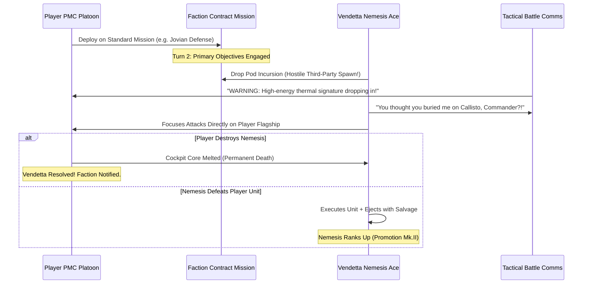

# Document 19: Pilot Nemesis System & Dynamic Character Relationship Web
**Document Version:** 1.0.0  
**Target Systems:** GameMaker Studio 2 (Modern GML), Datafiles JSON Pipeline  
**Inspirational Benchmarks:** *Middle-earth: Shadow of Mordor / War* (Monolith Nemesis System), *Front Mission 3/5*, *BattleTech*, *Crusader Kings III*  
**Authors & Contributors:** Lead Systems Architect (Lead Dev), Lead Game Designer (Director GDD), Lead Narrative Designer, Lead QA Engineer, Technical Art Director

---

## 1. Executive Summary & Core Philosophical Pillars

In *MechMakerConcept*, mobile suits are weapons of geopolitical mass destruction, but human agency pulls the triggers. The **Pilot Nemesis & Relational Character Web System** elevates tactical isometric battles and base management into a high-stakes, consequences-driven geopolitical human drama.

Characters—ranging from supreme planetary directors and fleet commodores to mercenary aces, trench grunts, and recruited PMC rookies—are not static stat-blocks. They belong to a **living directed relationship graph** with bloodlines, mentorship bonds, ideological loyalties, and bitter grudges. 

```
                          [THE PLAYER PMC]
                         /        |       \\
               (Actions)          |         (Decisions)
                 /                |                \\
                v                 v                 v
      [Assassination / Kill]  [Imprisonment]  [Faction Contracts]
                |                 |                 |
                v                 v                 v
       +--------------------------------------------------+
       |             RELATIONAL GRAPH DISPATCHER          |
       |  - Kinship (Blood Feuds / Family Retaliation)    |
       |  - Mentorship (Grief & Revenge Strikes)          |
       |  - Rivals (Opportunistic Alliances / Betrayals)  |
       |  - Faction Command (Embargoes / Blacklists)      |
       +--------------------------------------------------+
                |                                   |
                v                                   v
    [DYNAMIC RETALIATION AMBUSHES]        [INTERNAL PMC DISSENT]
    (Named Aces Hunt You on Grid)        (Pilots Mutiny or Desert)
```

### 1.1 The Five Pillars of the Mecha Nemesis System
1. **Consequential Permanence (Permadeath & Elimination)**: Major figures and pilots can be permanently killed on the battlefield, assassinated in covert contracts, executed after capture, or imprisoned. Death is permanent; there are no scripted revivals without explicit in-lore cybernetic reconstruction.
2. **The Ripple of Retaliation (Bloodlines & Wingman Bonds)**: Eliminating or capturing a character sends shockwaves across their relationship web. Spouses, children, siblings, wingmen, and mentors do not simply accept loss; they dynamically alter their behavior, declare blood debts, hire bounty hunters, or abandon faction orders to personally hunt down the player.
3. **Battlefield Memory & Grudge Scars**: Surviving pilots remember *how* they fought the player. Cockpit breaches leave ocular and neural scars; limbs blown off by 300mm railguns yield cybernetic prosthetics; cockpit incinerations yield deep pyrophobia and burning hatred.
4. **Opportunism & Command Vacuums**: Killing a high-ranking officer creates power vacuums. Ambitious subordinates within the same faction may secretly celebrate the player's actions, sending encrypted payments or tech tenders while publicly denouncing them.
5. **Internal PMC Cohesion & Ethical Tension**: Contract choices directly impact hired pilots. If the player accepts a contract to bombard a Colony habitat, Colony-born pilots within the player's own PMC will lodge protests, demand hazard pay, sabotage equipment, or desert to join an enemy vendetta strike team.

---

## 2. Mathematical Relationship Graph & Grudge Calculus

### 2.1 Graph Data Topology
The social web is implemented as a **Directed Attributed Multi-Graph**:
- **Nodes ($\mathcal{V}$)**: All named characters ($N \approx 32\text{ to }64$ active actors across the solar system).
- **Edges ($\mathcal{E}$)**: Directed relational bonds $(u \xrightarrow{\text{type}} v)$.

$$\mathcal{G} = (\mathcal{V}, \mathcal{E})$$

```
[General Deborah Vance] 
   |-- (Estranged Kin: Nephew) --------> [Jax 'Jackal' Vance] (Syndicate Reaver)
   |-- (Mentor / Commander) -----------> [Lt. Marcus Cole] (Terran Ace)
   |-- (Bureaucratic Rival) -----------> [Arthur Sterling] (Senate Liaison)
   
[Lt. Marcus Cole]
   |-- (Senior Wingman / Protective) --> [Elena Rostova] (Terran Rookie)
```

### 2.2 Relational Edge Attributes
Every edge $e_{u,v} \in \mathcal{E}$ possesses multi-dimensional scalar parameters:

$$\mathbf{R}_{u \to v} = \langle \text{Type}, \text{Affinity}, \text{Trust}, \text{Grudge}, \text{Obligation} \rangle$$

| Attribute | Range | Mathematical Meaning | Dynamic Trigger |
| :--- | :---: | :--- | :--- |
| **`affinity`** | $[-100, +100]$ | General emotional liking / hatred. | Rises with shared victories; drops with harmful contracts. |
| **`trust`** | $[-100, +100]$ | Belief in the character's honor and word. | Plummets to $-100$ if player betrays paroled prisoners or breaks truces. |
| **`grudge`** | $[0, 100]$ | Burning desire for personal retribution. | Increases when loved ones or wingmen are harmed/killed by $v$. |
| **`obligation`** | $[0, 100]$ | Fealty, blood debt, or formal oath to protect. | Dictates whether a character is compelled to declare a Blood Vendetta. |

### 2.3 Edge Relationship Types
1. **`REL_BLOODLINE`** (Kinship): Parent, child, sibling, nephew/niece. Multiplier on Grudge transference: $\lambda_{\text{kin}} = 2.0$.
2. **`REL_MENTOR`** (Teacher / Student): Academy instructor or combat flight lead. Grudge multiplier: $\lambda_{\text{mentor}} = 1.5$.
3. **`REL_WINGMAN`** (Battlefield Bond): Squad-mate forged in fire. Grudge multiplier: $\lambda_{\text{wing}} = 1.75$.
4. **`REL_RIVAL`** (Competitive Grudge): Long-standing professional adversary. Grudge multiplier on death: $\lambda_{\text{rival}} = -0.5$ (opportunistic joy).
5. **`REL_DEBT_BOUND`** (Indentured / Blackmailed): Cybernetic servitude or financial bondage (e.g. Zaibatsu cyber-aces).
6. **`REL_SUBORDINATE`** (Chain of Command): Lower-ranked officer awaiting promotion in the event of a superior's demise.

### 2.4 The Ripple Traversal Formula (Dispatched on Elimination)
When the player executes or kills character $K$, the graph dispatcher evaluates all inbound connections $u \to K$:

$$\Delta \text{Grudge}_{u \to \text{Player}} = \min\left(100, \text{BaseSeverity}(K) \times \lambda_{\text{type}} \times \frac{\mathbf{R}_{u \to K}.\text{affinity}}{100}\right)$$

Where:
$$\text{BaseSeverity}(K) = \begin{cases} 50 & \text{if } K \text{ is an Ace Pilot} \\ 80 & \text{if } K \text{ is a Supreme Faction Leader / Director} \\ 30 & \text{if } K \text{ is a Line Pilot / Grunt} \end{cases}$$

If $\Delta \text{Grudge}_{u \to \text{Player}} \ge 70$, character $u$ triggers a **State Transition** into `VENDETTA_ACTIVE`.

---

## 3. Dramatis Personae & Canonical Character Web

The initial game state defines 16 foundational figures across the four major powers, featuring deep historical intersections and dormant family fissures:

```
[TERRAN COALITION]                             [OUTER COLONIES LEAGUE]
General Deborah Vance <---------------------> Fleet Cmdr. Cassian Vane
  (Blood: Nephew Jax)                           (Former Academy Rival)
     |                                              |
     v                                              v
Lt. Marcus Cole                                 Sorren 'Ghost' Lin
     |                                              |
     v                                              v
Ensign Elena Rostova                            Kira Dahl

        ^                                              ^
        |                                              |
        v                                              v
Madame Rosalind Cruz <----------------------> Director Renzo Takahashi
  (Underworld Trade)                            (Cybernetic Procurement)
     |                                              |
     v                                              v
'Jackal' Jax Vance                              Null-07 (Ren)
(Estranged Terran Ex-Pilot)                     (Sub-Nanometer Cyber-Ace)
[SYNDICATE RIM]                                [ZAIBATSU AEROSPACE]
```

### 3.1 Terran Coalition Personnel
#### 1. General Deborah Vance (`char_terran_vance`)
- **Faction Role:** Supreme Director of Planetary Ordnance & Trench Operations.
- **Personality:** Stoic, unyielding iron militarist. Lost her son in the Callisto uprising.
- **Relational Connections:**
  - `char_syndicate_jackal`: Estranged nephew Jax Vance (disowned family black sheep who stole a military prototype and fled to the Syndicate).
  - `pilot_cole`: Primary military protégé and decorated combat wingman.
  - `char_colony_cassian`: Archenemy and former Academy classmate prior to the Secession War.
- **Elimination Consequences:** If Vance is killed, Terran Coalition command fractures into martial law. Marcus Cole immediately swears a Blood Vendetta against the player, mobilizing an elite heavy assault task force.

#### 2. High Commissioner Arthur Sterling (`char_terran_sterling`)
- **Faction Role:** Senate Defense Liaison & Planetary Procurement Hawk.
- **Personality:** Cynical corporate bureaucrat and war profiteer.
- **Relational Connections:**
  - `char_terran_vance`: Bitter bureaucratic rival; resents Vance's military influence.
  - `char_zaibatsu_renzo`: Secret backchannel investor in Zaibatsu cyber-implants.
- **Elimination Consequences:** If Sterling is assassinated, General Vance takes complete control of Terran military budgets, increasing Coalition contract payouts but intensifying military aggression.

#### 3. Lt. Marcus 'Breaker' Cole (`pilot_cole`)
- **Faction Role:** Terran Heavy Ace Pilot (Pilots GHA-07 Ironclad Custom).
- **Personality:** Gruff frontline veteran who shields rookies with his own armor plating.
- **Relational Connections:**
  - `char_terran_vance`: Devoted protégé and sworn bodyguard.
  - `pilot_rostova`: Protective mentor; treats Elena like a surrogate daughter.
- **Nemesis Behavior:** If captured, Cole refuses to talk unless Elena Rostova is harmed. If Rostova is killed by the player, Cole gains the trait `Enraged_Berserker` (+50% Melee Damage, -30% Evasion) and relentlessly hunts the player.

#### 4. Ensign Elena Rostova (`pilot_rostova`)
- **Faction Role:** Junior Scout / Artillery Spotter.
- **Personality:** Idealistic rookie pilot fighting to clear her family's disgraced military debts.
- **Relational Connections:**
  - `pilot_cole`: Adored mentor and father figure.
- **Elimination Consequences:** If Elena is killed, Cole's tactical discipline collapses; he abandons defensive line doctrines to pursue suicidal close-range battering attacks against the player.

---

### 3.2 Outer Colony League Personnel
#### 5. Fleet Commander Cassian Vane (`char_colony_cassian`)
- **Faction Role:** Supreme Marshall of the Liberation Flotilla.
- **Personality:** Aristocratic orbital dogfighter, philosopher-commander, master of particle beam tactics.
- **Relational Connections:**
  - `char_terran_vance`: Respected archenemy from pre-war solar academy days.
  - `pilot_sorren`: Top-scoring ace apprentice; treats Sorren as the living embodiment of Colony freedom.
  - `char_colony_lyra`: Political ally, though frequently clashes over resource civilian rationing.
- **Elimination Consequences:** Eliminating Cassian destroys Colony tactical cohesion. Colony fleets resort to desperate, chaotic guerrilla raids. Sorren Lin swears eternal vengeance, equipping high-speed stealth particle sabers.

#### 6. Minister Lyra Thorne (`char_colony_lyra`)
- **Faction Role:** Chief Diplomat & Solar Habitat Resource Chair.
- **Personality:** Pragmatic humanitarian fighting to keep orbital life support powered.
- **Relational Connections:**
  - `char_colony_cassian`: Diplomatic partner and strategic advisor.
- **Elimination Consequences:** Assassinating Lyra causes habitat riots across Colony space. Colony trade prices skyrocket, and humanitarian aid contracts become violent insurgencies.

#### 7. Sorren 'Ghost' Lin (`pilot_sorren`)
- **Faction Role:** Colony Elite Interceptor Ace (Pilots OCM-09 Aether Custom).
- **Personality:** Quiet, lethal zero-G sniper who avoids needless slaughter but never misses.
- **Relational Connections:**
  - `char_colony_cassian`: Sworn personal apprentice and wingman.
  - `pilot_kira`: Flight partner and close confidante.
- **Nemesis Behavior:** If Cassian Vane is killed, Sorren Lin transforms into the `Vengeful_Ghost`: paints his Aether chassis pitch black, stalks player contracts from extreme range, and attempts to snipe the player's reactor in turn 1.

#### 8. Kira Dahl (`pilot_kira`)
- **Faction Role:** Fast-attack Skirmisher & Vector Specialist.
- **Personality:** Energetic, fiercely loyal orbital fighter.
- **Relational Connections:**
  - `pilot_sorren`: Longtime flight partner.
- **Elimination Consequences:** If Kira is shot down without ejection, Sorren Lin loses all emotional restraint, abandoning sniper distance to engage in frantic CQB saber duels.

---

### 3.3 Rim-Syndicate Cartel Personnel
#### 9. Madame Rosalind Cruz (`char_syndicate_cruz`)
- **Faction Role:** Matriarch of Scrap Depot 9 & Asteroid Smuggling Baroness.
- **Personality:** Ruthless, sharp-tongued survivor who treats contracts like family bonds and betrayal like a death sentence.
- **Relational Connections:**
  - `pilot_nadia`: Adopted daughter and master foundry mechanic.
  - `char_syndicate_torval`: Hired fleet enforcer; keeps him on a tight leash with scrap shipments.
- **Elimination Consequences:** If Cruz is killed, Depot 9 descends into bloody pirate civil war. Black-market alloy and parts prices fluctuate wildly (+80% volatility). Nadia Ortiz launches an explosive demolition vendetta.

#### 10. Commodore 'Iron-Eye' Torval (`char_syndicate_torval`)
- **Faction Role:** Cartel Reaver Fleet Commodore.
- **Personality:** Bloodthirsty pirate warlord missing his right eye from a Jovian railgun explosion.
- **Relational Connections:**
  - `char_syndicate_cruz`: Indentured naval commander.
  - `pilot_jackal`: Hires Jax for high-risk corporate raiding runs.
- **Elimination Consequences:** If Torval is slain, pirate raids on player transport convoys temporarily cease until a new warlord claims his flagship.

#### 11. Nadia 'Spark' Ortiz (`pilot_nadia`)
- **Faction Role:** Combat Mechanic & Slag-Lobber Demolitionist (Pilots SCA-14 Slag-Lobber).
- **Personality:** Brash grease monkey who loves incendiary weapons and high-impact demolition.
- **Relational Connections:**
  - `char_syndicate_cruz`: Adoptive mother and protector.
- **Nemesis Behavior:** If Cruz is harmed or imprisoned, Nadia deploys thermite mines across extraction zones and uses incendiary slag to roast player cockpits.

#### 12. Jax 'Jackal' Vance (`pilot_jackal`)
- **Faction Role:** Renegade Reaver Ace (Pilots Hyena Breacher Custom).
- **Personality:** Bitter, nihilistic ex-Terran test pilot who hates his aristocratic Coalition heritage.
- **Relational Connections:**
  - `char_terran_vance`: Disowned nephew; fled Earth after a fatal prototype sabotage incident.
- **Dynamic Drama:** If General Deborah Vance orders the player to kill Jax, doing so earns massive Coalition standing but permanently alienates the Syndicate. If the player captures Jax alive, he can be used as devastating diplomatic leverage or recruited as an elite brawler ace.

---

### 3.4 Apex Bio-Cybernetics Zaibatsu Personnel
#### 13. Director Renzo Takahashi (`char_zaibatsu_renzo`)
- **Faction Role:** Executive VP of Special Weapons & Cybernetic R&D.
- **Personality:** Cold, calculating transhumanist who views human pilots as biological components.
- **Relational Connections:**
  - `pilot_null07`: Treats Null-07 as company property; holds the neural kill-switch codes.
  - `char_zaibatsu_vivienne`: Head of neural implant research; frequent partner in corporate espionage.
- **Elimination Consequences:** Eliminating Takahashi triggers a corporate boardroom purge. Zaibatsu contracts temporarily pause, and rogue neural-linked prototypes escape containment.

#### 14. Dr. Vivienne Chen (`char_zaibatsu_vivienne`)
- **Faction Role:** Chief Neural Architect & Cybernetic Surgeon.
- **Personality:** Detached scientist fascinated by human pain thresholds and brain-machine latency.
- **Relational Connections:**
  - `char_zaibatsu_renzo`: Corporate supervisor and research patron.
  - `pilot_null07`: Oversees Null-07's surgical maintenance and cognitive suppressants.
- **Elimination Consequences:** If Chen is eliminated, Null-07's mental suppression fails, initiating a berserk awakening where Ren fights to reclaim their stolen memories.

#### 15. Null-07 / Ren (`pilot_null07`)
- **Faction Role:** Cybernetic Transhuman Ace (Pilots ZX-22 Susanoo Custom).
- **Personality:** Emotionally suppressed cyber-pilot struggling with fractured memories of a previous life.
- **Relational Connections:**
  - `char_zaibatsu_renzo`: Bound by corporate neural leash.
  - `char_zaibatsu_vivienne`: Surgical creator and controller.
- **Nemesis Evolution:** If defeated in battle and spared by the player, Null-07 can experience a **Neural Awakening**, breaking free of Zaibatsu programming to become an irreplaceable ally or an unpredictable third-party avenger.

#### 16. Maya 'Kestrel' Zhao (`pilot_maya`)
- **Faction Role:** Corporate Duelist & Infiltration Specialist (Pilots ZM-11 Muramasa).
- **Personality:** Razor-sharp mercenary duelist obsessed with blade perfection and honor.
- **Relational Connections:**
  - `char_zaibatsu_renzo`: Under private corporate contract.
- **Nemesis Behavior:** If disarmed by the player in melee combat, Maya swears to return with a superior monomolecular blade to challenge the player to a formal duel.

---

## 4. The Monolith-Style Nemesis Dynamic Loop

```
           +---------------------------------------------+
           |           BATTLEFIELD ENCOUNTER             |
           +---------------------------------------------+
                     /                      \\
           (Player Defeats Pilot)     (Pilot Defeats Player)
                   /                          \\
                  v                            v
      [EJECTION / SURVIVAL]         [PILOT GAINS PROMOTION]
      - Pilot escapes with scars     - Pilot gains Ace Level (+1)
      - Retains battle memories      - New custom chassis upgrade
      - Develops phobias / traits    - Faction influence increases
                  |                            |
                  v                            v
      [DYNAMIC NEMESIS EVOLUTION]   [TAUNTING / HUMILIATION]
      - Installs cyber prosthetics   - Mocks player on next sortie
      - Upgrades counter-weapons     - Sets up defensive redoubts
                  |
                  v
      +------------------------------------------+
      |       UNSCHEDULED BATTLEFIELD AMBUSH     |
      | "Remember me? You melted my left arm on  |
      |  Callisto! Now I crack your cockpit open"|
      +------------------------------------------+
```

### 4.1 Battlefield Outcomes & Nemesis Mutations
When a named pilot's mobile suit is destroyed in battle, the combat resolver calculates their physical and psychological fate:

$$\mathbf{P}(\text{Outcome}) = f(\text{Destruction Type}, \text{Cockpit Integrity}, \text{Ejection System})$$

| Destruction Type | Survival Rate | Dynamic Physical Trait | Psychological Nemesis Mutation |
| :--- | :---: | :--- | :--- |
| **Torso Core Meltdown** | 35% | `trait_burn_scarring` (Cybernetic skin grafts) | `fear_of_plasma` (Panic when hit by energy beams) OR `pyromaniac` |
| **300mm Railgun Punch** | 50% | `trait_bionic_limbs` (Pneumatic replacement arm) | `grudge_railguns` (Equips heavy shields to deflect kinetic solid slugs) |
| **Cockpit Breached / Pried** | 20% | `trait_cyber_eye` (Tachyon sensor ocular patch) | `fear_of_melee` OR `vengeful_brawler` (Swears to crush player with claw) |
| **Clean Ejection Pod** | 90% | Unscathed physical body | `humiliated` (Desires public duel to reclaim military honor) |

### 4.2 Dynamic Trait Taxonomy
Surviving nemeses dynamically acquire traits that alter tactical combat and AI decision-making:

#### Strengths & Counters (Tactical Adaptations)
- **`trait_iron_skin`**: Replaced standard plating with hardened tungsten laminates; takes -30% kinetic damage from autocannons.
- **`trait_beam_baffle`**: Installed active reflective aerosol dispensers; completely deflects the first particle beam salvo of every combat.
- **`trait_ambush_specialist`**: Gains the ability to spawn behind player lines on turn 3 of an ongoing mission.
- **`trait_executioner`**: If this pilot brings a player PMC suit below 15% Torso HP, they will attempt an immediate melee cockpit crush to execute the player's pilot permanently.

#### Flaws & Vulnerabilities (Exploitable Weaknesses)
- **`trait_phantom_pain`**: Suffers -2 Action Points whenever their mech takes heavy internal structural damage.
- **`trait_cockpit_claustrophobia`**: Suffers -25% accuracy if targeted by smokescreens, tear gas, or visual ECM jammers.
- **`trait_berserker_rage`**: Attacks the nearest target regardless of cover if their primary weapon hardpoint is destroyed.

---

## 5. Prisoner Disposition, Interrogation & Diplomatic Hostages

When an enemy pilot ejects or is incapacitated, the player's salvage recovery team can retrieve their pod from the field:

```
                          [CAPTURED PILOT IN BRIG]
                         /           |            \\
                        /            |             \\
                       v             v              v
               [INTERROGATE]     [RANSOM / PAROLE]   [EXECUTE]
                     |               |              |
                     v               v              v
              - Intel on Bases  - Large Credits   - Permanent Permadeath
              - Prototype Specs - Faction Goodwill- Sworn Blood Vendettas
              - Betrayal Risk   - Returns later   - Internal PMC Shock
```

### 5.1 Prisoner Management Options
1. **Diplomatic Ransom**:
   - Release the prisoner back to their home faction for credits ($\text{Tier 1} = 150\text{k Cr}$, $\text{Tier 4} = 1.2\text{M Cr}$).
   - **Consequence:** Faction standing increases ($+15$ to $+35$). However, the pilot returns to active service and may face the player again in future campaigns with increased combat experience.
2. **Parole / Honor Release**:
   - Release the pilot without demanding ransom as a gesture of battlefield chivalry.
   - **Consequence:** Massive trust boost ($+50\text{ Trust}$ with the pilot). Highly honorable pilots (like Marcus Cole or Cassian Vane) will refuse to fire on player units during future contested sorties.
3. **Coercive Interrogation**:
   - Question the prisoner to reveal hidden solar mining nodes, prototype blueprint caches, or enemy troop movements.
   - **Consequence:** Yields high-tier intelligence; permanently damages trust ($-50\text{ Trust}$). If the pilot ever escapes, they become a permanent bitter nemesis.
4. **Permanent Execution**:
   - Eliminate the figure permanently in captivity.
   - **Consequence:** Removes the threat forever. Triggers **Immediate Blood Vendettas** across all family members and close wingmen. The executing PMC gains the planetary reputation trait `Butchers_of_the_Void`, causing enemy pilots to fight to the death rather than eject.
5. **PMC Recruitment (Turning the Enemy)**:
   - Persuade, bribe, or free the pilot from their faction obligations (e.g., freeing Jax Vance from Syndicate bounties or hacking Null-07's neural leash).
   - **Consequence:** Gain an elite ace pilot. However, their former faction issues a capture-or-kill bounty on the traitor and their new PMC employers.

---

## 6. Procedural Vendetta Incursions & Dynamic Ambush System

When an enemy pilot reaches `VENDETTA_ACTIVE` ($\text{Grudge} \ge 70$), they enter the **Procedural Incursion Queue**.



### 6.1 Ambush Mechanics on the Isometric Grid
- **Drop-Pod Entry**: On turn $2\text{ or }3$ of an ordinary contract, an unscheduled atmospheric re-entry capsule slams into the grid.
- **Third-Party Alignment**: The nemesis is hostile to the player, but if their home faction is also hostile to the contract target, they will engage both sides chaotically.
- **Customized Counter-Loadout**: The nemesis actively analyzes the player's most frequently used weapons from their memory log:
  - If the player relies on **Long-Range Railguns**, the nemesis deploys with high-speed vernier boost drives, smoke dispensers, and zig-zag rush AI.
  - If the player relies on **Heavy Armor Kinetic Brawlers**, the nemesis brings thermal plasma lances and slag incendiaries.
- **Dynamic Battle Barks**: The pilot taunts the player via HUD portrait com-links, mentioning slain companions, specific destroyed limbs, or past engagements by location name.

---

## 7. Dynamic Portrait Compositor System

To represent dynamic physical evolution (scars, bionics, eye patches, faction transfers), the UI does not rely on static art alone. It employs a **Layered Procedural Portrait Compositor**:

```
Layer 5: [Faction Insignia / Kill Badges]   (e.g., Terran Eagle, Reaver Skull)
Layer 4: [Cybernetic Prosthetics]           (e.g., Tachyon Ocular Lens, Chrome Jaw)
Layer 3: [Battle Scars & Burns]             (e.g., Acid Slag Splash, Plasma Burn)
Layer 2: [Facial Hair / Expression State]   (e.g., Furious, Despairing, Cocky)
Layer 1: [Base Character Portrait]          (e.g., Vance, Cole, Sorren, Ren)
```

```
+---------------------------------------------------+
|               DYNAMIC PORTRAIT STACK              |
|                                                   |
|    [ Layer 1: Base Character Line Art ]           |
|                     +                             |
|    [ Layer 2: Plasma Scar Overlay (Alpha 80%) ]   |
|                     +                             |
|    [ Layer 3: Cybernetic Ocular Bionic Eyepiece ] |
|                     +                             |
|    [ Layer 4: Faction Retaliation Blood Badge ]   |
|                                                   |
+---------------------------------------------------+
```

### 7.1 Visual Evolution Matrix
1. **Base Face Canvas**: Canonical character portrait (e.g., `spr_portrait_cole`).
2. **Scar Overlays**:
   - `spr_overlay_burn_plasma`: Applied when surviving core meltdowns.
   - `spr_overlay_shrapnel_scars`: Applied when ejecting from shredded cockpits.
3. **Cybernetic Overlays**:
   - `spr_overlay_bionic_eye_red`: Applied when losing ocular systems.
   - `spr_overlay_neural_bracket`: Applied when pilots receive Zaibatsu brain grafts.
4. **Emotional Expression Variants**:
   - `Neutral`, `Grinning / Cocky`, `Snarl / Enraged` (active when facing a sworn nemesis), `Bandaged / Exhausted` (post-defeat).

---

## 8. GameMaker Studio 2 Engine Architecture (Modern GML)

### 8.1 Data Structure Definitions (Struct Schemas)

#### `CharacterNode` Struct
```gml
function CharacterNode(_id, _name, _callsign, _faction_id, _tier, _base_sprite) constructor {
    id = _id;
    name = _name;
    callsign = _callsign;
    faction_id = _faction_id;
    tier = _tier;                      // 1 = Grunt/Rookie, 2 = Veteran, 3 = Ace/Officer, 4 = Supreme Leader
    base_sprite = _base_sprite;
    
    // Status & Life State
    is_alive = true;
    is_imprisoned = false;
    imprisoned_by = "";                // "player" or faction_id
    state = "IDLE";                    // "IDLE", "VENDETTA_ACTIVE", "HUNTING", "DESERTED", "RETIRED"
    
    // Combat Attributes & Evolution
    kills = 0;
    times_defeated = 0;
    assigned_mech_blueprint = "";
    
    // Nemesis Traits & Physical Scars
    traits = [];                       // Array of trait structs
    scars = [];                        // Array of visual scar IDs ("burn_plasma", "cyber_eye", etc.)
    
    // Relational Edges
    relationships = {};                // Keyed by target_char_id -> RelationshipEdge struct
    
    // Battlefield Memory Log
    memory_log = [];                   // Array of MemoryEntry structs
}
```

#### `RelationshipEdge` Struct
```gml
function RelationshipEdge(_target_id, _type, _affinity, _trust, _obligation) constructor {
    target_id = _target_id;
    type = _type;                      // "BLOODLINE", "MENTOR", "WINGMAN", "RIVAL", "DEBT_BOUND"
    affinity = clamp(_affinity, -100, 100);
    trust = clamp(_trust, -100, 100);
    grudge = 0;                        // 0 to 100
    obligation = _obligation;          // 0 to 100
    is_active = true;
}
```

#### `MemoryEntry` Struct
```gml
function MemoryEntry(_turn, _encounter_type, _actor_id, _location, _weapon_used, _notes) constructor {
    turn = _turn;
    encounter_type = _encounter_type;  // "DEFEATED_BY", "ESCAPED_FROM", "CAPTURED_BY", "WITNESSED_KILL"
    actor_id = _actor_id;              // Character or player ID
    location = _location;              // E.g., "sector_ganymede_trench"
    weapon_used = _weapon_used;        // E.g., "wpn_titan_rail_300mm"
    notes = _notes;
}
```

---

### 8.2 The Nemesis Manager Singleton (`obj_NemesisManager`)

The persistent singleton `obj_NemesisManager` manages relationship traversal, graph events, memory queries, and procedural ambush queues:

```gml
/// @function nemesis_record_kill(_killer_id, _victim_id, _weapon_id, _location)
/// @description Dispatches a death event across the relationship graph, calculating grudge cascades and vendetta declarations.
function nemesis_record_kill(_killer_id, _victim_id, _weapon_id, _location) {
    if (!variable_struct_exists(character_graph, _victim_id)) return;
    
    var _victim = character_graph[$ _victim_id];
    _victim.is_alive = false;
    _victim.state = "DEAD";
    
    show_debug_message("[obj_NemesisManager] CHARACTER PERMANENT DEATH: " + _victim.name + " killed by " + string(_killer_id));
    
    // 1. Iterate through all actors connected to the victim
    var _all_keys = variable_struct_get_names(character_graph);
    for (var i = 0; i < array_length(_all_keys); i++) {
        var _actor_id = _all_keys[i];
        if (_actor_id == _victim_id) continue;
        
        var _actor = character_graph[$ _actor_id];
        if (!_actor.is_alive) continue;
        
        // Check if actor has a direct relationship with the victim
        if (variable_struct_exists(_actor.relationships, _victim_id)) {
            var _edge = _actor.relationships[$ _victim_id];
            
            // Calculate grudge multiplier based on relationship type
            var _multiplier = 1.0;
            if (_edge.type == "BLOODLINE") _multiplier = 2.0;
            else if (_edge.type == "WINGMAN") _multiplier = 1.75;
            else if (_edge.type == "MENTOR") _multiplier = 1.5;
            else if (_edge.type == "RIVAL") _multiplier = -0.5; // Rivals take joy in death!
            
            var _base_severity = (_victim.tier >= 3) ? 75 : 45;
            var _grudge_delta = _base_severity * _multiplier * max(0.2, (_edge.affinity / 100.0));
            
            if (_killer_id == "player") {
                _edge.grudge = clamp(_edge.grudge + _grudge_delta, 0, 100);
                _edge.affinity = clamp(_edge.affinity - _grudge_delta, -100, 100);
                _edge.trust = -100;
                
                // Add memory entry
                array_push(_actor.memory_log, new MemoryEntry(
                    global.turn_count,
                    "WITNESSED_KILL",
                    _killer_id,
                    _location,
                    _weapon_id,
                    "Player murdered " + _victim.name + " (" + _edge.type + ")"
                ));
                
                // Check for Blood Vendetta Declaration Threshold
                if (_edge.grudge >= 70 && _actor.state != "VENDETTA_ACTIVE") {
                    _actor.state = "VENDETTA_ACTIVE";
                    array_push(active_vendetta_queue, _actor_id);
                    show_debug_message("[obj_NemesisManager] BLOOD VENDETTA DECLARED: " + _actor.name + " is hunting the Player!");
                }
            }
        }
    }
}
```

---

## 9. Lead QA Static Edge Case & Safety Verification

The Lead QA Engineer and Static Analyzer define strict architectural constraints to prevent infinite loops, orphaned relationships, and memory leaks:

| Edge Case Risk | Engineering Vulnerability | QA Rule & Defensive Implementation |
| :--- | :--- | :--- |
| **Cyclic Grudge Cascades** | Pilot A hates Pilot B, Pilot B hates Pilot A; death loops into reciprocal infinite events. | Event propagation depth is capped at $\text{depth} = 1$. Grudge updates only evaluate direct first-degree neighbors. |
| **Orphaned Relationship Pointers** | Character $K$ dies, but other structs hold memory references to undefined instances. | Graph nodes are never deleted from memory; `is_alive = false` flags preserve structural graph integrity. |
| **Cascade Mutiny Lockout** | Player executes an enemy ace, causing all hired PMC pilots to mutiny simultaneously in one turn. | Mutiny checks require an internal threshold check ($\text{Morale} < 10$) and roll against a dampener curve; maximum 1 mutiny event per 4 turns. |
| **Memory Leaks in Graph Traversal** | Iterating over 64 struct keys using dynamic string arrays creates heap fragmentation. | Use static arrays `character_id_list` pre-cached in `Create_0`, eliminating runtime dynamic key allocations. |
| **Infinite Ambush Loops** | A vendetta pilot dies, another declares vendetta, ambushing on every consecutive mission. | Cooldown timer: Minimum $3\text{ missions}$ between procedural drop-pod nemesis incursions. |

---

## 10. Future Implementation Milestones

```
Phase 1: Conceptual Brief & Character Web Specification (Current - Doc 19)
Phase 2: Datafiles JSON Registry (characters_relational_graph.json)
Phase 3: GML Architecture & Manager Integration (obj_NemesisManager & scr_nemesis_dispatcher)
Phase 4: Procedural Drop-Pod Ambush Incursion in Isometric Combat (obj_BattleManager)
Phase 5: Layered Dynamic Portrait Compositor HUD & Comms Terminal
```

This specification completes the technical, architectural, and narrative foundation for the **Pilot Nemesis & Relational Character Web System**.
