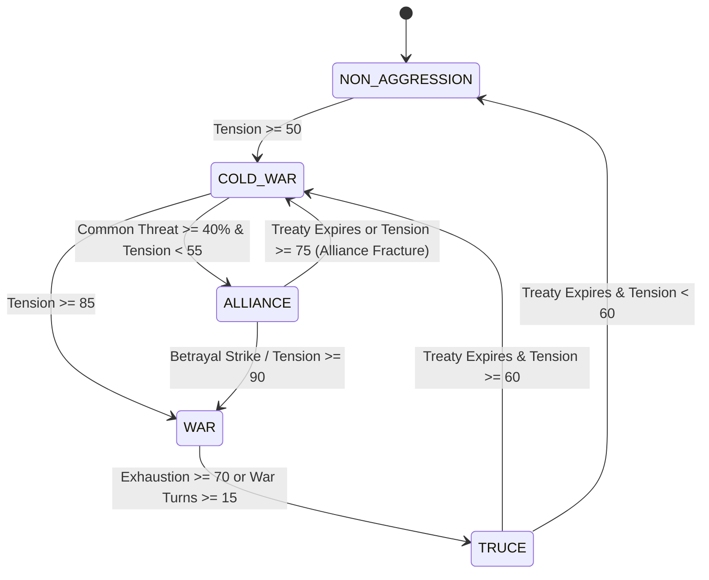

# Document 21: Faction AI Diplomacy, Dynamic Alliances, Truces & Interstellar War System

## 1. Executive Summary & Design Vision

In *MechMakerConcept*, the interstellar battlefield is not a static game of Risk. It is a ruthless, multi-polar geopolitical simulation inspired by *Gihren's Greed (Gihren no Yabou)*, *Front Mission*, and *BattleTech*. Four ideologically asymmetric factions compete for the Sol System's resources, industrial dominance, and sovereign legitimacy:

1. **The Terran Coalition (Earth Central)**: Authoritarian state-capitalist empire seeking imperial reunification and mineral monopolies.
2. **The Outer Colony League (Jovian Liberation)**: Revolutionary spacenoid confederacy fighting for communal independence and orbital self-determination.
3. **The Rim Syndicate Cartel (Scavenger Guild)**: Pragmatic outlaw cartels, arms smugglers, and pirate syndicates profiting off prolonged conflict.
4. **Apex Bio-Cybernetics Zaibatsu (Hyper-Corp)**: Transhumanist corporate technocracy playing all sides to test military neural interfaces and monopolize rare isotopes.

```
                           [TERRAN COALITION]
                         (Imperial Hegemony)
                            /     |                                /      |                                /       |                      [TRUCE]   /    [WAR]       \   [COLD WAR]
                        /         |                                /          |                [OUTER COLONIES] ─────── [SYNDICATE] ─────── [APEX ZAIBATSU]
      (Spacenoid Freedom)  [ALLIANCE]  (Black Market)  [PROXY WAR] (Corp Technocracy)
```

---

## 2. Bilateral Diplomatic Matrix Schema

Diplomacy in the game is tracked bilaterally across all **6 unique faction pairs**:
1. `terran_colony`
2. `terran_syndicate`
3. `terran_zaibatsu`
4. `colony_syndicate`
5. `colony_zaibatsu`
6. `syndicate_zaibatsu`

### 2.1 The 5 Diplomatic States
| State | Badge Color | Military Rules | Trade & Contract Access |
| :--- | :--- | :--- | :--- |
| **WAR** | Crimson (`#FF3232`) | Active border offensives, drop-pod strikes, frontline skirmishes. | Blacklisted; contracts target rival. |
| **COLD_WAR** | Purple (`#C864FF`) | Severe tension, covert espionage, proxy skirmishes, arms race. | Heavy 30% tariffs; high tension. |
| **TRUCE** | Amber (`#FFC832`) | Ceasefire accord (duration: 8–18 turns); active combat suspended. | Neutral commerce; no hostile sorties. |
| **ALLIANCE** | Cyan (`#00F0FF`) | Mutual defense pact (duration: 10–22 turns); joint offensives. | Free-trade discount (-20%); tech sharing. |
| **NON_AGGRESSION** | Steel (`#96B4DC`) | Formal diplomatic recognition; border peace. | Standard tariffs; normal contracts. |

---

## 3. The Mathematical Tension & Dynamic Balancing Engine

To satisfy the core design directive—**preventing permanent stagnant alliances and maintaining constant geopolitical friction**—the system uses an explicit **Geopolitical Tension Curve ($	ext{Tension} \in [0, 100]$)** for every bilateral pair.

### 3.1 Tension Shift Calculus
Every strategic turn, bilateral tension updates according to:
$$\Delta 	ext{Tension} = 	ext{Base Ideological Friction} + 	ext{Resource Competition} + 	ext{Alliance Paranoia} - 	ext{Truce Decay} + 	ext{Player Action}$$

#### 1. Base Ideological Friction:
- **Terran vs Colony**: $+3.0$ / turn (Inherently irreconcilable: Earth tribute vs colonial liberty).
- **Terran vs Syndicate**: $+2.5$ / turn (Law enforcement vs pirate smuggling).
- **Colony vs Zaibatsu**: $+2.0$ / turn (Spacenoid labor exploitation vs corporate greed).
- **Syndicate vs Zaibatsu**: $+1.5$ / turn (Black market IP theft vs corporate patent kill-teams).
- **Terran vs Zaibatsu**: $+1.0$ / turn (State regulation vs corporate sovereignty).
- **Colony vs Syndicate**: $+1.0$ / turn (Mutual anti-Earth necessity, but pirate extortion).

#### 2. Alliance Paranoia (The Anti-Permanent Alliance Rule):
- **Why Alliances Cannot Last Permanently**: Even when two factions form a military pact, mutual distrust and covert espionage fester.
- **Formula**:
  $$	ext{During ALLIANCE}: \Delta 	ext{Tension} = +2.5 	ext{ per turn}$$
  When an alliance reaches $	ext{Tension} \ge 75$ or its treaty timer expires, it **fractures into Cold War or War** with a dramatic diplomatic cable of betrayal!

#### 3. Truce Exhaustion & Decay:
- During a **TRUCE**, active war exhaustion cools relations: $\Delta 	ext{Tension} = -2.0 	ext{ per turn}$.
- However, if the truce timer reaches $0$ and unresolved historical grievances remain ($	ext{Tension} > 60$), relations immediately revert to **COLD WAR**.

#### 4. Balance-of-Power Anti-Blobbing (Rubber-Banding):
If any single faction expands beyond **$40\%$ territory control** or military strength:
- The other three factions receive a $+30$ surge in mutual threat perception.
- Bilateral tensions between the weaker factions decrease by $-25$.
- Triggers an **Emergency Anti-Hegemonic Coalition Alliance** against the dominant power!
- Once the dominant faction is beaten back below $32\%$, the coalition dissolves as original ideological rivalries resurface.

---

## 4. State Transition Thresholds



1. **War Declaration**:
   - Triggers when $	ext{Tension} \ge 85$.
   - Breaks any non-aggression pact or truce immediately.
   - Posts a high-priority Diplomatic Cable to the Command Deck Turn Briefing.
2. **Ceasefire Truce Accord**:
   - Signed after prolonged war ($10+$ turns) or when a faction loses $> 15\%$ territory in recent clashes.
   - Sets state to `TRUCE`, assigns `treaty_turns_left = irandom_range(10, 18)`, drops tension to $40$.
3. **Coalition Alliance**:
   - Formed when two factions share a rival controlling $> 38\%$ Sol influence.
   - Sets state to `ALLIANCE`, assigns `treaty_turns_left = irandom_range(12, 20)`.

---

## 5. Player Agency: Mercenary Diplomacy & Covert Operations

As a licensed independent PMC, the player can exploit and manipulate the galactic balance of power:

1. **Proxy War Contracts**:
   - Factions hire the player to conduct surgical strikes that frame rival factions, spiking bilateral tension by $+25$ and triggering war declarations.
2. **Truce Brokering (Peace Delegation Escort)**:
   - When a faction is on the brink of defeat, they offer a high-paying mercenary contract ($150,000$ to $350,000	ext{ Cr}$) to protect diplomatic envoys and broker a ceasefire accord.
3. **Coalition Muscle**:
   - The player's PMC can deploy strike wings in joint offensives alongside allied factions, tilting the territory shift during macro war simulation.
4. **Mass-Production Arms Sales**:
   - Licensing custom mobile suit blueprints to one side shifts the military strength score, directly precipitating territorial collapse or counter-offensives.

---

## 6. Narrative Diplomatic Cables Format

All diplomatic developments are transmitted via in-game diplomatic cables structured for the Command Deck:
- **Terran Coalition**: Formal, legalistic, bureaucratic military communiqués.
- **Outer Colonies**: Defiant, ideological spacenoid manifestos.
- **Rogue Syndicates**: Casual, cynical, extortionate black-market cables.
- **Apex Zaibatsu**: Clinical, cold, corporate executive memorandums.
