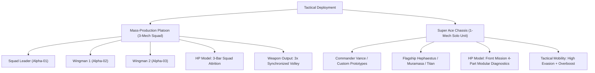
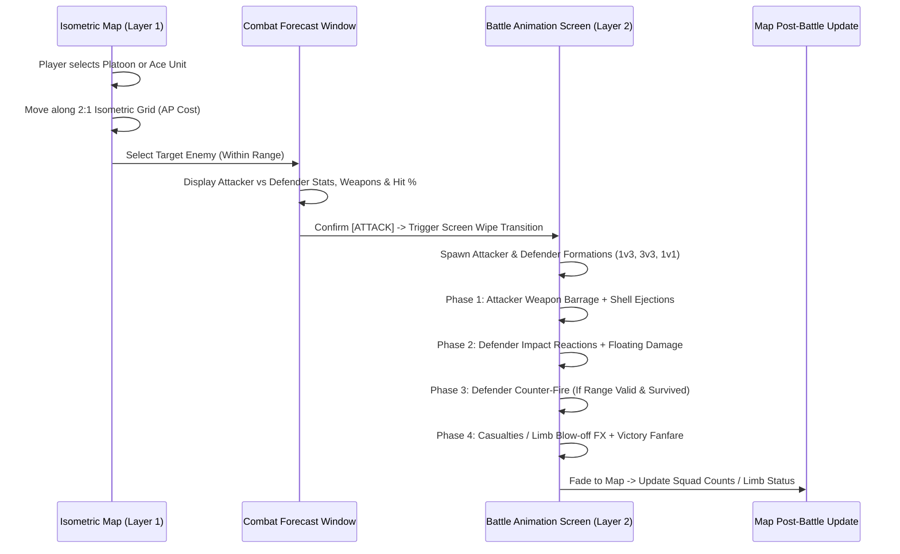

# Document 31: Dual-Layer Tactical Combat: SNES Front Mission + Gihren\x27s Greed Hybrid System
## Dedicated Battle Animation Screen, Platoon Squad Attrition (3 Units) & Super Ace Duels (1 Unit)

> [!NOTE]
> **Design Vision:** True to 16-bit SNES *Front Mission (1995)* and the tactical squad doctrine of *Gihren\x27s Greed (Giren no Yabou)*, the combat system is architected as a **Dual-Layer Tactical Experience**:
> 1. **Layer 1: The Isometric Tactical Map**: A 2:1 axonometric wargame map where platoons maneuver, secure elevation, establish crossfire arcs, and declare combat.
> 2. **Layer 2: The Dedicated Battle Animation Screen**: A cinematic, side-view mecha combat clash screen where attacks resolve with full animated weapon fire, cartridge ejections, missile smoke arcs, and part destruction!
>
> In accordance with military mecha doctrine:
> - **Standard Mass-Production Units are fielded as 3-Mech Platoons** (1 Leader + 2 Wingmen).
> - **Legendary Super Aces & Custom Prototypes are fielded as 1-Mech Solo Units** with full 4-part Front Mission modular limb targeting (`BODY`, `L-ARM`, `R-ARM`, `LEGS`).

---

## 1. Dedicated Battle Animation Screen Mockups

````carousel

<!-- slide -->

````

### Mockup 1: Mass-Production Platoon Engagement (3v3 Squads)
- **Cinematic Mecha Clash:** 
  - **Left Side (Allied Platoon):** 3 military olive-drab heavy mobile suits in echelon triangle formation advancing on vernier thrusters while firing synchronized volleys of 120mm autocannons and rotary vulcans.
  - **Right Side (Enemy Platoon):** 3 hostile crimson outlaw wanzers returning fire with shoulder missile pods and heavy rifles while taking kinetic impact spark bursts.
- **SNES Front Mission Battle HUD:**
  - **Top Banner:** `COMBAT ENGAGEMENT // 120mm BARRAGE`.
  - **Bottom-Left Panel:** Allied Commander pilot portrait with 3 individual health gauges representing each squad member (Alpha-01 Leader, Alpha-02 Wingman, Alpha-03 Wingman).
  - **Bottom-Right Panel:** Hostile ace/grunt portrait with 3 enemy member health gauges (Viper-01, Viper-02, Viper-03).
  - **Dynamic Combat Text:** Floating damage numbers (`128`, `128`) and `CRITICAL HIT!` alerts.

### Mockup 2: Super Ace Engagement (1 Solo Ace vs 3-Unit Grunt Platoon)
- **High-Mobility Ace Dominance:**
  - **Left Side (Super Ace Custom):** Single custom prototype flagship suit (gold/navy plating, aerodynamic wings, dual cyan vernier flares) executing a high-speed dash with plasma beam rifle and thermal blade.
  - **Right Side (Enemy Grunt Platoon):** 3 red mass-production wanzers (`GRUNT A`, `GRUNT B`, `GRUNT C`) firing machine guns into the ace\x27s optical evasion blur.
- **Front Mission 4-Part Diagnostic Readout (Bottom-Left):**
  - **BODY:** 750 / 750 HP (Central core survival).
  - **L-ARM:** 520 / 520 HP (Thermal blade arm).
  - **R-ARM:** 520 / 520 HP (Plasma beam rifle mount).
  - **LEGS:** 680 / 680 HP (High-mobility vernier stride).
- **Grunt Squad Telemetry (Bottom-Right):** 3 vertical status meters showing individual grunt attrition.
- **Combat Evasion FX:** `EVADED! 0 0` damage readouts and motion blur afterimages.

---

## 2. Platoon Composition & Unit Classification



### 2.1 Mass-Production Platoons (3 Mobile Suits)
Standard doctrine for Terran, Colony, Syndicate, and Zaibatsu frontline forces:
- **Chassis Examples:** GHA-07 Ironclad, AET-01 Aether, SCR-12 Hyena, ZAI-03 Muramasa line units.
- **Map Representation:** A squad stack token on the 2:1 isometric grid displaying a `x3` strength counter.
- **Battle Screen Presentation:** 3 mobile suits deployed in classic triangular echelon formation:
  - Lead Chassis: Center-front ($X_0, Y_0$)
  - Top Wingman: Upper-rear ($X_0 - 45, Y_0 - 35$)
  - Bottom Wingman: Lower-rear ($X_0 - 45, Y_0 + 35$)
- **Squad Attrition System:**
  $$\text{Total Platoon HP} = \text{HP}_{\text{Lead}} + \text{HP}_{\text{Wing1}} + \text{HP}_{\text{Wing2}}$$
  As damage is sustained during combat exchanges, wingmen are incrementally disabled and destroyed:
  - $100\% \to 67\%$ HP: Full strength (3 suits firing).
  - $66\% \to 34\%$ HP: Moderate damage (1 wingman destroyed, 2 suits firing).
  - $33\% \to 1\%$ HP: Critical state (2 wingmen destroyed, lone squad leader fighting).
  - $0\%$ HP: Platoon wiped out.

### 2.2 Super Ace Units (1 Mobile Suit)
Reserved for named commanders, customized player mechs, and prototype flagships:
- **Chassis Examples:** Vance\x27s Custom Warhammer, Cole\x27s Heavy Ironclad, Nadia\x27s Custom Aether, Renzo\x27s Muramasa, Hephaestus Avatar, Valkyrie Titan Juggernaut.
- **Map Representation:** A distinct gold-bordered animated chassis token with an `ACE` badge.
- **Battle Screen Presentation:** Single centered unit on the combat side, scaled at 1.25x for imposing presence.
- **Front Mission 4-Part Modular Damage:**
  - **Body (Torso Core):** Sustains reactor integrity and cockpit armor. Loss = complete Destruction.
  - **Left Arm:** Mounts secondary weapon or energy shield. Loss = Disarmed on left flank.
  - **Right Arm:** Mounts primary heavy weapon. Loss = Disarmed on right flank.
  - **Legs:** Controls hydraulic jumping, vernier skating, and evasion. Loss = Movement reduced to 1 tile, evasion to 0%.

---

## 3. Two-Layer Combat Flow & Game Loop



### 3.1 Combat Forecast & Targeting Overlay
Before entering the battle animation screen, the player inspects the engagement:
- **If Attacker is a Super Ace:** The player can choose **Standard Volley** or spend +2 AP for an **Aimed Limb Shot** targeting the enemy\x27s specific part (or focusing down the enemy squad leader).
- **Forecast Telemetry:** Displays Weapon Matchup, Hit %, Expected Damage, and Counterattack Warning.

### 3.2 The Dedicated Battle Screen Sequence
1. **Camera Framing:** Side-view mecha combat stage with 3-layer parallax background matching the map\x27s terrain (Industrial Catwalks, Desert Craters, Ruined Colony, Asteroid Mines).
2. **Attacker Action (0.0s - 2.5s):**
   - Vernier boosters ignite; units slide forward.
   - Autocannons cycle with bright 4-frame muzzle flash; spent brass casings eject in arcs.
   - Rocket launchers deploy exhaust smoke trails; plasma rifles emit coherent energy beams.
3. **Impact & Hit Resolution (2.5s - 4.0s):**
   - Screen shakes with rumble intensity proportional to weapon caliber.
   - Sparks and explosion particles burst from target units.
   - Damage numbers float upward; floating alert banners display `CRITICAL HIT!`, `ARM DESTROYED!`, or `EVADED!`.
4. **Counterattack Phase (4.0s - 6.5s):**
   - Surviving defenders return fire with remaining intact armaments.
5. **Return Transition:**
   - Cinematic wipe transitions back to the 2:1 isometric tactical map.

---

## 4. Technical Architecture & GameMaker Implementation Plan

### 4.1 State Machine in `obj_BattleManager`
```gml
enum COMBAT_STATE {
    // LAYER 1: ISOMETRIC TACTICAL MAP
    MAP_IDLE,               // Browsing battlefield, hovering tiles
    MAP_UNIT_SELECTED,      // Unit selected, showing AP movement & attack tiles
    MAP_MOVE_ANIMATION,     // Unit moving along isometric waypoint path
    MAP_TARGET_SELECT,      // Cycling through eligible targets in range
    MAP_COMBAT_FORECAST,    // Front Mission forecast popup: stats, hit%, part aim
    
    // TRANSITION
    BATTLE_TRANSITION_IN,   // Screen wipe / metallic iris transition to duel screen
    
    // LAYER 2: DEDICATED BATTLE ANIMATION SCREEN
    BATTLE_SCREEN_ACTIVE,   // Dedicated battle arena rendering 1v3, 3v3, or 1v1
    BATTLE_ATTACK_STEP,     // Attacker units firing, ejecting brass, rockets launching
    BATTLE_IMPACT_STEP,     // Projectile hit reactions, sparks, limb loss explosions
    BATTLE_COUNTER_STEP,    // Defender return fire sequence
    BATTLE_SUMMARY_STEP,    // Damage tally, pilot EXP popup, squad casualty update
    
    // RETURN
    BATTLE_TRANSITION_OUT   // Return to isometric map, update unit tokens & health
}
```

### 4.2 Data Schema: Platoon vs Super Ace
```json
{
  "unit_id": "platoon_allied_01",
  "callsign": "Alpha-01 Warhammer Team",
  "pilot_id": "pilot_vance",
  "is_super_ace": false,
  "squad_size": 3,
  "squad_members": [
    { "id": "lead", "chassis": "ironclad", "cur_hp": 650, "max_hp": 650, "weapon": "120mm_autocannon" },
    { "id": "wing_1", "chassis": "ironclad", "cur_hp": 520, "max_hp": 520, "weapon": "heavy_vulcan" },
    { "id": "wing_2", "chassis": "ironclad", "cur_hp": 520, "max_hp": 520, "weapon": "heavy_vulcan" }
  ]
}
```
For Super Aces:
```json
{
  "unit_id": "ace_vance_custom",
  "callsign": "Warhammer Prime",
  "pilot_id": "pilot_vance",
  "is_super_ace": true,
  "squad_size": 1,
  "components": {
    "body":     { "cur_hp": 750, "max_hp": 750, "armor": 45, "intact": true },
    "arm_left": { "cur_hp": 520, "max_hp": 520, "armor": 38, "intact": true, "weapon": "thermal_blade" },
    "arm_right":{ "cur_hp": 520, "max_hp": 520, "armor": 38, "intact": true, "weapon": "plasma_rifle" },
    "legs":     { "cur_hp": 680, "max_hp": 680, "armor": 40, "intact": true }
  }
}
```

---

## 5. Summary of Key Deliverables & Implementation Order

1. **Battle Animation Screen Renderer:** Dedicated GUI/Surface renderer drawing the cinematic side-view arena, parallax background, and 3-unit / 1-unit mecha formations.
2. **Front Mission SNES HUD Framing:** Pilot portraits, beveled 16-bit status frames, 3 squad member gauges for platoons, and 4-limb wireframe health meters for Super Aces.
3. **Animation & FX Sequencing:** Timed state sequencer handling firing, recoil, physical tracers, shell casing physics, impact sparks, and counterattacks.
4. **Map-to-Screen Transition:** Smooth screen wipe bridging the 2:1 isometric battlefield map and the dedicated battle animation screen.
