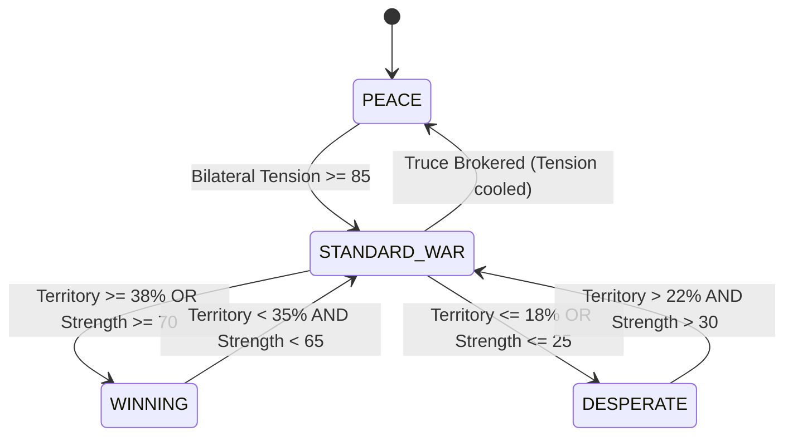

# Document 36: Faction Ideologies, Phase 1 Geopolitical Setting, & AI Behavioral State Machines

## 1. Executive Summary & Phase 1 World Picture (Y205 - Y208)

In *MechMakerConcept*, the Sol System in **Phase 1: The Baikal Shock & The L-5 Secession (Y205 - Y208)** is a tinderbox on the verge of total conflagration. 

Following the dissolution of the Old Earth Central Hegemony, the planetary cradle of humanity faces an existential energy crisis. Earth's heavy metallurgical factories require vast quantities of rare fusion isotopes—chiefly **Helium-3** from Jovian atmospheric scoops and **Tritium catalysts** from deep-space orbital refineries. For two generations, the orbital habitats of the L-5 Lagrange cluster and the Jovian moons supplied these minerals under brutal colonial extraction quotas.

In **Y205**, Spacenoid representatives proclaimed the **L-5 Covenant**, declaring absolute independence from Earth and halting all uncompensated mineral freighters. Earth's Military Council responded with the **Baikal Directive**: converting heavy industrial tractor plants into mobile suit assembly lines and deploying the first generation of monolithic cast-tungsten war machines (*TC-X01 Golem*, *GHA-07 Ironclad*) with orders to pacify the shipping corridors by force.

Taking advantage of this galactic rift:
- **The Rim-Syndicate Cartel** consolidated the lawless asteroid hollows into an outlaw pirate haven, harvesting the battlefields for scrap metal and ambushing mineral barges.
- **Apex Bio-Cybernetics Zaibatsu** weaponized high-finance, corporate debt, and bio-neural cybernetics from the Martian underground, secretly fueling both sides to harvest telemetry and acquire distressed assets.
- **PMC Hephaestus (The Player)** operates as a sovereign, mobile forge dreadnought maintaining armed neutrality. With crucible metallurgy capable of synthesizing custom alloys, the player holds the decisive power to determine which faction's war machine triumphs.

```
                           [THE TERRAN COALITION]
                         (Planetary Destiny & Hegemony)
                            /         |         \
                    [WAR]  /          |          \  [COLD WAR / TRADE]
                          /    [PROXY WAR / RAID] \
                         v            v            v
           [THE OUTER COLONIES] ───────────── [APEX ZAIBATSU]
           (Spacenoid Freedom)  [ALLIANCE /   (Transhumanist Corp)
                                 CONTRABAND]
                                      ^
                                      | [SALVAGE / RAID]
                           [THE RIM-SYNDICATE CARTEL]
                            (Lawless Scrap Sovereignty)
```

---

## 2. Phase 1 Detailed Faction Dossiers

### Faction 1: The Terran Coalition (TC) — "Slab, Steam, and Steel"
* **Founding Ethos**: Planetary Integrity & Centralized Imperial Destiny.
* **Capital & Fortress**: Lake Baikal Heavy Metallurgical Complex (Earth) & Copernicus Crater Naval Base (Luna).
* **Phase 1 Strategic Starting State**: 38% Territory Control, 55 Military Strength Score.
* **Economic Reality**: Dominates heavy casting foundries, automotive retooling plants, and demographic manpower. Suffers from catastrophic domestic shortages of refined helium-3, tritium superconducting matrices, and rare-earth catalysts.
* **Internal Political Divide**:
  - *The Hawk Defense Ministry (General Deborah Vance)*: Demands total military pacification of the orbital colonies, arguing that Spacenoids are indentured debtors who must be crushed before their particle beam technology matures.
  - *Senate Trade Oligarchs (Arthur Sterling)*: Advocates for high-tariff commercial treaties and contracting PMCs to secure mineral shipments without triggering all-out planetary war.
* **Phase 1 Strategic Choice**: Enforce brutal resource extraction quotas via orbital drop-pod invasions or seek a negotiated settlement before colonial beam weapons achieve decisive battlefield superiority.

---

### Faction 2: The Outer Colony League (OCL) — "Vector, Velocity, and Voltage"
* **Founding Ethos**: Vector Liberty & Spacenoid Sovereignty.
* **Capital & Habitats**: L-5 Orbital Citadel & Callisto Cryo-Refinery Habitats.
* **Phase 1 Strategic Starting State**: 32% Territory Control, 50 Military Strength Score.
* **Economic Reality**: Monopolizes virtually all high-yield Helium-3 gas extraction across the Jovian atmosphere, solar reflector swarms, and electron-beam titanium sintering. However, its populations live inside fragile ceramic bio-domes vulnerable to single kinetic artillery punctures, with zero domestic tungsten reserves.
* **Internal Political Divide**:
  - *Insurgent Flotilla Command (Fleet Commander Cassian Vane)*: Former cargo pilot turned supreme military leader; argues that Earth will never respect colonial liberty until low Earth orbit is blockaded and its orbital elevators disabled.
  - *Civilian Trade Senate (Minister Lyra Thorne)*: Pragmatic diplomat advocating for economic leverage, barter alliances with the Asteroid Belt, and hiring independent PMCs to deter Terran aggression.
* **Phase 1 Strategic Choice**: Maintain an agile, zero-G hit-and-run defensive perimeter around Jovian space or take the offensive directly to Earth's orbital staging bases.

---

### Faction 3: The Rim-Syndicate Cartel (RSC) — "Scrap, Sever, and Snatch"
* **Founding Ethos**: Scrap Sovereignty & The Freedom of the Void.
* **Capital & Depots**: Ceres Smelting Hollows & Vesta Debris Graveyard.
* **Phase 1 Strategic Starting State**: 16% Territory Control, 30 Military Strength Score.
* **Economic Reality**: Controls vast deep-space salvage graveyards, asteroid hollow smelting operations, and black-market contraband routes. Holds immense stockpiles of raw scrap iron, slag, and unlogged fusion cores, but lacks high-tech cleanrooms, relying on jury-rigged modifications and hijacked military hardware.
* **Internal Political Divide**:
  - *Scrap Depot Matriarchs (Madame Rosalind Cruz)*: Shrewd commercial operators who view the Earth-Colony war as an astronomical profit opportunity; sell black-market arms to both sides while laundering profits into neutral trade ports.
  - *Reaver Commodores ('Iron-Eye' Torval)*: Ruthless pirate warlords who believe the Cartel should crush all corporate freighters and enforce an independent outlaw empire across the Asteroid Belt.
* **Phase 1 Strategic Choice**: Act as arms suppliers and black-market middlemen to both warring titans or consolidate the pirate clans into an aggressive raiding fleet capable of seizing territory.

---

### Faction 4: Apex Bio-Cybernetics Zaibatsu — "Synapse, Stock, and Stealth"
* **Founding Ethos**: Post-Human Optimization & Transhumanist Shareholder Hegemony.
* **Capital & Arcologies**: Olympus Mons Subterranean Cleanrooms & Phobos Data Vaults (Mars).
* **Phase 1 Strategic Starting State**: 14% Territory Control, 45 Military Strength Score.
* **Economic Reality**: Maintains a total monopoly over bio-neural spinal cockpits, optical stealth refractors, and sub-zero tachyon superconductor matrices. Possesses astronomical corporate liquidity and advanced patents, but suffers from low native population and severe distrust from planetary governments.
* **Internal Political Divide**:
  - *Corporate Board of Directors (Executive Director Takahashi)*: Cautious venture capitalists seeking to acquire distressed sovereign debt, buy out rival factories, and secure legal monopolies through patent litigation.
  - *Unchecked Cybernetic R&D Labs (Chief Scientist Renzo)*: Transhumanist extremists field-testing experimental bio-neural implants and surgical combat reflexes on pilot specimens with zero ethical oversight.
* **Phase 1 Strategic Choice**: Secretly finance both sides of the war to harvest live combat telemetry and acquire sovereign debt, or execute covert decapitation strikes against rival political leaders to initiate a corporate takeover of Sol.

---

## 3. The Faction AI Brain: Behavioral State Machine

Every faction's strategic decision engine operates across **four distinct behavioral states**:



---

### 3.1 The Terran Coalition AI Brain
1. **Peace State (Consolidation & Fortress Stockpiling)**:
   - *Domestic Focus*: Sintering heavy tungsten ingots, upgrading Baikal redoubts, producing *GHA-07 Ironclad* mainstays.
   - *Diplomatic Stance*: Trades heavy machinery with Apex Zaibatsu for neural processors; enforces non-aggression with neutral outposts.
   - *PMC Policy*: Issues standard state patrol and convoy escort tenders at standard payouts ($1.0\times$).
2. **Alignment & Diplomatic Matrix**:
   - *Natural Trade Partner*: Apex Zaibatsu (buys high-tech sensors in exchange for heavy equipment and raw iron).
   - *Natural Ally*: Apex Zaibatsu (pragmatic corporate security pact against insurgent rebellion).
   - *Primary Enemy*: The Outer Colony League (ideologically incompatible; Earth demands their resources).
   - *Tension Triggers*: Colonial expansion into L-5; PMC exporting beam weaponry or superconducting reactors to the Colonies.
3. **Winning State (Imperial Hegemony & Resource Extraction)**:
   - *Behavioral Shift*: Imposes unilateral 40% tariffs across all Sol shipping; issues ultimatums demanding uncompensated Helium-3 tithes.
   - *Military Posture*: Launches aggressive two-front orbital drop invasions into Jovian and Belt sectors.
   - *PMC Policy*: Squeezes mercenary profit margins, reducing contract payouts to $0.85\times$ base value due to imperial arrogance.
   - *Vulnerability*: Overstretched logistical supply lines and high domestic war weariness.
4. **Desperate State (Totalitarian Fortress Protocol & Scorched Earth)**:
   - *Behavioral Shift*: Declares planetary martial law, institutes civilian labor conscription, and abandons diplomatic protocols.
   - *Emergency Measures*:
     - Unseals forbidden pre-war superheavy warframe: **`VHD-X01 Juggernaut Prime`** / **`VHD-X02 Odin Dread-Chassis`**.
     - Issues frantic emergency bailout tenders to the player's PMC offering **$+100\%$ bonus bounties ($2.0\times$ multiplier)**.
     - Authorizes scorched-earth orbital kinetic saturation strikes against contested borderline sectors.

---

### 3.2 The Outer Colony League AI Brain
1. **Peace State (Technological Acceleration & Habitat Shielding)**:
   - *Domestic Focus*: Expanding Helium-3 gas refining, upgrading bio-dome defense shields, tuning vernier agility on *AET-01 Aether* interceptors.
   - *Diplomatic Stance*: Barters raw fuel with the Syndicate for smuggled steel; maintains open trade with neutral hubs.
   - *PMC Policy*: Offers high-paying escort contracts for civilian food transports; seeks high-mobility particle beam blueprints ($1.0\times$).
2. **Alignment & Diplomatic Matrix**:
   - *Natural Trade Partner*: The Rim-Syndicate Cartel (trades Helium-3 and synthetic nutrients for smuggled Terran steel and asteroid ores).
   - *Natural Ally*: The Rim-Syndicate Cartel (anti-Earth liberation compact).
   - *Primary Enemy*: The Terran Coalition (anti-imperial liberation war).
   - *Tension Triggers*: Terran naval fleet movements in Lunar orbit; Syndicate pirating civilian passenger liners.
3. **Winning State (Ideological Crusade & Liberation Hegemony)**:
   - *Behavioral Shift*: Vows to liberate Earth's oppressed populace, overreaching into terrestrial gravity wells where their agile vacuum thrusters suffer severe atmospheric drag.
   - *Military Posture*: Enforces a total space blockade over low Earth orbit, cutting off all imported minerals.
   - *PMC Policy*: Demands total loyalty to the Spacenoid cause, offering standard bounties ($1.0\times$) with strict operational rules of engagement.
   - *Vulnerability*: Civilian bio-domes left lightly defended while vanguard fleets overextend into Earth's gravity well.
4. **Desperate State (Last Stand of the Free Orbit & Mutual Extinction Threat)**:
   - *Behavioral Shift*: Civilian bio-domes threatened with kinetic extinction; evacuations ordered to deep-space fortress stations.
   - *Emergency Measures*:
     - Deploys experimental lost-tech super-weapon: **`Astraea Dominus X-01`** and **`Selene Archon Interceptors`**.
     - Floods PMC channels with frantic humanitarian defense tenders at **$2.0\times$ base payout**.
     - Threatens to de-orbit spent mining asteroids into Earth's orbital corridors as a doomsday deterrent.

---

### 3.3 The Rim-Syndicate Cartel AI Brain
1. **Peace State (Opportunistic Scavenging & Black Market Smuggling)**:
   - *Domestic Focus*: Stripping derelict hulks, hotwiring scavenged reactors, mass-producing *SCR-12 Hyena* frames.
   - *Diplomatic Stance*: Sells black-market military hardware and stolen blueprints for hard currency and fuel cells.
   - *PMC Policy*: Offers high-risk, lucrative wetwork contracts, black-market blueprint trades, and salvage bounties ($1.0\times$).
2. **Alignment & Diplomatic Matrix**:
   - *Natural Trade Partner*: Outer Colony League and corrupt Terran regional governors.
   - *Natural Ally*: Whoever is currently losing (to prolong the conflict for salvage profits!).
   - *Primary Enemy*: Wealthy unescorted merchant convoys of ANY faction (especially Terran heavy freight).
   - *Tension Triggers*: Any faction establishing military bases in the Asteroid Belt; Zaibatsu cybernetic hit-squads hunting pirate captains.
3. **Winning State (Pirate Armada Ascendancy & System-Wide Extortion)**:
   - *Behavioral Shift*: Warlord Cruz and Torval consolidate the clans into a massive reaver armada.
   - *Military Posture*: Imposes violent protection rackets across all four quadrant trade routes; raids both Earth and Colony hubs.
   - *PMC Policy*: Offers aggressive plundering bounties, but demands a 20% cut of all salvage.
   - *Vulnerability*: Total absence of central logistics; internal clan infighting erupts as warlords feud over plunder.
4. **Desperate State (Scorched Void Guerrilla & Suicide Swarms)**:
   - *Behavioral Shift*: Asteroid hollows raided, black-market accounts frozen; clans scatter into deep-space stealth drifts.
   - *Emergency Measures*:
     - Unseals colossal jury-rigged monstrosity: **`AJS-X02 Rust Behemoth`** / **`ARC-X09 Iron Reaver`**.
     - Launches suicidal unshielded overclocked shock squads with zero regard for pilot survival.
     - Offers the player's PMC emergency mercenary contracts with **double bounties ($2.0\times$)** and promises of territorial spoils.

---

### 3.4 Apex Bio-Cybernetics Zaibatsu AI Brain
1. **Peace State (Covert Espionage & Bio-Neural Telemetry Testing)**:
   - *Domestic Focus*: R&D into spinal neural links, hostile corporate acquisitions, producing *ZAI-03 Muramasa* dueling frames.
   - *Diplomatic Stance*: Supplies neural coprocessors, optical stealth gear, and precision components in exchange for raw mineral quotas.
   - *PMC Policy*: Hires PMCs for covert asset extraction, VIP wetwork, and live-fire telemetry gathering ($1.0\times$).
2. **Alignment & Diplomatic Matrix**:
   - *Natural Trade Partner*: The Terran Coalition (high-value defense contracts).
   - *Natural Ally*: The second-weakest faction (as a puppet buffer state to destabilize the hegemon).
   - *Primary Enemy*: The Rim-Syndicate Cartel (patent thieves) and whichever power defaults on debt repayment.
   - *Tension Triggers*: Discovery of Zaibatsu black-ops infiltration units in rival territory; Syndicate black-market cloning of Takahashi interfaces.
3. **Winning State (Corporate Feudalism & Bio-Synthetic Monopoly)**:
   - *Behavioral Shift*: Forecloses on sovereign planetary debt, seizing orbital factories and shipyards as corporate collateral.
   - *Military Posture*: Deploys autonomous AI combat drones to replace human military garrisons across Sol.
   - *PMC Policy*: Squeezes independent contractors, demanding proprietary neural licensing fees and cutting payouts to $0.85\times$.
   - *Vulnerability*: Over-centralized cybernetic telemetry networks; highly vulnerable to electromagnetic pulses and physical kinetic artillery.
4. **Desperate State (Cybernetic Singularity Protocol & Rogue Lab Activation)**:
   - *Behavioral Shift*: Martian arcologies besieged, corporate board facing liquidation; all safety protocols overridden.
   - *Emergency Measures*:
     - Unseals forbidden autonomous cybernetic apex prototype: **`HATS-X01 Amaterasu Zero`** / **`ZBT-X07 Null-07 Phantom`**.
     - Dispatches brain-fried cybernetic suicide aces stripped of all pain and survival inhibitors.
     - Offers the player's PMC astronomical equity payouts (**$+100\%$ bonus bounties ($2.0\times$)**) and proprietary patent schematics.

---

## 4. GameMaker Architecture & Implementation

### 4.1 Faction Struct Extensions ([`objects/obj_FactionManager/Create_0.gml`](file:///home/tom/GameMakerProjects/MechMakerConcept/objects/obj_FactionManager/Create_0.gml))
Every faction struct in `obj_FactionManager.factions` maintains live AI Brain state variables:
```gml
factions.faction_a = {
    id: "faction_a",
    name: "The Terran Coalition",
    ai_state: "PEACE", // "PEACE", "STANDARD_WAR", "WINNING", "DESPERATE"
    ai_behavior_title: "Imperial Hegemony & Kinetic Fortification",
    contract_bounty_multiplier: 1.0, // Scales dynamically (0.85x winning, 2.0x desperate)
    superweapon_unsealed: false,
    superweapon_name: "VHD-X01 Juggernaut Prime",
    primary_enemy_id: "faction_b",
    preferred_ally_id: "faction_d",
    peace_focus: "Stockpiling tungsten ingots & expanding GHA-07 Ironclad assembly lines.",
    winning_agenda: "Imposes 40% planetary tariffs; enforces Helium-3 tribute quotas.",
    desperate_protocol: "Declares martial law; unseals VHD-X01 Juggernaut Prime; offers 2.0x emergency bounties."
};
```

### 4.2 Dynamic Evaluation Engine (`evaluate_faction_ai_turn`)
Executed at the start of every strategic turn:
1. **Desperate Threshold**: If a faction's territory $\le 18\%$ OR military strength $\le 25$:
   - Sets `ai_state = "DESPERATE"`.
   - Sets `contract_bounty_multiplier = 2.0` (all contracts for this faction pay double!).
   - Sets `superweapon_unsealed = true`.
   - Dispatches high-priority emergency diplomatic cable.
2. **Winning Threshold**: If territory $\ge 38\%$ OR military strength $\ge 70$:
   - Sets `ai_state = "WINNING"`.
   - Sets `contract_bounty_multiplier = 0.85`.
   - Dispatches hegemonic ascendancy cable.
3. **War Threshold**: If actively engaged in war:
   - Sets `ai_state = "STANDARD_WAR"`, `contract_bounty_multiplier = 1.25`.
4. **Peace Threshold**:
   - Sets `ai_state = "PEACE"`, `contract_bounty_multiplier = 1.0`.

### 4.3 Contract Payout Scaling (`fulfill_contract`)
When the player fulfills a contract in `obj_FactionManager`:
```gml
var _b_mult = (variable_struct_exists(factions, _cnt.faction)) ? (factions[$ _cnt.faction][$ "contract_bounty_multiplier"] ?? 1.0) : 1.0;
var _final_payout = round(_cnt.payout_credits * _b_mult);
obj_GameManager.add_funds(_final_payout);
```

### 4.4 In-Game UI Integration ([`objects/obj_HQTerminal/Draw_64.gml`](file:///home/tom/GameMakerProjects/MechMakerConcept/objects/obj_HQTerminal/Draw_64.gml))
- **Tab 2 (Contracts & Bounties)**:
  - Faction meter boxes display live AI Brain status tags (`[PEACE]`, `[WAR]`, `[DOMINANT]`, `[CRITICAL +100%]`).
  - Desperate factions trigger flashing crimson alert borders and notice: `EMERGENCY: Double Payout Bailout Active!`.
- **Tab 3 Subtab 2 (Diplomacy & Strategic Dossier)**:
  - Displays the full **FACTION AI BRAIN & BEHAVIORAL INTELLIGENCE** dossier for both factions in the selected bilateral pair, detailing active posture, arch-rival, preferred ally, and bounty multiplier.

---

## 5. Verification & Automated Test Coverage
All mechanics are verified by [`tools/test_faction_ai_and_phase1_lore.py`](file:///home/tom/GameMakerProjects/MechMakerConcept/tools/test_faction_ai_and_phase1_lore.py):
- 100% token balance verified across modified GML files.
- Complete Phase 1 world setting and all 4 faction AI Brains in `datafiles/factions_lore.json` verified.
- Dynamic AI state transitions (`PEACE` $\rightarrow$ `WINNING` $\rightarrow$ `DESPERATE`) and contract bounty scaling validated via simulation.
